# PaceMate 시스템 구조도와 DFD (PM 정리, 2026-10-25)

기준: 배포된 현재 main(Phase 7 + 배포 후 수정). 근거: `backend/main.py` 의 실제 라우트(코드에서 추출), `backend/store.py`, `backend/*.py` 모듈 구성, `docs/erd_current.md`, `docs/deploy_guide.md`. 데이터 구조(ERD)는 `docs/erd_current.md`. 화면의 그림은 Mermaid 로 작성했다(GitHub, VS Code 미리보기에서 보인다).
주의: 라우트와 저장소는 코드로 확인했고, 프로세스별 "어떤 컬렉션을 읽고 쓰는가"는 ERD 와 라우트 이름에서 정리한 것이다(함수 단위로 전수 확인하지는 않았다).

## 1. 시스템 구성도 (배포 구조)

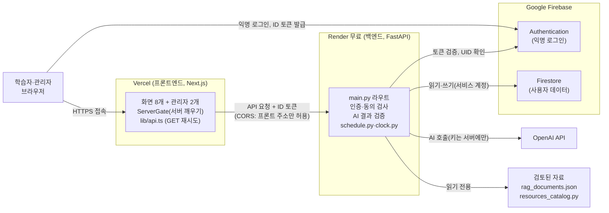

핵심: 브라우저는 OpenAI 와 Firestore 에 직접 가지 않는다. 모든 데이터와 AI 요청은 백엔드를 거치고, 백엔드는 **토큰에서 UID 를 정한다**. 비밀값(OpenAI 키, Firebase 서비스 계정)은 Render 환경변수에만 있다.

## 2. 백엔드 모듈 구조

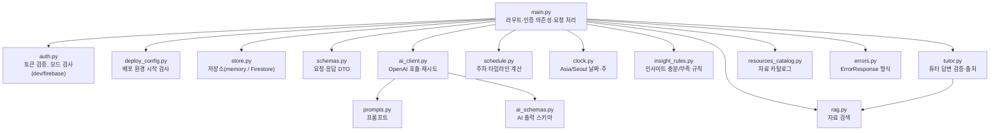

## 3. DFD (구판)

> **구판 표시:** 아래 DFD(화면 터미널 + API 그룹 7개)는 2026-10-25 기준 구판이다. 현재 기준은 **`docs/dfd_by_module.md`**(모듈 4개: 레벨 0·1·2)다. 이 문서의 §1 구성도, §2 모듈 구조, §4~§8 은 그대로 유효하다.

범례(사용자 지정 2026-10-25): **원 = 프로세스, 사각형 = 터미널(레벨 0 에서는 시스템을 활용하는 조직, 레벨 1·2 에서는 입출력 화면), 띠(이중선 직사각형) = 데이터 저장소(ERD 의 테이블·파일 이름과 같은 이름과 물리 이름), 곡선 화살표 = 데이터 흐름**. 저장소와 프로세스 사이의 화살표에는 **참조하는 정보 이름**(저장소 → 프로세스)과 **편집을 위해 입력하는 정보 이름**(프로세스 → 저장소)을 쓴다. 저장소 이름은 `docs/erd_current.md` 의 테이블 이름과 같다(`learning_documents` 는 파일 `backend/data/rag_documents.json`). 레벨 0 은 시스템 전체가 원 하나다.

### 3-1. 레벨 0 (배경도)

배경도는 **시스템 전체를 원 하나**로 두고, 터미널(사각형)은 시스템을 활용하는 조직(학습자, 관리자)이다. 데이터 흐름은 하위 프로세스들의 흐름을 모은 것(프로세스의 집합)이다. OpenAI 와 Firebase 는 활용 조직이 아니라 시스템이 부르는 내부 서비스로 보고 터미널에서 뺐다(구성도는 §1).

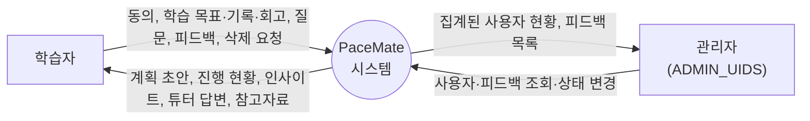

### 3-2. 레벨 1: 프로세스 7개 그룹 (모아서 먼저 확인, 아래 3-3 에서 API 단위로 분리)

원칙(사용자 지정): 기계적으로 처리할 때는 **일단 모아서 확인한 뒤 분리**한다. 그래서 API 함수 40여 개를 기능이 같은 7개 그룹으로 묶은 것이 레벨 1 이고, 각 그룹을 API 함수 단위로 푼 것이 레벨 2(3-3)다. 표기와 규칙은 3-3 과 같다(터미널 = 입출력 화면 사각형, 프로세스 = 원, 저장소 = 띠, 흐름 = 곡선 화살표, 터미널끼리와 터미널-저장소 직접 흐름 없음, OpenAI 와 Firebase 는 내부 호출로 흡수).

```mermaid
%%{init: {"flowchart": {"curve": "basis"}}}%%
flowchart LR
    S1["[화면] 동의 창"]
    S2["[화면] 내 정보·설정"]
    S3["[화면] 대시보드"]
    S4["[화면] 학습 경로 설정"]
    S5["[화면] 학습 과제 계획"]
    S6["[화면] 학습 실행 기록"]
    S7["[화면] 종합 학습 분석"]
    S8["[화면] AI 튜터"]
    S9["[화면] 관리자 화면 2개"]
    S10["[화면] 서버 깨우기 화면"]

    P1(("P1<br/>인증·계정"))
    P2(("P2<br/>학습 경로·계획"))
    P3(("P3<br/>목표·과제"))
    P4(("P4<br/>실행 기록·타이머"))
    P5(("P5<br/>요약·분석·인사이트"))
    P6(("P6<br/>AI 튜터"))
    P7(("P7<br/>피드백·관리자"))

    S1 -->|"약관 동의"| P1
    S2 -->|"프로필 조회, 삭제 요청"| P1
    S10 -->|"상태 확인 요청"| P1
    P1 -->|"동의 결과, 프로필, 삭제 결과, 상태"| S1
    P1 -->|"프로필, 삭제 결과"| S2
    P1 -->|"상태, 실행 모드"| S10

    S4 -->|"분야, 직무, 과정, 수준, 기간, 주당 시간, 확정 요청"| P2
    P2 -->|"직무 예시, 과정·수준, 계획 초안, 확정 결과"| S4

    S3 -->|"과제 완료 토글"| P3
    S5 -->|"학습·과제·참고자료 조회, 과제 수정"| P3
    S6 -->|"학습·과제 조회, 학습 전환"| P3
    P3 -->|"수정된 과제"| S3
    P3 -->|"학습 상세, 과제, 참고자료"| S5
    P3 -->|"학습 목록, 과제"| S6

    S6 -->|"기록, 회고, 타이머 요청"| P4
    P4 -->|"기록 목록, 타이머 상태"| S6

    S3 -->|"요약 요청"| P5
    S7 -->|"분석 요청"| P5
    S6 -->|"인사이트 조회·생성 요청"| P5
    P5 -->|"지표, 주간 활동"| S3
    P5 -->|"분석 지표"| S7
    P5 -->|"인사이트 또는 부족 안내"| S6

    S8 -->|"대화, 질문, 요약 요청"| P6
    P6 -->|"답변, 출처, 키워드, 대화 목록"| S8

    S2 -->|"평점, 의견"| P7
    S9 -->|"조회·처리 요청"| P7
    P7 -->|"접수 결과"| S2
    P7 -->|"사용자 현황, 피드백 목록, 집계"| S9
    DUS[["users<br/>(Firestore users)"]]
    DCR[["consent_records<br/>(Firestore consent_records)"]]
    DGO[["goals<br/>(Firestore goals)"]]
    DTK[["tasks<br/>(Firestore tasks)"]]
    DSL[["study_logs<br/>(Firestore study_logs)"]]
    DRF[["reflections<br/>(Firestore reflections)"]]
    DCV[["conversations<br/>(Firestore conversations)"]]
    DIN[["insights<br/>(Firestore insights)"]]
    DLD[["learning_documents<br/>(파일 backend/data/rag_documents.json)"]]
    DFB[["feedback<br/>(Firestore feedback)"]]
    DUS -->|"동의 버전 / 프로필(활성 학습, 동의 버전, 마지막 활동)"| P1
    DCR -->|"기존 동의 이력"| P1
    DGO -->|"학습 소유 확인(학습 id)"| P1
    P1 -->|"동의 기록(약관 버전, 개인정보 동의, AI 사용 동의, 동의 시각) / 삭제: 본인 동의 이력"| DCR
    P1 -->|"사용자(uid, 동의 버전, 생성 시각) / 활성 학습(active_goal_id) / 삭제 대상 사용자 문서"| DUS
    P1 -->|"삭제: 본인 학습"| DGO
    P1 -->|"삭제: 본인 과제"| DTK
    P1 -->|"삭제: 본인 학습 기록"| DSL
    P1 -->|"삭제: 본인 회고"| DRF
    P1 -->|"삭제: 본인 대화"| DCV
    P1 -->|"삭제: 본인 인사이트"| DIN
    DLD -->|"분야·과정에 맞는 참고자료 후보(제목, 출처, 링크)"| P2
    DGO -->|"진행 중 학습의 기간·상태(겹침 검사), 같은 요청 번호의 기존 학습"| P2
    DTK -->|"재시도 시 기존 과제"| P2
    DUS -->|"활성 학습"| P2
    P2 -->|"학습 목표(분야, 과정, 현재·목표 수준, 시작일, 목표일, 주당 시간, AI 조언)"| DGO
    P2 -->|"과제(제목, 설명, 예상 시간, 주차 배치, 추천 요일, 순서)"| DTK
    P2 -->|"활성 학습 지정"| DUS
    DGO -->|"학습 목록(분야, 과정, 기간, 상태) / 학습 상세(수준, 기간, 주당 시간, 조언) / 학습의 분야·과정"| P3
    DLD -->|"참고자료(제목, 출처, 링크)"| P3
    DTK -->|"과제 목록(제목, 상태, 주차, 추천 요일) / 수정 대상 과제"| P3
    DSL -->|"과제별 기록 수·누적 시간"| P3
    P3 -->|"과제 상태, 추천 요일"| DTK
    DSL -->|"학습 기록(날짜, 분, 활동, 시작·종료 시각) / 같은 요청 번호의 기존 기록 / 수정 대상 기록 외"| P4
    DRF -->|"회고(내용, 태그) / 기존 회고"| P4
    DTK -->|"과제 소유 확인"| P4
    DUS -->|"진행 중 타이머"| P4
    P4 -->|"학습 기록(과제, 날짜, 분, 활동) / 수정한 기록(날짜, 분, 활동) / 삭제: 학습 기록 외"| DSL
    P4 -->|"회고(내용, 태그) / 수정·삭제한 회고 / 삭제: 그 기록의 회고"| DRF
    P4 -->|"활성 타이머(과제, 학습, 시작 시각, 요청 번호) / 타이머 해제"| DUS
    DGO -->|"학습 목록·기간 / 학습 소유 확인"| P5
    DTK -->|"과제 수·완료 수·이번 주 과제 / 과제 수·완료 수 / 입력 변화 확인(과제) 외"| P5
    DSL -->|"이번 주 학습 시간·기록 수 / 기간별 학습 시간·기록 / 최근 14일 기록 수 외"| P5
    DRF -->|"회고 수(인사이트 안내 판정) / 회고 수 / 최근 회고(최대 5)"| P5
    DIN -->|"저장된 인사이트·최신 여부 / 저장된 인사이트(요약, 어려움, 다음 행동) / 같은 요청 번호의 기존 인사이트"| P5
    P5 -->|"인사이트(요약, 어려움, 다음 행동, 생성 시각, 입력 서명)"| DIN
    DCV -->|"대화 목록(제목, 수정 시각) / 같은 요청 번호의 기존 대화 / 대화(메시지, 출처, 키워드) 외"| P6
    DGO -->|"학습의 분야·과정(링크 생성) / 진행 중 학습(분야, 과정) / 학습 수"| P6
    DTK -->|"과제 현황 / 과제 수"| P6
    DSL -->|"최근 기록 / 기록 수"| P6
    DRF -->|"최근 회고 / 회고 수"| P6
    DLD -->|"질문과 맞는 근거 자료(본문 조각, 출처)"| P6
    P6 -->|"새 대화(제목, 요청 번호) / 질문과 답변(메시지, 출처, 키워드, 요청 번호)"| DCV
    DFB -->|"같은 요청 번호의 기존 피드백 / 피드백 목록(평점, 화면, 의견, 상태) / 피드백 집계(평점, 상태별 건수) 외"| P7
    DUS -->|"피드백 제출 횟수 / 사용자 목록(마지막 활동, 동의 버전, 활성 학습)"| P7
    DGO -->|"사용자별 학습 수"| P7
    P7 -->|"피드백(사용성·AI 도움 평점, 화면, 의견) / 처리 상태(new, seen, candidate, done)"| DFB
    P7 -->|"피드백 제출 횟수"| DUS
```

그룹과 API 의 대응(자세한 내용은 3-3-1 표):
| 그룹 | 포함하는 API 프로세스(레벨 2) |
|---|---|
| P1 | P1.1 ~ P1.5 |
| P2 | P2.1 ~ P2.4 |
| P3 | P3.1 ~ P3.5 |
| P4 | P4.1 ~ P4.8 |
| P5 | P5.1 ~ P5.4 |
| P6 | P6.1 ~ P6.5 |
| P7 | P7.1 ~ P7.5 |
번호 규칙: 레벨 1 의 `Pn` 이 레벨 2 의 `Pn.k` 들로 분해된다. 모든 프로세스는 먼저 토큰 검증(Firebase)을 거치지만 그림에서는 생략한다.

### 3-3. 레벨 2: API 함수마다 프로세스 (레벨 1 의 7개 그룹을 풀어 쓴 것)

작성 규칙(사용자 지정, 2026-10-25):
1. **터미널(사각형)끼리는 데이터 흐름이 없다.** 그래서 학습자, 관리자, OpenAI 터미널은 레벨 1·2 에서 쓰지 않는다.
2. **터미널(사각형)은 화면만** 둔다(`[화면] 이름`). 학습자와 관리자는 화면을 통해서만 시스템과 만난다.
3. **API 함수 하나가 프로세스(원) 하나**다(`P그룹.번호 메서드 경로`). 번호는 표 3-3-1 과 같다. 복잡해지면 나중에 레벨을 나눈다.
4. 저장소(띠)는 **프로세스와만** 연결한다(화면이나 저장소끼리 직접 잇지 않는다).
5. **OpenAI 호출은 터미널이 아니라 내부 프로세스**(`AI 호출: 용도`)로 그린다. 해당 API 프로세스가 입력을 넘기고 결과를 받는다. 모든 API 프로세스는 먼저 토큰 검증(Firebase)을 거치지만, 그림이 복잡해져서 생략한다(§4 인증 흐름 참고).

레벨 0(배경도)의 학습자, 관리자(활용 조직)는 레벨 1·2 에서 **그들이 쓰는 입출력 화면 터미널들**로 풀린다(학습자 = 대시보드 등 7개 화면과 동의 창, 관리자 = 관리자 화면 2개). OpenAI 와 Firebase 는 외부 조직이 아니라 시스템 내부 호출로 본다.

#### 3-3-1. 프로세스 목록 (API 40여 개 중 화면이 호출하는 것 + 서버에만 있는 것)
| 번호 | API | 호출하는 화면 터미널 | AI 호출 | 읽고 쓰는 저장소 |
|---|---|---|---|---|
| P1.1 | POST /api/consent | 동의 창 | - | users, consent_records (쓰기) |
| P1.2 | GET /api/user/profile | 내 정보·설정, 앱 공통(관리자 메뉴 표시), 학습 실행 기록(학습 전환) | - | users (읽기) |
| P1.3 | PATCH /api/user/profile | 학습 실행 기록(학습 전환) | - | users (쓰기) |
| P1.4 | POST /api/user/delete-data | 내 정보·설정 | - | users, consent_records, goals, tasks, study_logs, reflections, conversations, insights (삭제) |
| P1.5 | GET /health | 서버 깨우기 화면 | - | 없음 |
| P2.1 | POST /api/path/ideas | 학습 경로 설정 | 직무 예시 | 없음(저장 안 함) |
| P2.2 | POST /api/path/recommend | 학습 경로 설정 | 과정·수준 추천 | 없음 |
| P2.3 | POST /api/plan/generate | 학습 경로 설정 | 계획 초안 | learning_documents (참고자료 후보 읽기) |
| P2.4 | POST /api/plan/confirm | 학습 경로 설정 | - | goals(겹침 검사 읽기, 쓰기), tasks(쓰기), users(활성 학습) |
| P3.1 | GET /api/goals | 학습 실행 기록(학습 전환) | - | goals |
| P3.2 | GET /api/goals/{id} | 학습 과제 계획 | - | goals |
| P3.3 | GET /api/goals/{id}/references | 학습 과제 계획 | - | goals, 학습 자료(읽기) |
| P3.4 | GET /api/tasks | 학습 과제 계획, 학습 실행 기록, 학습 경로 설정 | - | tasks, study_logs(누적) |
| P3.5 | PATCH /api/tasks/{id} | 대시보드, 학습 과제 계획 | - | tasks (쓰기) |
| P4.1 | GET /api/study-logs | 학습 실행 기록 | - | study_logs, reflections |
| P4.2 | POST /api/study-logs | 학습 실행 기록 | - | study_logs, reflections |
| P4.3 | PATCH /api/study-logs/{id} | 학습 실행 기록 | - | study_logs, reflections |
| P4.4 | DELETE /api/study-logs/{id} | 학습 실행 기록 | - | study_logs, reflections |
| P4.5 | POST /api/timer/start | 학습 실행 기록 | - | users (active_timer) |
| P4.6 | POST /api/timer/finish | 학습 실행 기록 | - | users, study_logs |
| P4.7 | POST /api/timer/cancel | 학습 실행 기록 | - | users |
| P4.8 | GET /api/timer/active | 학습 실행 기록 | - | users |
| P5.1 | GET /api/dashboard/summary | 대시보드 | - | goals, tasks, study_logs, insights |
| P5.2 | GET /api/analytics/overview | 종합 학습 분석 | - | goals, tasks, study_logs |
| P5.3 | GET /api/goals/{id}/insight | 학습 실행 기록(인사이트 카드) | - | insights |
| P5.4 | POST /api/goals/{id}/insight | 학습 실행 기록(인사이트 카드) | 인사이트 | tasks, study_logs, reflections (읽기), insights (쓰기) |
| P6.1 | GET /api/conversations | AI 튜터 | - | conversations |
| P6.2 | POST /api/conversations | AI 튜터 | - | conversations |
| P6.3 | GET /api/conversations/{id} | AI 튜터 | - | conversations |
| P6.4 | POST /api/conversations/{id}/messages | AI 튜터 | 튜터 답변 | conversations, goals, 학습 자료(읽기) |
| P6.5 | GET /api/data/summary | AI 튜터 | - | goals, tasks, study_logs |
| P7.1 | POST /api/feedback | 내 정보·설정 | - | feedback, users(횟수) |
| P7.2 | GET /api/admin/users | 관리자: 사용자 관리 | - | users |
| P7.3 | GET /api/admin/feedback | 관리자: 사용자 피드백 | - | feedback |
| P7.4 | GET /api/admin/feedback/summary | 관리자: 사용자 피드백 | - | feedback |
| P7.5 | PATCH /api/admin/feedback/{id} | 관리자: 사용자 피드백 | - | feedback (쓰기) |

**서버에는 있으나 현재 화면이 호출하지 않는 API**(프로세스로 정의하되 입력 터미널이 없어 그림에서는 제외): POST /api/goals, PATCH /api/goals/{id}, DELETE /api/goals/{id}, POST /api/tasks, DELETE /api/tasks/{id}, GET /api/resources(자료 보관함 화면 준비 중). 목표와 과제 생성은 화면에서는 P2.4(plan/confirm)가 맡는다.
저장소 읽기·쓰기는 `backend/main.py` 의 라우트가 부르는 `db.get/find/create/set/update/delete` 를 정적 분석(AST)으로 뽑아 확인했고, 컬렉션 이름이 변수인 호출(`<dynamic>`)은 코드를 보고 사람이 보완했다. 화살표 글자(정보 이름)는 ERD 필드와 요청·응답 DTO 이름에서 정리했다. 모든 개인 데이터 API 는 공통으로 `users`(동의 버전 확인)를 읽고 마지막 활동을 10분에 한 번 갱신하지만 그림에서는 생략했다.

#### 3-3-2. P1 인증·계정
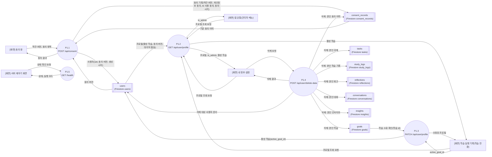

#### 3-3-3. P2 학습 경로·계획 (AI 호출 내부 프로세스 포함)
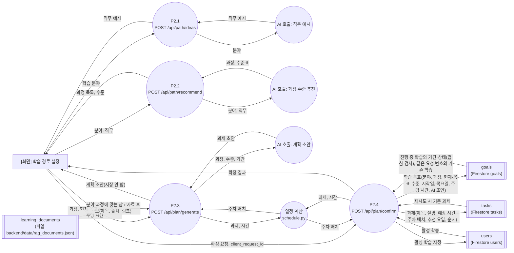

#### 3-3-4. P3 목표·과제 조회와 과제 상태
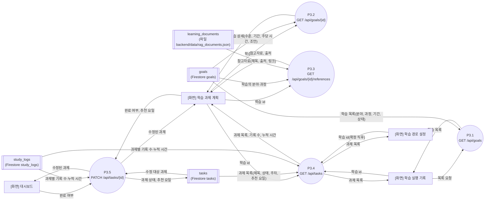

#### 3-3-5. P4 학습 실행 기록·타이머
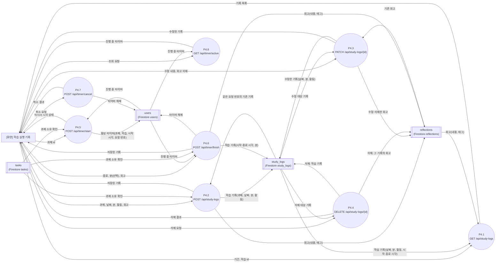

#### 3-3-6. P5 대시보드·분석·인사이트
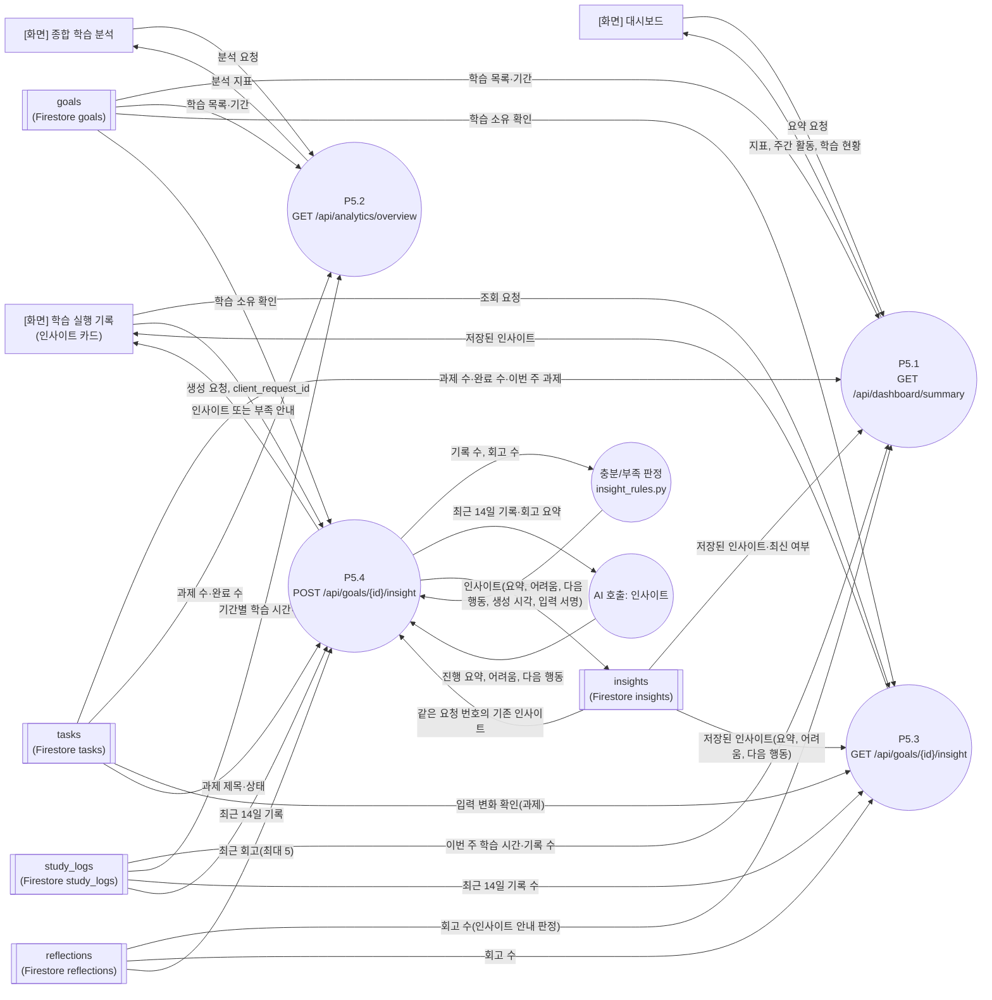

#### 3-3-7. P6 AI 튜터
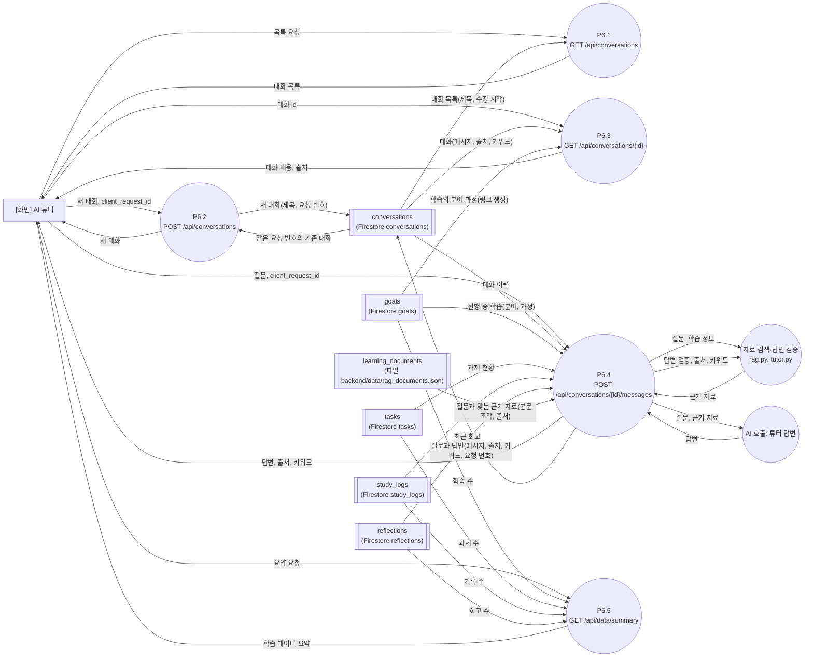

#### 3-3-8. P7 피드백·관리자
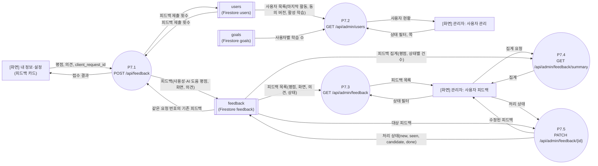
(관리자 API 는 P7.2~P7.5 모두 `ADMIN_UIDS` 확인을 먼저 한다. 허용 목록 밖은 403.)

읽는 법:
- **모든 프로세스(P2~P7)는 P1 의 토큰 검증을 먼저 통과**한다. 개인 데이터 API 는 동의한 UID 만 쓴다.
- **P2.3 의 초안은 저장하지 않는다.** 사용자가 확정(P2.4)할 때 `goals` 와 `tasks` 를 한 번에 저장하고 서버가 일정을 다시 계산한다.
- **P6.4 튜터**는 검토된 자료만 근거로 쓰고, 출처가 없으면 근거 있는 것처럼 표시하지 않는다.
- **피드백(`feedback`)** 은 user_id 를 저장하지 않아 삭제 요청(P1.4) 때 남는다.
- 화면 하나가 여러 프로세스를 부른다(예: 학습 실행 기록 화면은 P1.2, P1.3, P3.1, P3.4, P4.1~P4.8, P5.3, P5.4 를 부른다).

결정 기록:
1. (처리됨, 2026-10-25) 레벨 0 은 활용 조직(학습자, 관리자) 터미널과 시스템 원 하나, 레벨 1·2 는 입출력 화면 터미널. OpenAI 와 Firebase 는 내부 호출로 본다.
2. (처리됨, 2026-10-25) 레벨 1 은 7개 그룹(3-2), 레벨 2 가 API 단위(3-3)로 나눴다. 모아서 확인한 뒤 분리하는 원칙.

## 4. 인증 흐름 (익명 로그인 → 요청 → 소유권 확인)

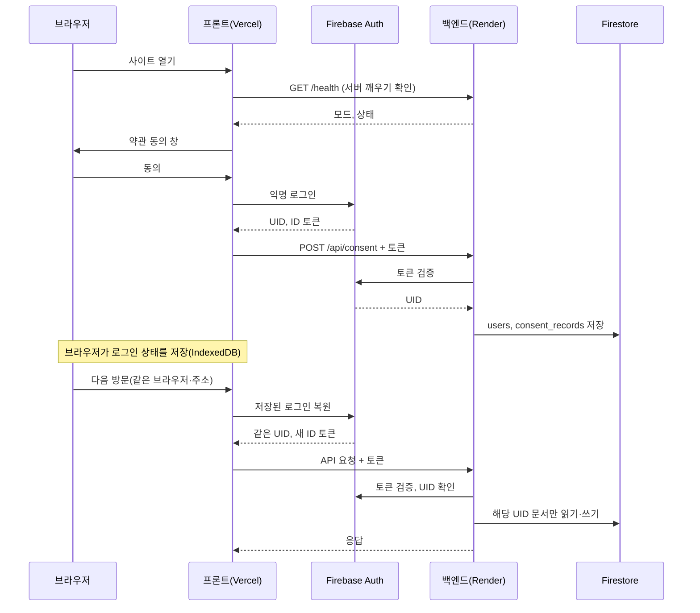

## 5. 학습 계획 생성과 확정 흐름

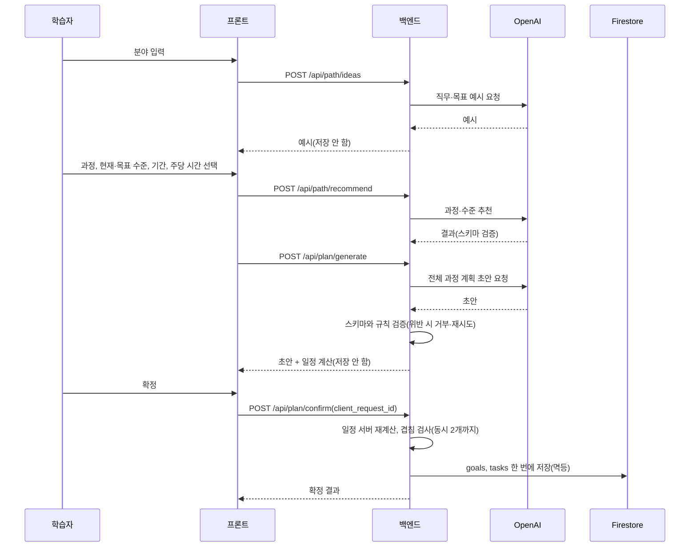

## 6. 저장소 정리

| 구분 | 위치 | 내용 | 사용자 소유 | 삭제 요청 때 |
|---|---|---|---|---|
| 사용자 | Firestore `users` | 동의 버전, 활성 학습, 활성 타이머, 마지막 활동, 피드백 횟수 | 예 | 삭제 |
| 동의 | `consent_records` | 약관 버전, 동의 항목 | 예 | 삭제 |
| 학습 | `goals`, `tasks` | 목표, 과제, 일정 | 예 | 삭제 |
| 기록 | `study_logs`, `reflections` | 학습 기록, 회고 | 예 | 삭제 |
| 대화 | `conversations` | 튜터 대화, 출처, 키워드 | 예 | 삭제 |
| 인사이트 | `insights` | 학습당 1건 | 예 | 삭제 |
| 피드백 | `feedback` | 평점, 의견(UID 없음) | 아니오 | **남음** |
| 학습 자료 | `backend/data/rag_documents.json`, `resources_catalog.py` | 검토된 자료 | 공용 읽기 전용 | 해당 없음 |
| 로그인 상태 | 브라우저 IndexedDB(Firebase) | 익명 UID 와 토큰 | 브라우저 | 삭제 요청 시 브라우저 저장 UID 지움 |

## 7. 보안 경계 한눈에
| 경계 | 규칙 |
|---|---|
| 브라우저 ↔ 백엔드 | HTTPS, CORS 는 배포된 프론트 주소만, ID 토큰 필수 |
| 백엔드 ↔ Firebase | 토큰 검증, 서비스 계정(서버 환경변수) |
| 백엔드 ↔ OpenAI | 키는 서버에만, 입력·응답 원문은 로그에 남기지 않음 |
| 소유권 | UID 는 토큰에서만, 타인 문서 접근 403 |
| 배포 환경 | Render 에서는 dev 인증, memory 저장, 안전하지 않은 CORS 를 거부 |
| 관리자 | `ADMIN_UIDS` 에 든 UID 만 `/api/admin/*` |

## 8. 변경 시 갱신
라우트, 컬렉션, 외부 서비스가 바뀌면 이 문서와 `docs/erd_current.md` 를 같이 갱신한다. 계정 승격(`docs/auth_upgrade_design.md`)이 구현되면 §4 와 §6 의 로그인 항목을 바꾼다.
