# PaceMate 시스템 구조도와 DFD (PM 정리, 2026-10-25)

기준: 배포된 현재 main(Phase 7 + 배포 후 수정). 근거: `backend/main.py` 의 실제 라우트(코드에서 추출), `backend/store.py`, `backend/*.py` 모듈 구성, `docs/erd_current.md`, `docs/deploy_guide.md`. 데이터 구조(ERD)는 `docs/erd_current.md`. 화면의 그림은 Mermaid 로 작성했다(GitHub, VS Code 미리보기에서 보인다).
주의: 라우트와 저장소는 코드로 확인했고, 프로세스별 "어떤 컬렉션을 읽고 쓰는가"는 ERD 와 라우트 이름에서 정리한 것이다(함수 단위로 전수 확인하지는 않았다).

## 1. 시스템 구성도 (배포 구조)

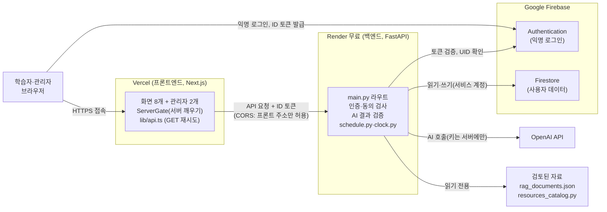

핵심: 브라우저는 OpenAI 와 Firestore 에 직접 가지 않는다. 모든 데이터와 AI 요청은 백엔드를 거치고, 백엔드는 **토큰에서 UID 를 정한다**. 비밀값(OpenAI 키, Firebase 서비스 계정)은 Render 환경변수에만 있다.

## 2. 백엔드 모듈 구조

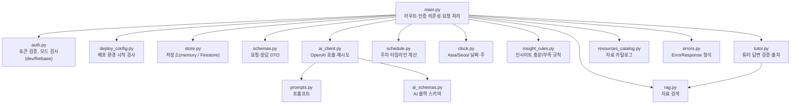

## 3. DFD

범례: 사각형 = 외부 개체, 둥근 사각형 = 프로세스, 원통 = 데이터 저장소.

### 3-1. 레벨 0 (컨텍스트)

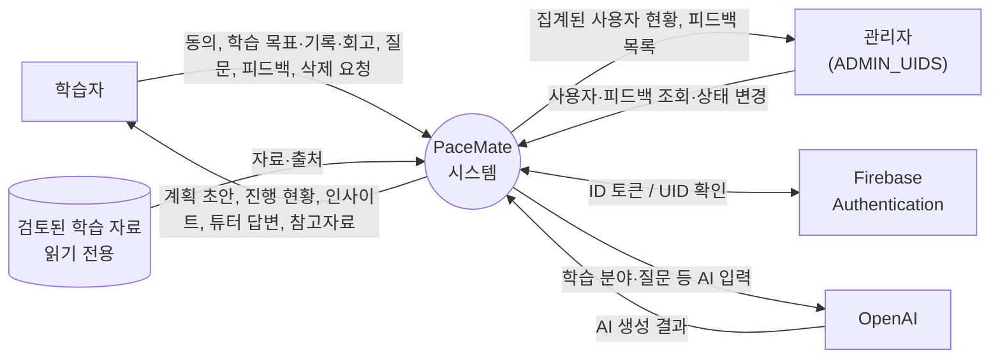

### 3-2. 레벨 1 개요 (프로세스와 저장소, 외부 개체는 묶어서 표시)

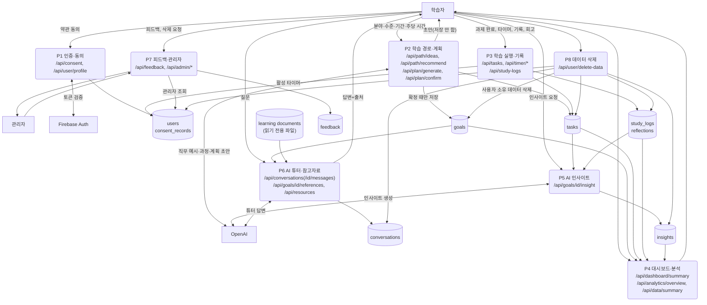

설명:
- **모든 프로세스(P2~P8)는 P1 의 토큰 검증을 먼저 통과**해야 한다. 개인 데이터 API 는 동의가 된 UID 만 쓴다(`require_consented_uid`).
- **P2 의 초안은 저장하지 않는다.** 사용자가 확정(`/api/plan/confirm`)할 때 `goals` 와 `tasks` 를 한 번에 저장하고, 확정 때 서버가 일정을 다시 계산한다.
- **P5 인사이트**는 학습당 1건(`insights`, 문서 ID = goal_id)이고, 기록·회고가 부족하면 AI 를 호출하지 않는다.
- **P6 튜터**는 검토된 자료(`rag_documents.json`)만 근거로 쓰고 출처가 없으면 근거 있는 것처럼 표시하지 않는다.
- **P7 피드백**은 user_id 를 저장하지 않는다(P8 삭제 대상이 아님). 관리자 판별은 환경변수 `ADMIN_UIDS`.
- **P8 삭제**는 `goals, tasks, study_logs, reflections, conversations, consent_records, insights, users` 의 사용자 소유 문서를 지운다. 피드백은 user_id 가 없어 남는다.

### 3-3. 레벨 1 상세: 외부 입출력을 터미널(화면명, API명)로 분리

3-2 는 프로세스와 저장소 중심의 개요이고, 여기서는 **외부 입출력을 터미널로 쪼갠다.** 터미널은 세 종류다.
- **[화면]** 학습자 또는 관리자가 보는 화면(화면 이름). 데이터는 화면에서 들어오고 화면으로 나간다.
- **[AI]** OpenAI 호출. 용도별로 분리한다(직무 예시, 과정·수준 추천, 계획 초안, 인사이트, 튜터 답변). 외부 서비스는 OpenAI 하나지만 프롬프트와 출력 스키마가 달라 별도 터미널로 그린다.
- **[인증]** Firebase Authentication(토큰 검증).

화살표 글자는 **API 이름**(메서드와 경로)이다. API 이름은 서버 코드에서, 화면별 호출은 프론트 코드에서 추출했다. 저장소는 원통, 프로세스는 둥근 사각형이다. 모든 API 는 P1 의 토큰 검증(`[인증]`)을 먼저 거친다(아래 그림에서는 생략).

#### 3-3-1. 화면과 API 대응표
| 터미널 [화면] | 사용하는 API | 프로세스 | AI 터미널 | 저장소 |
|---|---|---|---|---|
| 동의 창 | POST /api/consent | P1 | - | users, consent_records |
| 대시보드 | GET /api/dashboard/summary, PATCH /api/tasks/{id}, GET /api/user/profile | P4, P3 | - | goals, tasks, study_logs, insights, users |
| 학습 경로 설정 | POST /api/path/ideas, POST /api/path/recommend, POST /api/plan/generate, POST /api/plan/confirm, GET /api/tasks | P2 | 직무 예시, 과정·수준 추천, 계획 초안 | goals, tasks(확정 때만) |
| 학습 과제 계획 | GET /api/goals/{id}, GET /api/tasks, PATCH /api/tasks/{id}, GET /api/goals/{id}/references | P3, P6 | - | goals, tasks, 학습 자료(읽기) |
| 학습 실행 기록 | GET·POST·PATCH·DELETE /api/study-logs, POST /api/timer/start·finish·cancel, GET /api/timer/active, GET /api/goals, GET·PATCH /api/user/profile, GET·POST /api/goals/{id}/insight | P3, P5 | 인사이트 | tasks, study_logs, reflections, users, insights |
| 종합 학습 분석 | GET /api/analytics/overview | P4 | - | goals, tasks, study_logs |
| AI 튜터 | GET·POST /api/conversations, GET /api/conversations/{id}, POST /api/conversations/{id}/messages, GET /api/data/summary | P6 | 튜터 답변 | conversations, goals, 학습 자료(읽기) |
| 내 정보·설정 | GET /api/user/profile, POST /api/feedback, POST /api/user/delete-data | P1, P7, P8 | - | users, feedback, 사용자 소유 전체(삭제) |
| 관리자: 사용자 관리 | GET /api/admin/users | P7 | - | users |
| 관리자: 사용자 피드백 | GET /api/admin/feedback, GET /api/admin/feedback/summary, PATCH /api/admin/feedback/{id} | P7 | - | feedback |
- 화면 어디서나: GET /health(서버 깨우기 확인, 앱 첫 진입 때 ServerGate 가 호출).
- `GET /api/resources` 는 서버에 있으나 현재 화면에서 호출하지 않는다(자료 보관함 화면은 준비 중).

#### 3-3-2. P1 인증·동의 / P8 데이터 삭제 (동의 창, 내 정보·설정)
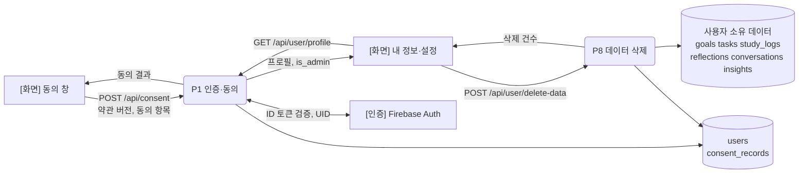

#### 3-3-3. P2 학습 경로·계획 (학습 경로 설정)
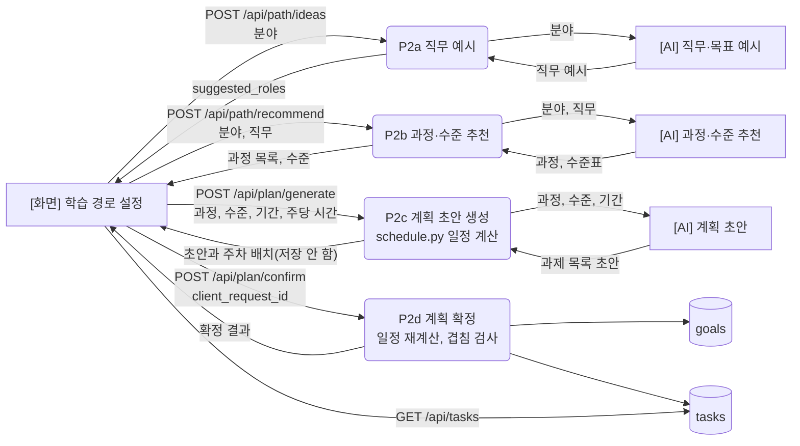

#### 3-3-4. P3 학습 실행·기록 (대시보드, 학습 과제 계획, 학습 실행 기록)
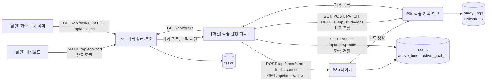

#### 3-3-5. P4 대시보드·분석 / P5 AI 인사이트
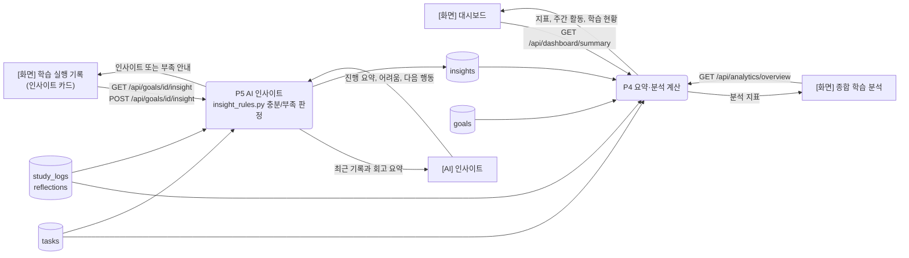

#### 3-3-6. P6 AI 튜터·참고자료 (AI 튜터, 학습 과제 계획)
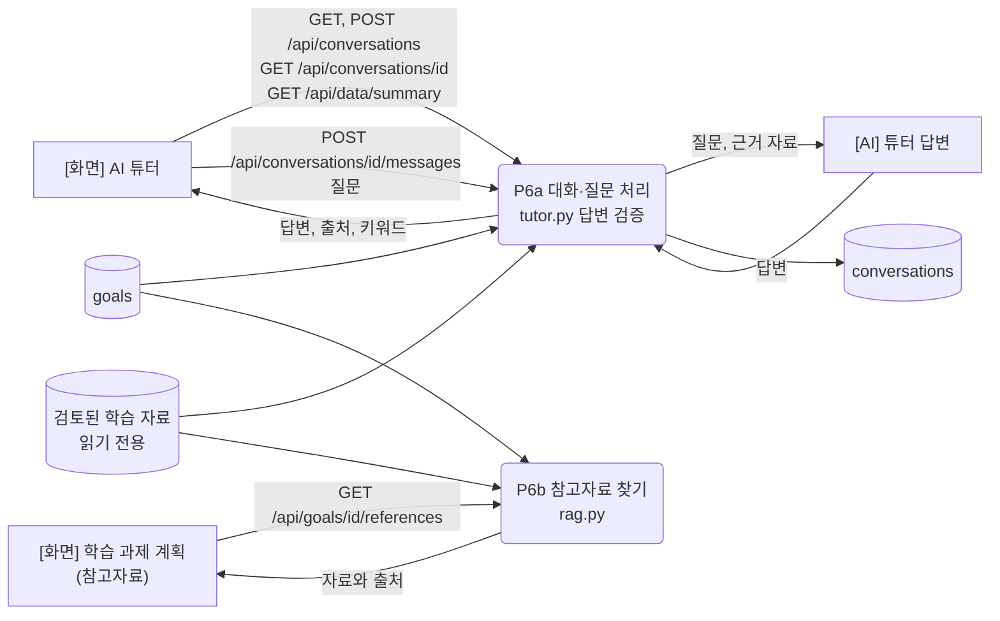

#### 3-3-7. P7 피드백·관리자 (내 정보·설정, 관리자 화면)
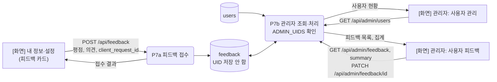

읽는 법: 한 화면이 여러 프로세스에 걸칠 수 있다(대시보드는 P4 요약과 P3 과제 토글). AI 터미널은 계획 생성 3개(직무 예시, 과정·수준 추천, 계획 초안), 인사이트 1개, 튜터 1개로 총 5개이고, 각각 OpenAI 호출 1종류에 해당한다. 사용자 입력과 AI 응답 원문은 로그에 남기지 않는다.

## 4. 인증 흐름 (익명 로그인 → 요청 → 소유권 확인)

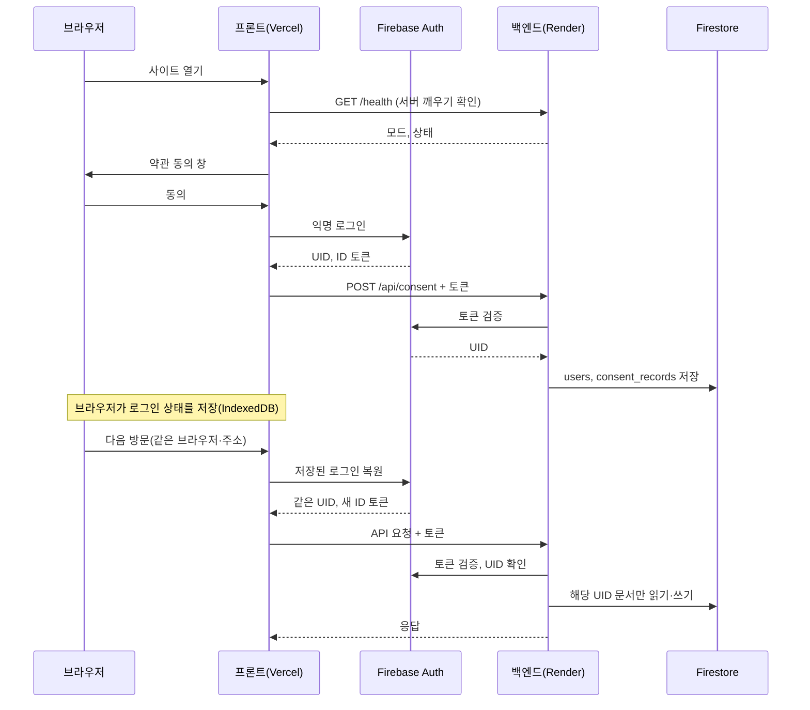

## 5. 학습 계획 생성과 확정 흐름

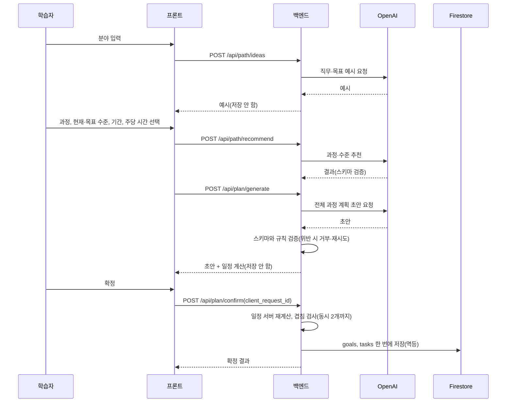

## 6. 저장소 정리

| 구분 | 위치 | 내용 | 사용자 소유 | 삭제 요청 때 |
|---|---|---|---|---|
| 사용자 | Firestore `users` | 동의 버전, 활성 학습, 활성 타이머, 마지막 활동, 피드백 횟수 | 예 | 삭제 |
| 동의 | `consent_records` | 약관 버전, 동의 항목 | 예 | 삭제 |
| 학습 | `goals`, `tasks` | 목표, 과제, 일정 | 예 | 삭제 |
| 기록 | `study_logs`, `reflections` | 학습 기록, 회고 | 예 | 삭제 |
| 대화 | `conversations` | 튜터 대화, 출처, 키워드 | 예 | 삭제 |
| 인사이트 | `insights` | 학습당 1건 | 예 | 삭제 |
| 피드백 | `feedback` | 평점, 의견(UID 없음) | 아니오 | **남음** |
| 학습 자료 | `backend/data/rag_documents.json`, `resources_catalog.py` | 검토된 자료 | 공용 읽기 전용 | 해당 없음 |
| 로그인 상태 | 브라우저 IndexedDB(Firebase) | 익명 UID 와 토큰 | 브라우저 | 삭제 요청 시 브라우저 저장 UID 지움 |

## 7. 보안 경계 한눈에
| 경계 | 규칙 |
|---|---|
| 브라우저 ↔ 백엔드 | HTTPS, CORS 는 배포된 프론트 주소만, ID 토큰 필수 |
| 백엔드 ↔ Firebase | 토큰 검증, 서비스 계정(서버 환경변수) |
| 백엔드 ↔ OpenAI | 키는 서버에만, 입력·응답 원문은 로그에 남기지 않음 |
| 소유권 | UID 는 토큰에서만, 타인 문서 접근 403 |
| 배포 환경 | Render 에서는 dev 인증, memory 저장, 안전하지 않은 CORS 를 거부 |
| 관리자 | `ADMIN_UIDS` 에 든 UID 만 `/api/admin/*` |

## 8. 변경 시 갱신
라우트, 컬렉션, 외부 서비스가 바뀌면 이 문서와 `docs/erd_current.md` 를 같이 갱신한다. 계정 승격(`docs/auth_upgrade_design.md`)이 구현되면 §4 와 §6 의 로그인 항목을 바꾼다.
