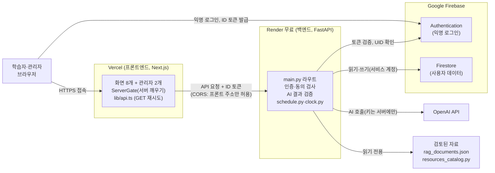
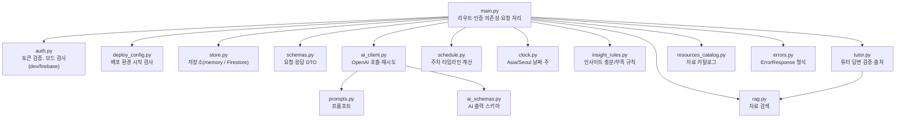
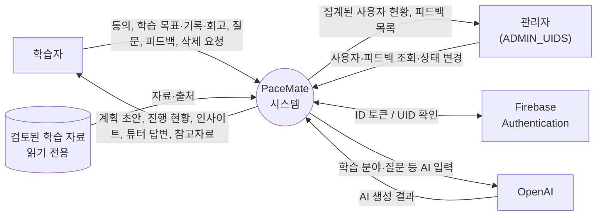
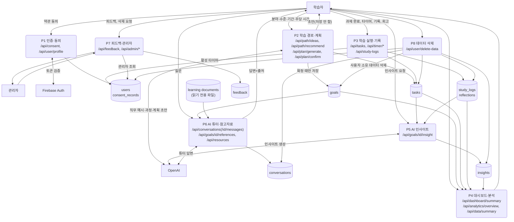
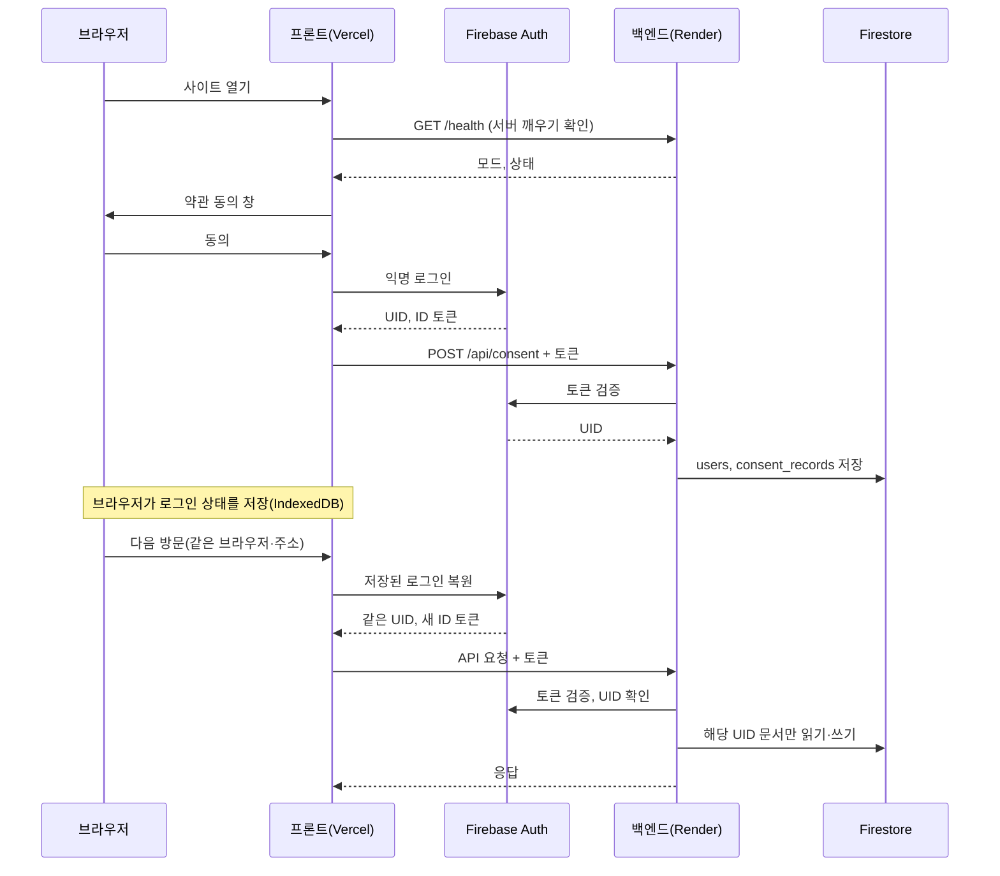
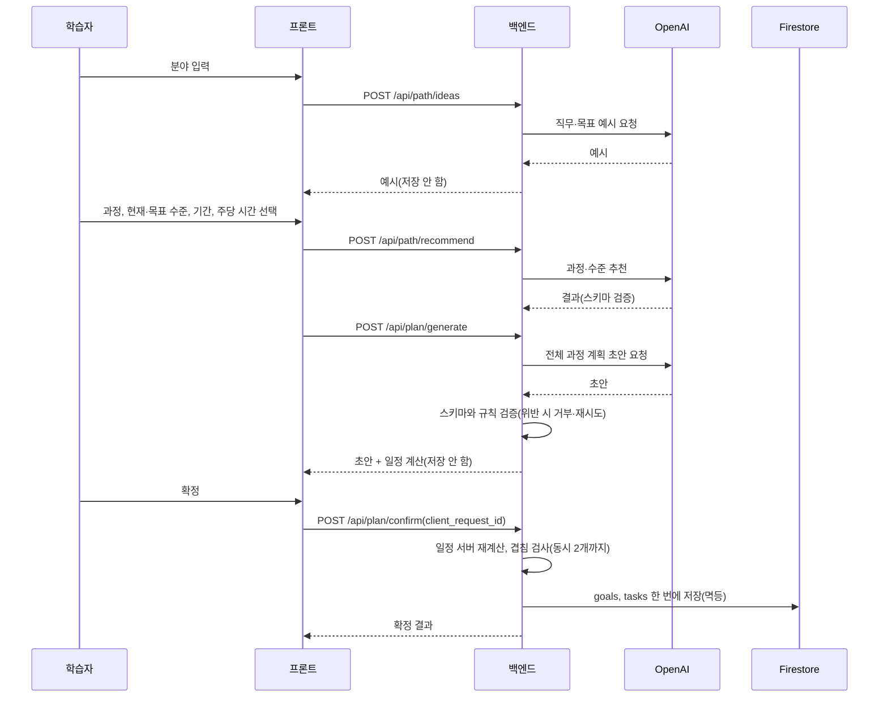

# PaceMate 시스템 구조도와 DFD (PM 정리, 2026-10-25)

기준: 배포된 현재 main(Phase 7 + 배포 후 수정). 근거: `backend/main.py` 의 실제 라우트(코드에서 추출), `backend/store.py`, `backend/*.py` 모듈 구성, `docs/erd_current.md`, `docs/deploy_guide.md`. 데이터 구조(ERD)는 `docs/erd_current.md`. 화면의 그림은 Mermaid 로 작성했다(GitHub, VS Code 미리보기에서 보인다).
주의: 라우트와 저장소는 코드로 확인했고, 프로세스별 "어떤 컬렉션을 읽고 쓰는가"는 ERD 와 라우트 이름에서 정리한 것이다(함수 단위로 전수 확인하지는 않았다).

## 1. 시스템 구성도 (배포 구조)

핵심: 브라우저는 OpenAI 와 Firestore 에 직접 가지 않는다. 모든 데이터와 AI 요청은 백엔드를 거치고, 백엔드는 **토큰에서 UID 를 정한다**. 비밀값(OpenAI 키, Firebase 서비스 계정)은 Render 환경변수에만 있다.

## 2. 백엔드 모듈 구조

## 3. DFD

범례: 사각형 = 외부 개체, 둥근 사각형 = 프로세스, 원통 = 데이터 저장소.

### 3-1. 레벨 0 (컨텍스트)

### 3-2. 레벨 1 (프로세스와 저장소)

설명:
- **모든 프로세스(P2~P8)는 P1 의 토큰 검증을 먼저 통과**해야 한다. 개인 데이터 API 는 동의가 된 UID 만 쓴다(`require_consented_uid`).
- **P2 의 초안은 저장하지 않는다.** 사용자가 확정(`/api/plan/confirm`)할 때 `goals` 와 `tasks` 를 한 번에 저장하고, 확정 때 서버가 일정을 다시 계산한다.
- **P5 인사이트**는 학습당 1건(`insights`, 문서 ID = goal_id)이고, 기록·회고가 부족하면 AI 를 호출하지 않는다.
- **P6 튜터**는 검토된 자료(`rag_documents.json`)만 근거로 쓰고 출처가 없으면 근거 있는 것처럼 표시하지 않는다.
- **P7 피드백**은 user_id 를 저장하지 않는다(P8 삭제 대상이 아님). 관리자 판별은 환경변수 `ADMIN_UIDS`.
- **P8 삭제**는 `goals, tasks, study_logs, reflections, conversations, consent_records, insights, users` 의 사용자 소유 문서를 지운다. 피드백은 user_id 가 없어 남는다.

## 4. 인증 흐름 (익명 로그인 → 요청 → 소유권 확인)

## 5. 학습 계획 생성과 확정 흐름

## 6. 저장소 정리

| 구분 | 위치 | 내용 | 사용자 소유 | 삭제 요청 때 |
|---|---|---|---|---|
| 사용자 | Firestore `users` | 동의 버전, 활성 학습, 활성 타이머, 마지막 활동, 피드백 횟수 | 예 | 삭제 |
| 동의 | `consent_records` | 약관 버전, 동의 항목 | 예 | 삭제 |
| 학습 | `goals`, `tasks` | 목표, 과제, 일정 | 예 | 삭제 |
| 기록 | `study_logs`, `reflections` | 학습 기록, 회고 | 예 | 삭제 |
| 대화 | `conversations` | 튜터 대화, 출처, 키워드 | 예 | 삭제 |
| 인사이트 | `insights` | 학습당 1건 | 예 | 삭제 |
| 피드백 | `feedback` | 평점, 의견(UID 없음) | 아니오 | **남음** |
| 학습 자료 | `backend/data/rag_documents.json`, `resources_catalog.py` | 검토된 자료 | 공용 읽기 전용 | 해당 없음 |
| 로그인 상태 | 브라우저 IndexedDB(Firebase) | 익명 UID 와 토큰 | 브라우저 | 삭제 요청 시 브라우저 저장 UID 지움 |

## 7. 보안 경계 한눈에
| 경계 | 규칙 |
|---|---|
| 브라우저 ↔ 백엔드 | HTTPS, CORS 는 배포된 프론트 주소만, ID 토큰 필수 |
| 백엔드 ↔ Firebase | 토큰 검증, 서비스 계정(서버 환경변수) |
| 백엔드 ↔ OpenAI | 키는 서버에만, 입력·응답 원문은 로그에 남기지 않음 |
| 소유권 | UID 는 토큰에서만, 타인 문서 접근 403 |
| 배포 환경 | Render 에서는 dev 인증, memory 저장, 안전하지 않은 CORS 를 거부 |
| 관리자 | `ADMIN_UIDS` 에 든 UID 만 `/api/admin/*` |

## 8. 변경 시 갱신
라우트, 컬렉션, 외부 서비스가 바뀌면 이 문서와 `docs/erd_current.md` 를 같이 갱신한다. 계정 승격(`docs/auth_upgrade_design.md`)이 구현되면 §4 와 §6 의 로그인 항목을 바꾼다.
