# PaceMate DFD (모듈 4개 기준: 레벨 0, 1, 2, 3)

작성: 검증/PM. 상태: **사용자 검증 중(터미널 규칙 반영 2026-10-27).** 이 문서가 현재 DFD 의 기준이다. 옛 `docs/architecture_dfd.md` 와 레벨 1 초안 `docs/dfd_level1_by_module_draft.md` 는 사용자가 삭제했다(2026-10-27, 의도한 삭제). 옛 내용은 커밋 0f9f83a 에서 볼 수 있다(§6).

기준: 서비스기획서 9.1(영역 4개), 레벨 1 초안(삭제됨), 화면 코드 `frontend/components/*.tsx`(터미널의 입력·조회 항목), 코드 `backend/main.py` 의 라우트 47개(+ `/health`), 저장소 정보는 옛 레벨 2(AST 분석, 2026-10-25)를 재사용하고 8B 이후의 관리자 참고자료 부분은 코드(`resource_*.py`, `link_checker.py`, `page_metadata.py`, `field_demand.py`)를 읽어 새로 정리했다.

## 0. 범례와 규칙
| 요소 | 모양·선 | 뜻 |
|---|---|---|
| 터미널 | 사각형 | **레벨 0(배경도)만** 사람·조직(학습자, 관리자). **레벨 1~3 에서는 입력 화면·조회 화면의 논리명**(사람·조직은 터미널이 될 수 없다). 외부 시스템인 AI 서비스(OpenAI)·허용 도메인 공개 웹 페이지도 터미널로 둔다(사용자 확인 필요) |
| 입력 화면 | 사각형 `[입력] …` | 사용자가 값을 넣는 화면. 화살표는 입력 화면 → 프로세스 한 방향 |
| 조회 화면 | 사각형 `[조회] …` | 프로세스의 결과를 보여 주는 화면. 화살표는 프로세스 → 조회 화면. 조건 없이 메뉴를 열거나 "다시 불러오기"로 조회하는 경우만 조회 요청을 함께 그린다(양방향) |
| 입출력 점검 | | 모든 프로세스는 입력과 출력을 함께 가진다. **입력만 있고 출력이 없으면 조회 화면 터미널 누락, 출력만 있고 입력이 없으면 입력 화면 터미널 누락**으로 보고 고친다(사용자 규칙, 2026-10-27) |
| 프로세스 | 원 | 레벨 1: 모듈 4개(P1~P4). 레벨 2: 메뉴·화면·구역·버튼 이름의 프로세스. 레벨 3: 단계 이름 |
| 다른 그림의 프로세스 | **점선 원** | 이 그림 밖에 있는 프로세스. 이어지는 선만 그리고 더 이어가지 않는다 |
| 데이터 저장소 | 띠(이중선 직사각형) | 레벨 1: **논리 저장소 5개**. 레벨 2·3: 물리 컬렉션 이름과 소속 논리 저장소를 함께 표시 |
| 다른 모듈이 만드는 저장소 | **점선 띠** + `(작성: 프로세스 이름)` | 흐름도 점선으로 그린다 |
| 쓰기 | 프로세스 → 저장소 화살표 | 저장소를 편집 |
| 읽기 | 레벨 1: 점선 + `◀ 읽기:` (저장소에서 왼쪽 프로세스로). 레벨 2: 저장소 → 프로세스 화살표 | 저장소를 참조 |
| 양방향 | 양쪽 화살표 | 읽기와 쓰기 |
| 생략 | | 모든 개인 데이터 API 가 먼저 하는 토큰 검증(Firebase)과 `users`(동의 버전) 읽기, 마지막 활동 갱신은 그림에서 생략 |
| Firebase | | 토큰 검증은 그림에서 생략(모든 프로세스가 먼저 거침) |

번호 규칙(사용자 지정): 레벨 0 배경도, **레벨 1 최상위도** = P1~P4, **레벨 2 상위도** = P1.1, P1.2 …, **레벨 3 하위도** = P1.1.1 … . 레벨 3 은 프로세스끼리 직접 흐름이 있을 때만 쓰고 가능하면 그리지 않는다(이 문서는 3곳). 레벨 2 프로세스 수: P1 = 화면 10개, P2 = 18개(+ 화면 없는 P2.19), P3 = 5개, P4 = 10개.

## 1. 논리 저장소와 물리 컬렉션
| 논리 저장소(레벨 1) | 물리 컬렉션(레벨 2, `docs/erd_current.md` 와 같은 이름) |
|---|---|
| 사용자·동의·피드백 | `users`, `consent_records`, `feedback` |
| 학습 PLAN | `goals`, `tasks` |
| 학습 DATA | `study_logs`, `reflections` |
| AI 대화·인사이트 | `conversations`, `insights` |
| 참고자료 | `learning_documents`(파일 `backend/data/rag_documents.json` + 승인된 문서), `resource_candidates` |

## 2. 레벨 0 (배경도)
시스템 전체가 원 하나이고, 터미널은 시스템을 쓰는 조직이다.
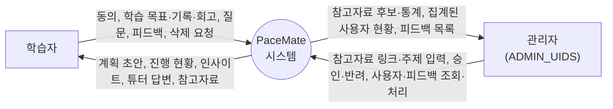

## 3. 레벨 1 (모듈 4개)
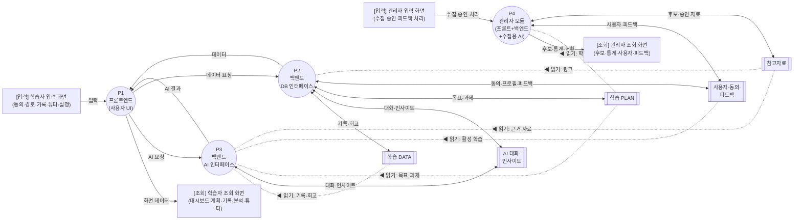

선 규칙: 프로세스 → 저장소 화살표 = 쓰기, 양쪽 화살표 = 읽기와 쓰기, 점선(`◀ 읽기:`) = 읽기 전용(저장소에서 왼쪽 프로세스로). **프론트(P1)는 저장소와 직접 만나지 않고**, 데이터는 P2 를, AI 기능은 P3 를 요청한다. P2 와 P3 사이에 흐름은 없다. **P3(AI)는 대화·인사이트만 쓰고**(코드 확인) 나머지 저장소는 읽기만 한다. 관리자 모듈 P4 는 수집용 AI 를 안에 포함한다.

흐름 설명(그림의 짧은 이름 → 실제 정보)
| 그림의 이름 | 실제 정보 |
|---|---|
| 입력 / 화면 데이터 | 학습자 입력 화면 → P1: 동의, 학습 목표·기록·회고, 질문, 피드백, 삭제 요청 / P1 → 학습자 조회 화면: 계획 초안, 진행 현황, 인사이트, 튜터 답변, 참고자료. 화면별 입력·조회 화면은 4-1 |
| AI 요청 / AI 결과 | P1 → P3: 직무·과정·계획 생성, 인사이트, 튜터 질문 / P3 → P1: 검증된 AI 결과 |
| 데이터 요청 / 데이터 | P1 → P2: 동의, 목표, 과제, 기록, 회고, 대화 목록, 피드백, 삭제 요청 / P2 → P1: 학습 데이터, 요약, 처리 결과 |
| 수집·승인·처리 / 후보·통계·현황 | 관리자 입력 화면 → P4: 링크·주제 입력, 승인·반려, 피드백 처리 상태 / P4 → 관리자 조회 화면: 후보 목록, 검사 결과, 통계, 사용자 현황, 피드백 목록. 화면별은 4-4 |
| P3 ↔ 저장소 | **읽기만:** 학습 기록·회고(학습 DATA), 목표·과제 현황(학습 PLAN), 활성 학습(사용자), 근거 자료(참고자료). **읽기와 쓰기:** 이전 대화 읽기·대화 저장, 인사이트 읽기·저장(AI 대화·인사이트). **학습 DATA·학습 PLAN 에는 쓰지 않는다**(코드 확인: AI API 5개가 쓰는 컬렉션은 `conversations`, `insights` 뿐) |
| P2 ↔ 저장소 | 학습 기록·회고, 대화·저장된 인사이트, 학습 목표·과제, 동의 이력·프로필·피드백(읽기·쓰기), 참고자료 링크(읽기만) |
| P4 ↔ 저장소 | 사용자별 학습 수(읽기만), 사용자 목록·피드백 / 처리 상태, 기존 자료·후보 / 후보·승인된 자료(읽기·쓰기) |

## 4. 레벨 2 (상위도)와 레벨 3 (하위도)
작성 규칙(사용자 지정, 2026-10-27)을 이 절 전체에 적용했다.
1. **레벨 2 = 레벨 1 프로세스 하나를 푼 그림.** 프로세스끼리 직접 흐름을 그리지 않고, **저장소를 거쳐서만** 이어진다(저장소를 거치는 통신은 실시간 연동이 아니라 따로 움직이는 시간 사건으로 본다).
2. **프로세스 이름은 메뉴·화면·화면 안의 구역·버튼 이름**이다(API 주소를 이름으로 쓰지 않는다). API 주소는 4-6 표에 둔다.
3. **다른 그림에 속한 프로세스는 점선 원**, 다른 모듈이 만드는 저장소는 **점선 띠 + `(작성: 프로세스 이름)`** 로 그리고, 이들과 이어지는 흐름은 점선으로 그린다. 점선 원에서 더 이어지는 선은 그리지 않는다.
4. **NLM 수준**이다. CRUD(조회·생성·수정·삭제)를 쪼개지 않고, 내부 함수로 분해하지 않는다. 같은 화면 기능의 조회·저장·수정·삭제 API 는 프로세스 하나로 묶는다.
5. **레벨 3(하위도)은 프로세스끼리 직접 흐름이 있을 때만** 쓴다. 여기서는 순서가 있는 연쇄가 AI 호출과 함께 나타나는 세 곳(P3.3 계획 초안 생성, P3.5 튜터 질문, P4.3 AI 주제 수집)만 그렸다. AI 서비스는 레벨 2 에서도 터미널(사각형)로 그린다.
6. **터미널은 레벨 0 에서만 사람·조직이고, 레벨 1~3 에서는 입력 화면·조회 화면의 논리명이다.** 모든 프로세스가 입력과 출력을 함께 갖는지 점검한다(입력만 있으면 조회 화면 누락, 출력만 있으면 입력 화면 누락). 2026-10-27 점검 결과: 레벨 1·P1·P4·P4.3 의 학습자·관리자 터미널을 화면으로 바꾸고, 출력이 없던 P1.10 앱 공통에 메뉴 화면을 추가했다. P2·P3 레벨 2 와 P3.3·P3.5 레벨 3 은 모든 프로세스가 점선 원(P1 화면)과 입력·출력을 주고받아 위반이 없었다.

### 4-1. 레벨 2: P1 프론트엔드(사용자 UI)
P1 은 저장소와 직접 만나지 않는다. 화면이 필요한 데이터·AI 결과는 P2·P3 의 프로세스(점선 원)에서 받는다. 프로세스는 메뉴(기능) 이름이고, 터미널은 그 메뉴의 입력 화면·조회 화면이다(입력·조회 항목은 화면 코드에서 확인).

```mermaid
%%{init: {"flowchart": {"curve": "basis"}}}%%
flowchart LR
    I11["[입력] 동의 입력 화면"]
    O11["[조회] 동의 안내 화면"]
    I12["[입력] 설정 입력 화면"]
    O12["[조회] 내 정보 조회 화면"]
    I13["[입력] 오늘 과제 완료 체크"]
    O13["[조회] 대시보드 조회 화면"]
    I14["[입력] 학습 경로 입력 화면"]
    O14["[조회] 학습 경로 제안 화면"]
    I15["[입력] 과제 계획 변경 입력"]
    O15["[조회] 학습 과제 계획 조회 화면"]
    I16["[입력] 학습 기록 입력 화면"]
    O16["[조회] 학습 기록 조회 화면"]
    O17["[조회] 종합 학습 분석 화면"]
    I18["[입력] 튜터 질문 입력 화면"]
    O18["[조회] 튜터 대화 조회 화면"]
    O19["[조회] 서버 준비 안내 화면"]
    O110["[조회] 메뉴(사이드바) 화면"]
    P11(("P1.1<br/>동의 창"))
    P12(("P1.2<br/>내 정보·설정"))
    P13(("P1.3<br/>대시보드"))
    P14(("P1.4<br/>학습 경로 설정"))
    P15(("P1.5<br/>학습 과제 계획"))
    P16(("P1.6<br/>학습 실행 기록"))
    P17(("P1.7<br/>종합 학습 분석"))
    P18(("P1.8<br/>AI 튜터"))
    P19(("P1.9<br/>서버 깨우기 화면"))
    P110(("P1.10<br/>앱 공통"))

    E21(("P2.1<br/>동의 저장"))
    E22(("P2.2<br/>내 정보 조회"))
    E23(("P2.3<br/>학습 전환"))
    E24(("P2.4<br/>내 데이터 삭제"))
    E25(("P2.5<br/>서버 깨우기"))
    E26(("P2.6<br/>계획 확정"))
    E27(("P2.7<br/>학습 목록·상세"))
    E28(("P2.8<br/>참고자료 보기"))
    E29(("P2.9<br/>과제 목록"))
    E210(("P2.10<br/>과제 완료·요일 변경"))
    E211(("P2.11<br/>학습 기록 관리"))
    E212(("P2.12<br/>타이머"))
    E213(("P2.13<br/>대시보드 요약"))
    E214(("P2.14<br/>종합 학습 분석 조회"))
    E215(("P2.15<br/>인사이트 카드 조회"))
    E216(("P2.16<br/>튜터 대화 관리"))
    E217(("P2.17<br/>학습 데이터 요약"))
    E218(("P2.18<br/>피드백 보내기"))
    E31(("P3.1<br/>직무 예시"))
    E32(("P3.2<br/>과정·수준 추천"))
    E33(("P3.3<br/>계획 초안 생성"))
    E34(("P3.4<br/>인사이트 생성"))
    E35(("P3.5<br/>튜터 질문"))

    I11 -->|"동의 항목 체크"| P11
    P11 -->|"수집·AI 이용 안내, 동의 결과"| O11
    I12 -->|"평점·의견, 삭제 확인"| P12
    P12 -->|"계정 ID·동의 버전, 접수·삭제 결과"| O12
    I13 -->|"완료 체크"| P13
    P13 -->|"지표, 오늘 추천 과제, 주간 활동, 종합 현황"| O13
    I14 -->|"분야·목표, 직무·과정·수준 선택, 기간·주당 시간, 과제 편집, 확정"| P14
    P14 -->|"직무 예시, 과정·수준 제안, 계획 초안, 확정 결과"| O14
    I15 -->|"주 이동, 완료, 추천 요일 변경"| P15
    P15 -->|"주차별 과제, AI 조언, 참고자료"| O15
    I16 -->|"학습 전환, 타이머 시작·종료, 기록·회고·태그 입력·수정·삭제, 인사이트 요청"| P16
    P16 -->|"과제별 진행, 기록 목록, 진행 중 타이머, 인사이트"| O16
    O17 <-->|"조회 요청(다시 불러오기) / 분석 지표"| P17
    I18 -->|"새 대화, 대화 선택, 질문"| P18
    P18 -->|"대화 목록, 메시지 이력, 답변·출처·관련 링크"| O18
    O19 <-->|"재시도 / 대기·실패 안내"| P19
    P110 -->|"관리자 메뉴 표시 여부"| O110

    P11 <-.->|"동의 항목 / 동의 결과"| E21
    P12 <-.->|"프로필 요청 / 프로필"| E22
    P12 <-.->|"삭제 요청 / 삭제 결과"| E24
    P12 <-.->|"평점·의견 / 접수 결과"| E218
    P13 <-.->|"요약 요청 / 지표·주간 활동"| E213
    P13 <-.->|"완료 체크 / 수정된 과제"| E210
    P14 <-.->|"분야 / 직무 예시"| E31
    P14 <-.->|"분야·직무 / 과정·수준"| E32
    P14 <-.->|"과정·수준·기간 / 계획 초안"| E33
    P14 <-.->|"확정 요청 / 확정 결과"| E26
    P14 <-.->|"학습 id / 과제 목록"| E29
    P15 <-.->|"학습 id / 학습 상세"| E27
    P15 <-.->|"학습 id / 참고자료"| E28
    P15 <-.->|"학습 id / 과제 목록"| E29
    P15 <-.->|"완료·요일 변경 / 수정된 과제"| E210
    P16 <-.->|"프로필 요청 / 활성 학습"| E22
    P16 <-.->|"학습 전환 / 수정된 프로필"| E23
    P16 <-.->|"목록 요청 / 학습 목록"| E27
    P16 <-.->|"학습 id / 과제 목록"| E29
    P16 <-.->|"기록 입력·수정·삭제 / 기록 목록"| E211
    P16 <-.->|"타이머 시작·종료 / 진행 중 타이머"| E212
    P16 <-.->|"조회 요청 / 저장된 인사이트"| E215
    P16 <-.->|"생성 요청 / 인사이트"| E34
    P17 <-.->|"분석 요청 / 분석 지표"| E214
    P18 <-.->|"대화 열기·만들기 / 대화 내용"| E216
    P18 <-.->|"요약 요청 / 학습 데이터 요약"| E217
    P18 <-.->|"질문 / 답변·출처"| E35
    P19 <-.->|"상태 확인 / 상태"| E25
    P110 <-.->|"프로필 요청 / 관리자 여부"| E22

    classDef ext stroke-dasharray:5 5
    class E21,E22,E23,E24,E25,E26,E27,E28,E29,E210,E211,E212,E213,E214,E215,E216,E217,E218,E31,E32,E33,E34,E35 ext
```

P1.10 앱 공통은 화면이 아니라 모든 화면 위에서 도는 공통 부분이다(익명 로그인 토큰 발급, 모든 요청에 토큰 붙이기, 요청 재시도, 관리자 메뉴 표시). 이전 판에는 출력이 없었는데(입출력 점검 위반), 실제 출력인 메뉴 화면의 관리자 메뉴 표시를 조회 화면 터미널로 추가했다. 화면별 호출은 4-6 표에 번호로 있다.

### 4-2. 레벨 2: P2 백엔드(DB 인터페이스)
18개 프로세스를 읽기 좋도록 **기능 묶음 3장**으로 나누어 그렸다(세 장 모두 P2 의 레벨 2 이고, 프로세스 번호는 겹치지 않는다). 점선 띠는 P2 가 만들지 않는 저장소다.

#### 4-2-1. 계정·동의·계획 확정 (P2.1~P2.6)
계획 초안(P3.3)은 저장하지 않고, 사용자가 확정할 때 P2.6 이 학습 목표와 과제를 한 번에 저장한다.
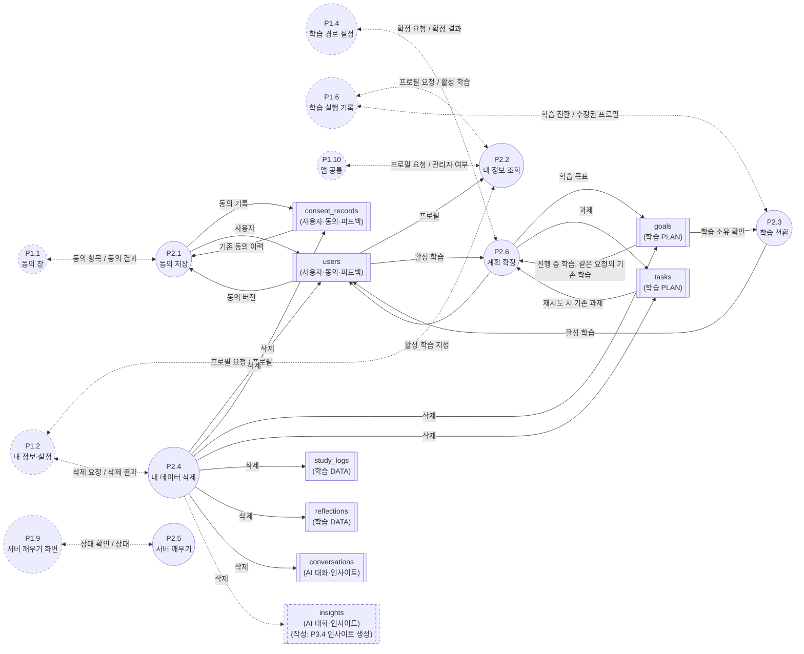

#### 4-2-2. 학습 목록·과제·기록·타이머 (P2.7~P2.12)
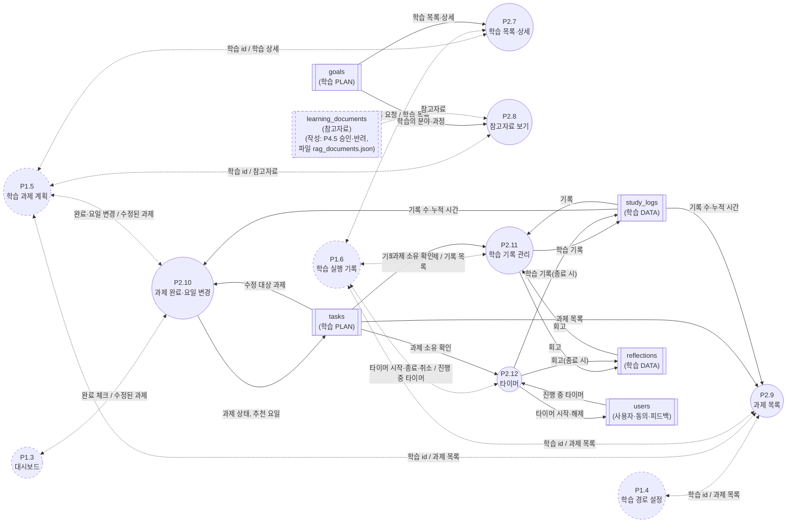

#### 4-2-3. 대시보드·분석·인사이트 조회·튜터 대화·피드백 (P2.13~P2.18)
`feedback` 은 user_id 를 저장하지 않아 P2.4(내 데이터 삭제)로 지워지지 않는다.
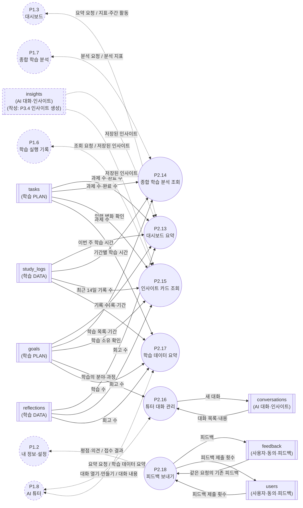

화면에서 부르지 않는 API 5개(`POST·PATCH·DELETE /api/goals`, `POST·DELETE /api/tasks`)는 **P2.19 목표·과제 직접 편집(화면 없음)** 으로 표 4-6 에만 두고 그림에서 뺐다. 화면에서 목표·과제를 만드는 것은 P2.6 이다.

### 4-3. 레벨 2: P3 백엔드(AI 인터페이스)
P3 는 필요한 학습 데이터를 저장소에서 **직접 읽고**, 결과(대화·인사이트)를 직접 쓴다. AI 서비스(OpenAI)는 터미널이고 키는 서버에만 있다. 읽기 전용 저장소는 다른 모듈이 만든 것이라 점선이다.
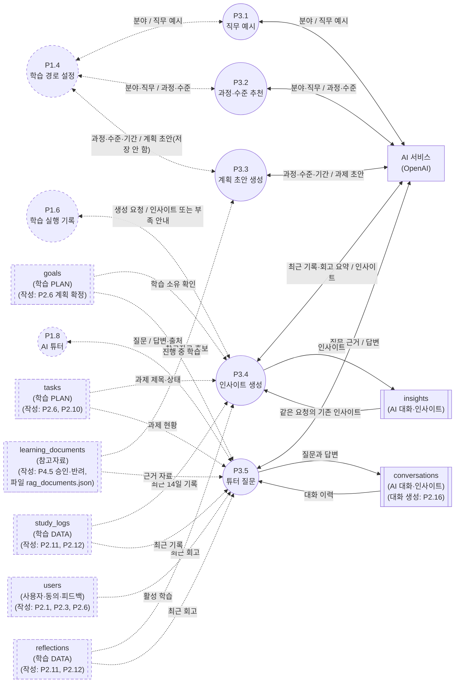
초안(P3.1~P3.3)은 저장하지 않는다. 튜터는 검토된 자료만 근거로 쓰고, 출처가 없으면 근거가 있는 것처럼 표시하지 않는다.

### 4-4. 레벨 2: P4 관리자 모듈(프론트+백엔드+수집용 AI)
관리자 화면(참고자료 관리, 사용자 관리, 사용자 피드백)의 구역·버튼이 프로세스이고, 모든 관리자 API 는 `ADMIN_UIDS` 확인(허용 목록 밖은 403)을 먼저 한다. 수집용 AI(분류·요약·링크 제안)는 이 모듈 안에서 쓰는 AI 라 AI 서비스 터미널로 표시한다. 승인한 자료만 `learning_documents` 에 들어가고, 사용자 화면이 그 자료를 보는지는 읽기 스위치(`RESOURCE_READ_SOURCE`, 기본 `file`)에 달려 있다.
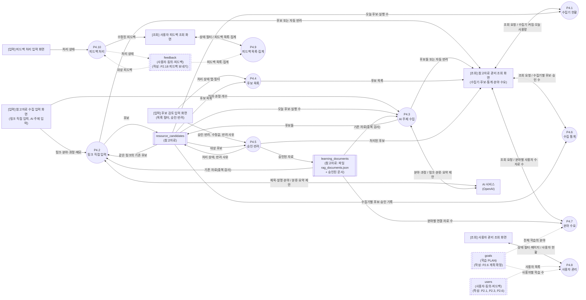

### 4-5. 레벨 3 (하위도): 프로세스끼리 직접 흐름이 있는 곳
하위도에서는 프로세스 사이의 직접 흐름이 나온다(규칙 5). 이름은 단계 이름이다. 레벨 3 에도 같은 표기(점선 원, 점선 띠)를 쓴다.

#### 4-5-1. P3.3 계획 초안 생성
AI 가 과제 초안을 만들고(서버가 규칙으로 검증하고 위반 시 재시도), 참고자료 후보를 찾고, 일정을 배치해 초안을 조립한다. 저장하지 않는다.
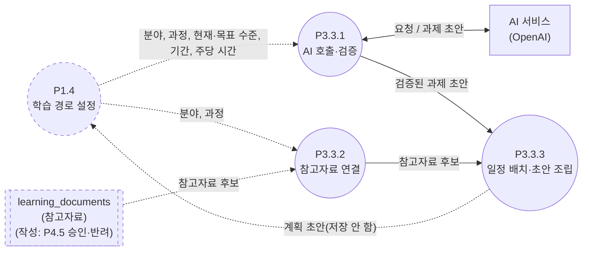

#### 4-5-2. P3.5 튜터 질문
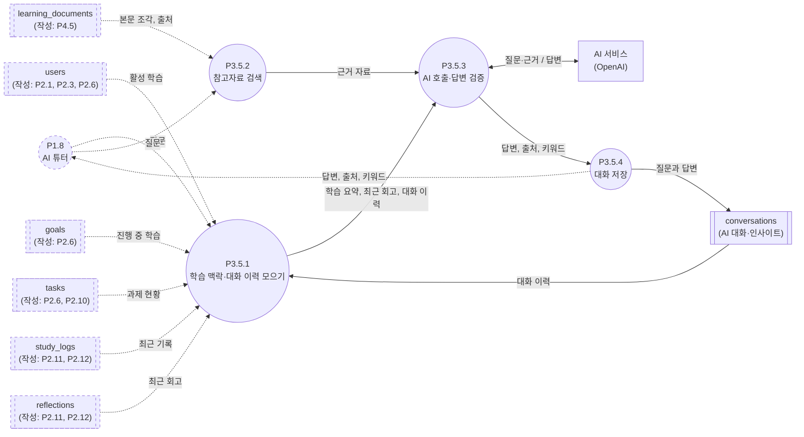

#### 4-5-3. P4.3 AI 주제 수집 (P4.2 링크 직접 입력은 P4.3.2~P4.3.5 와 같은 절차)
수집은 후보 링크만 만들고, 링크 검사·메타데이터 읽기·분류 제안·후보 저장은 모든 수집이 같은 절차를 지난다. P4.2 는 관리자가 입력한 링크 1개를 곧바로 P4.3.2 부터 시작한다(별도 그림은 생략).
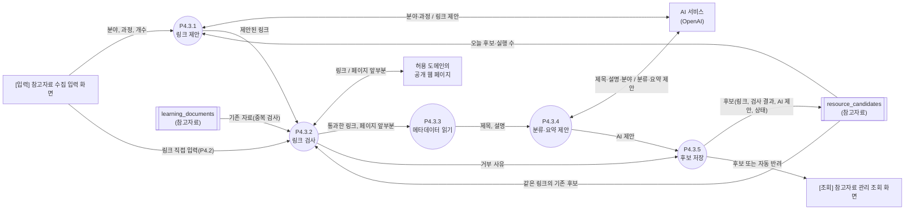

### 4-6. 전체 프로세스 목록
#### P1 (화면, 4-1 그림)
| 번호 | 프로세스(메뉴) | 입력 화면 | 조회 화면 | 부르는 P2·P3 프로세스 | 화면 코드 |
|---|---|---|---|---|---|
| P1.1 | 동의 창 | 동의 입력 화면 | 동의 안내 화면 | P2.1 | ConsentModal |
| P1.2 | 내 정보·설정 | 설정 입력 화면 | 내 정보 조회 화면 | P2.2, P2.4, P2.18 | SettingsScreen, FeedbackCard, DeleteDataSection, AccountIdCard |
| P1.3 | 대시보드 | 오늘 과제 완료 체크 | 대시보드 조회 화면 | P2.10, P2.13 | Dashboard |
| P1.4 | 학습 경로 설정 | 학습 경로 입력 화면 | 학습 경로 제안 화면 | P2.6, P2.9, P3.1, P3.2, P3.3 | LearningPathWizard |
| P1.5 | 학습 과제 계획 | 과제 계획 변경 입력 | 학습 과제 계획 조회 화면 | P2.7, P2.8, P2.9, P2.10 | WeeklyPlanScreen |
| P1.6 | 학습 실행 기록 | 학습 기록 입력 화면 | 학습 기록 조회 화면 | P2.2, P2.3, P2.7, P2.9, P2.11, P2.12, P2.15, P3.4 | ExecutionScreen, GoalSwitch, InsightCard |
| P1.7 | 종합 학습 분석 | (조회 화면의 다시 불러오기) | 종합 학습 분석 화면 | P2.14 | AnalysisScreen |
| P1.8 | AI 튜터 | 튜터 질문 입력 화면 | 튜터 대화 조회 화면 | P2.16, P2.17, P3.5 | TutorScreen |
| P1.9 | 서버 깨우기 화면 | (조회 화면의 재시도) | 서버 준비 안내 화면 | P2.5 | ServerGate, WakeNotice |
| P1.10 | 앱 공통 | - (입력은 P2.2 의 프로필) | 메뉴(사이드바) 화면 | P2.2 | AuthProvider, page.tsx |

#### P2 (DB 인터페이스)
| 번호 | 프로세스 | 묶인 API | 읽는 저장소 | 쓰는 저장소 |
|---|---|---|---|---|
| P2.1 | 동의 저장 | POST /api/consent | users, consent_records | users, consent_records |
| P2.2 | 내 정보 조회 | GET /api/user/profile | users | - |
| P2.3 | 학습 전환 | PATCH /api/user/profile | goals | users |
| P2.4 | 내 데이터 삭제 | POST /api/user/delete-data | - | (삭제) users, consent_records, goals, tasks, study_logs, reflections, conversations, insights |
| P2.5 | 서버 깨우기 | GET /health | - | - |
| P2.6 | 계획 확정 | POST /api/plan/confirm | goals, tasks, users | goals, tasks, users |
| P2.7 | 학습 목록·상세 | GET /api/goals, GET /api/goals/{id} | goals | - |
| P2.8 | 참고자료 보기 | GET /api/goals/{id}/references | goals, learning_documents | - |
| P2.9 | 과제 목록 | GET /api/tasks | tasks, study_logs | - |
| P2.10 | 과제 완료·요일 변경 | PATCH /api/tasks/{id} | tasks, study_logs | tasks |
| P2.11 | 학습 기록 관리 | GET·POST /api/study-logs, PATCH·DELETE /api/study-logs/{id} | study_logs, reflections, tasks | study_logs, reflections |
| P2.12 | 타이머 | POST /api/timer/start, /finish, /cancel, GET /api/timer/active | users, tasks | users, study_logs, reflections |
| P2.13 | 대시보드 요약 | GET /api/dashboard/summary | goals, tasks, study_logs, reflections, insights | - |
| P2.14 | 종합 학습 분석 조회 | GET /api/analytics/overview | goals, tasks, study_logs | - |
| P2.15 | 인사이트 카드 조회 | GET /api/goals/{id}/insight | insights, goals, tasks, study_logs, reflections | - |
| P2.16 | 튜터 대화 관리 | GET·POST /api/conversations, GET /api/conversations/{id} | conversations, goals | conversations |
| P2.17 | 학습 데이터 요약 | GET /api/data/summary | goals, tasks, study_logs, reflections | - |
| P2.18 | 피드백 보내기 | POST /api/feedback | feedback, users | feedback, users |
| P2.19 | 목표·과제 직접 편집(화면 없음, 그림 제외) | POST·PATCH·DELETE /api/goals, POST·DELETE /api/tasks | goals, tasks | goals, tasks |

#### P3 (AI 인터페이스)
| 번호 | 프로세스 | API | AI 호출 | 읽는 저장소 | 쓰는 저장소 |
|---|---|---|---|---|---|
| P3.1 | 직무 예시 | POST /api/path/ideas | 직무 예시 | - | - |
| P3.2 | 과정·수준 추천 | POST /api/path/recommend | 과정·수준 추천 | - | - |
| P3.3 | 계획 초안 생성 | POST /api/plan/generate | 계획 초안 | learning_documents | - |
| P3.4 | 인사이트 생성 | POST /api/goals/{id}/insight | 인사이트 | goals, tasks, study_logs, reflections, insights | insights |
| P3.5 | 튜터 질문 | POST /api/conversations/{id}/messages | 튜터 답변 | conversations, users, goals, tasks, study_logs, reflections, learning_documents | conversations |

#### P4 (관리자 모듈)
| 번호 | 프로세스(화면 구역·버튼) | 화면(입력 / 조회 터미널) | API | 수집용 AI | 읽는 저장소 | 쓰는 저장소 |
|---|---|---|---|---|---|---|
| P4.1 | 수집기 현황 | (조회 요청) / 참고자료 관리 조회 | GET /api/admin/resources/collectors | - | resource_candidates | - |
| P4.2 | 링크 직접 입력 | 참고자료 수집 입력 / 참고자료 관리 조회 | POST /api/admin/resources/candidates | 분류·요약 제안 | resource_candidates, learning_documents | resource_candidates |
| P4.3 | AI 주제 수집 | 참고자료 수집 입력 / 참고자료 관리 조회 | POST /api/admin/resources/collect | 링크 제안, 분류·요약 제안 | resource_candidates, learning_documents | resource_candidates |
| P4.4 | 후보 목록 | 후보 검토 입력 / 참고자료 관리 조회 | GET /api/admin/resources/candidates | - | resource_candidates | - |
| P4.5 | 승인·반려 | 후보 검토 입력 / 참고자료 관리 조회 | PATCH /api/admin/resources/candidates/{id} | - | resource_candidates | resource_candidates, learning_documents |
| P4.6 | 수집 통계 | (조회 요청) / 참고자료 관리 조회 | GET /api/admin/resources/stats | - | resource_candidates | - |
| P4.7 | 분야 수요 | (조회 요청) / 참고자료 관리 조회 | GET /api/admin/resources/field-demand(기본 꺼짐) | - | goals, learning_documents | - |
| P4.8 | 사용자 관리 | (상태 필터·페이지) / 사용자 관리 조회 | GET /api/admin/users | - | users, goals | - |
| P4.9 | 피드백 목록·집계 | (상태 필터) / 사용자 피드백 조회 | GET /api/admin/feedback, GET /api/admin/feedback/summary | - | feedback | - |
| P4.10 | 피드백 처리 | 피드백 처리 입력 / 사용자 피드백 조회 | PATCH /api/admin/feedback/{id} | - | feedback | feedback |

API 개수 대조: P2 32개(P2.1~P2.18 에 27개, P2.19 에 5개, `/health` 포함), P3 5개, P4 11개 = 48개(라우트 47개 + `/health`)와 같다.

## 5. 확인 수준 (사용자 검증 전)
| 구분 | 내용 |
|---|---|
| 코드로 확인함 | API 라우트 수와 영역 배정(각 API 는 한 영역), AI API 5개가 쓰는 컬렉션은 `conversations`, `insights` 뿐, 튜터(`send_message`)가 학습 맥락·참고자료 검색·AI 호출·대화 저장을 이 순서로 하는 것, 계획 초안(`generate_plan`)이 AI 호출 → 참고자료 연결 → 일정 배치 순인 것 |
| 사람이 정리함 | 화살표의 정보 이름(ERD 필드와 요청·응답 DTO 이름), 논리 저장소 묶음, 프로세스 묶음(CRUD 묶기)과 이름(메뉴·화면·버튼 이름 기준), P4 참고자료 수집 그림, 입력·조회 화면 터미널의 논리명(화면 코드의 입력 요소와 관리자 API 의 조회 조건 `status`·`page` 를 읽고 정함) |
| **미확인** | 저장소 읽기·쓰기의 2026-10-25 이후 코드 변경 전수 재확인, P4 참고자료 API 별 컬렉션 읽기·쓰기의 정적 분석 확인, P3.4·P3.5 가 읽는 저장소(users 포함) 세부, `learning_documents` 읽기가 읽기 스위치에 따라 승인 문서를 합치는 점의 모든 프로세스 반영, 그림 렌더링(이 PC 에서 그림 도구 사용 불가) |

## 6. 구판과의 관계
- 옛 `docs/architecture_dfd.md`(구성도, 백엔드 모듈 구조, 옛 DFD, 인증 흐름, 계획 생성 흐름, 저장소 정리, 보안 경계)와 `docs/dfd_level1_by_module_draft.md` 는 **2026-10-27 사용자가 삭제했다.** 내용은 커밋 0f9f83a 에서 볼 수 있다. 구성도·보안 경계를 다시 둘 곳은 사용자 결정 대기.
- 이 문서의 옛 판(커밋 cb1476e, API 단위 프로세스 P2.1~P2.32)과의 번호 대응: P2.1~P2.6 은 그대로, 옛 P2.7·P2.8 → P2.7, 옛 P2.9 → P2.8, 옛 P2.10 → P2.9, 옛 P2.11 → P2.10, 옛 P2.12~P2.15 → P2.11, 옛 P2.16~P2.19 → P2.12, 옛 P2.20 → P2.13, 옛 P2.21 → P2.14, 옛 P2.22 → P2.15, 옛 P2.23~P2.25 → P2.16, 옛 P2.26 → P2.17, 옛 P2.27 → P2.18, 옛 P2.28~P2.32 → P2.19. P3 번호는 그대로. P4: 옛 P4.4~P4.10 → P4.1~P4.7, 옛 P4.11 → P4.8, 옛 P4.12·P4.13 → P4.9, 옛 P4.14 → P4.10, 옛 P4.15~P4.17(내부 처리) → 레벨 3(P4.3.2~P4.3.4), 옛 P4.1~P4.3(화면 3개)은 화면 이름으로 표에 둔다.
- 도면 변경 이력은 `docs/change_management.md` CR-010.
