# PaceMate DFD (모듈 4개 기준: 레벨 0, 1, 2)

작성: 검증/PM. 상태: **PM 작성 완료, 사용자 검증 대기.** 이 문서가 현재 DFD 의 기준이다. 구성도·인증 흐름·보안 경계는 `docs/architecture_dfd.md` 에 그대로 있고, 거기의 옛 DFD(7그룹 기준)는 구판으로 남긴다(§6).

기준: 서비스기획서 9.1(영역 4개), `docs/dfd_level1_by_module_draft.md`(레벨 1 초안), 코드 `backend/main.py` 의 라우트 47개(+ `/health`), 저장소 정보는 옛 레벨 2(AST 분석, 2026-10-25)를 재사용하고 8B 이후의 관리자 참고자료 부분은 코드(`resource_*.py`, `link_checker.py`, `page_metadata.py`, `field_demand.py`)를 읽어 새로 정리했다.

## 0. 범례와 규칙
| 요소 | 모양·선 | 뜻 |
|---|---|---|
| 터미널 | 사각형 | 레벨 0·1 에서는 **학습자·관리자**(시스템을 쓰는 조직). 레벨 2 에서 상위 프로세스의 화면·API 도 상대편으로 사각형을 쓴다(`[P1 화면]`, `[P4 화면]`) |
| 프로세스 | 원 | 레벨 1: 모듈 4개(P1~P4). 레벨 2: 화면(P1), API 함수(P2~P4), 내부 처리 |
| 데이터 저장소 | 띠(이중선 직사각형) | 레벨 1: **논리 저장소 5개**. 레벨 2: 물리 컬렉션 이름과 소속 논리 저장소를 함께 표시 |
| 쓰기 | 프로세스 → 저장소 화살표 | 저장소를 편집 |
| 읽기 | 레벨 1: 점선 + `◀ 읽기:` (저장소에서 왼쪽 프로세스로). 레벨 2: 저장소 → 프로세스 화살표 | 저장소를 참조 |
| 양방향 | 양쪽 화살표 | 읽기와 쓰기 |
| 생략 | | 모든 개인 데이터 API 가 먼저 하는 토큰 검증(Firebase)과 `users`(동의 버전) 읽기, 마지막 활동 갱신은 그림에서 생략 |
| OpenAI, Firebase, 외부 공개 페이지 | | 터미널로 그리지 않고 **내부 처리**로 본다(AI 호출, 토큰 검증, 링크 검사) |

번호 규칙: P1 = 프론트(화면 10개), P2 = DB 인터페이스(32개), P3 = AI 인터페이스(5개 API + 내부 처리), P4 = 관리자 모듈(화면 3 + API 11 + 내부 처리 3). 레벨 1 의 `Pn` 이 레벨 2 의 `Pn.k` 로 풀린다.

## 1. 논리 저장소와 물리 컬렉션
| 논리 저장소(레벨 1) | 물리 컬렉션(레벨 2, `docs/erd_current.md` 와 같은 이름) |
|---|---|
| 사용자·동의·피드백 | `users`, `consent_records`, `feedback` |
| 학습 PLAN | `goals`, `tasks` |
| 학습 DATA | `study_logs`, `reflections` |
| AI 대화·인사이트 | `conversations`, `insights` |
| 참고자료 | `learning_documents`(파일 `backend/data/rag_documents.json` + 승인된 문서), `resource_candidates` |

## 2. 레벨 0 (배경도)
시스템 전체가 원 하나이고, 터미널은 시스템을 쓰는 조직이다.
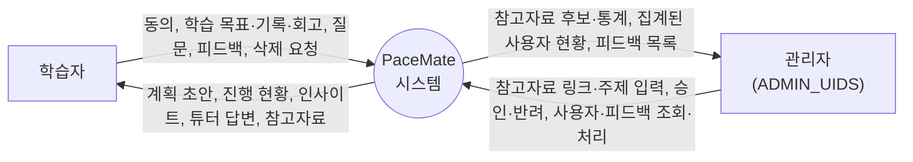

## 3. 레벨 1 (모듈 4개)
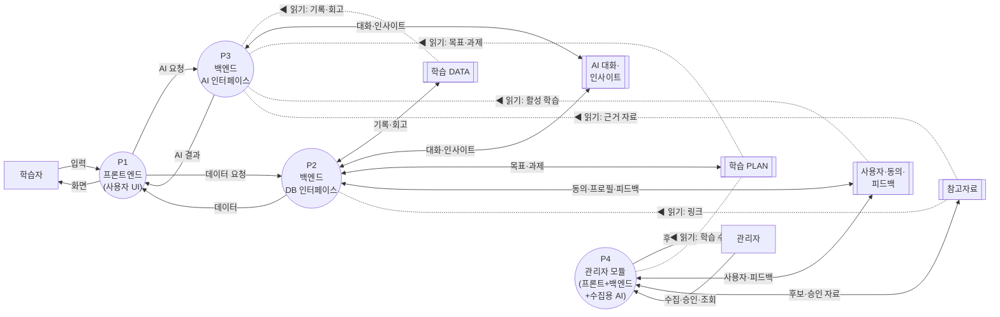

선 규칙: 프로세스 → 저장소 화살표 = 쓰기, 양쪽 화살표 = 읽기와 쓰기, 점선(`◀ 읽기:`) = 읽기 전용(저장소에서 왼쪽 프로세스로). **프론트(P1)는 저장소와 직접 만나지 않고**, 데이터는 P2 를, AI 기능은 P3 를 요청한다. P2 와 P3 사이에 흐름은 없다. **P3(AI)는 대화·인사이트만 쓰고**(코드 확인) 나머지 저장소는 읽기만 한다. 관리자 모듈 P4 는 수집용 AI 를 안에 포함한다.

흐름 설명(그림의 짧은 이름 → 실제 정보)
| 그림의 이름 | 실제 정보 |
|---|---|
| 입력 / 화면 | 학습자 → P1: 동의, 학습 목표·기록·회고, 질문, 피드백, 삭제 요청 / P1 → 학습자: 계획 초안, 진행 현황, 인사이트, 튜터 답변, 참고자료 |
| AI 요청 / AI 결과 | P1 → P3: 직무·과정·계획 생성, 인사이트, 튜터 질문 / P3 → P1: 검증된 AI 결과 |
| 데이터 요청 / 데이터 | P1 → P2: 동의, 목표, 과제, 기록, 회고, 대화 목록, 피드백, 삭제 요청 / P2 → P1: 학습 데이터, 요약, 처리 결과 |
| 수집·승인·조회 / 후보·통계 | 관리자 → P4: 링크·주제 입력, 승인·반려, 사용자·피드백 조회·처리 / P4 → 관리자: 후보 목록, 검사 결과, 통계, 사용자 현황, 피드백 목록 |
| P3 ↔ 저장소 | **읽기만:** 학습 기록·회고(학습 DATA), 목표·과제 현황(학습 PLAN), 활성 학습(사용자), 근거 자료(참고자료). **읽기와 쓰기:** 이전 대화 읽기·대화 저장, 인사이트 읽기·저장(AI 대화·인사이트). **학습 DATA·학습 PLAN 에는 쓰지 않는다**(코드 확인: AI API 5개가 쓰는 컬렉션은 `conversations`, `insights` 뿐) |
| P2 ↔ 저장소 | 학습 기록·회고, 대화·저장된 인사이트, 학습 목표·과제, 동의 이력·프로필·피드백(읽기·쓰기), 참고자료 링크(읽기만) |
| P4 ↔ 저장소 | 사용자별 학습 수(읽기만), 사용자 목록·피드백 / 처리 상태, 기존 자료·후보 / 후보·승인된 자료(읽기·쓰기) |

## 4. 레벨 2
### 4-1. P1 프론트엔드(사용자 UI): 화면 단위
화면이 프로세스이고, 학습자의 입력과 화면 표시가 흐름이다. 화면은 API(P2·P3)를 불러 데이터를 얻는다.

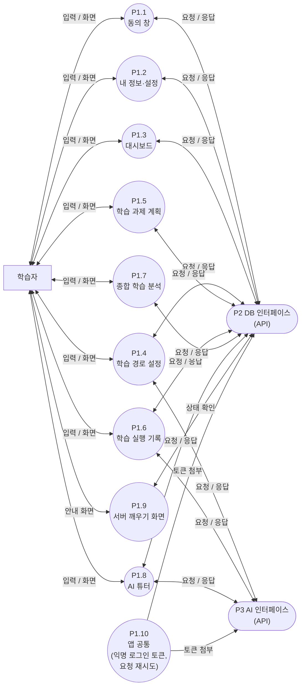

화면이 부르는 API(번호는 4-6 표):
| 화면 | 부르는 API (번호) |
|---|---|
| P1.1 동의 창 | P2.1 |
| P1.2 내 정보·설정 | P2.2, P2.4, P2.27 |
| P1.3 대시보드 | P2.11, P2.20 |
| P1.4 학습 경로 설정 | P2.6, P2.10, P3.1, P3.2, P3.3 |
| P1.5 학습 과제 계획 | P2.8, P2.9, P2.10, P2.11 |
| P1.6 학습 실행 기록 | P2.2, P2.3, P2.7, P2.10, P2.12, P2.13, P2.14, P2.15, P2.16, P2.17, P2.18, P2.19, P2.22, P3.4 |
| P1.7 종합 학습 분석 | P2.21 |
| P1.8 AI 튜터 | P2.23, P2.24, P2.25, P2.26, P3.5 |
| P1.9 서버 깨우기 화면 | P2.5 |
| P1.10 앱 공통 | P2.2 |

(관리자 화면 3개는 P4 안에 있다. `lib/api.ts` 의 요청 재시도와 Firebase 익명 로그인 토큰 발급은 P1.10 앱 공통이 맡는다.)

### 4-2. P2 백엔드(DB 인터페이스): API 단위
아래 그림의 `[P1 화면]` 사각형은 요청을 보내는 상대(P1 의 화면)다. 저장소는 물리 컬렉션 이름과 괄호 안 논리 저장소 이름으로 표시한다.

#### 4-2-1. 계정·동의 (P2.1~P2.5)
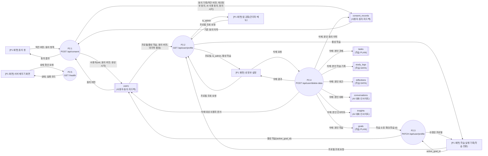

#### 4-2-2. 학습 계획 확정 (P2.6)
계획 초안(P3.3)은 저장하지 않고, 사용자가 확정할 때 이 프로세스가 `goals` 와 `tasks` 를 한 번에 저장한다(서버가 일정을 다시 계산).
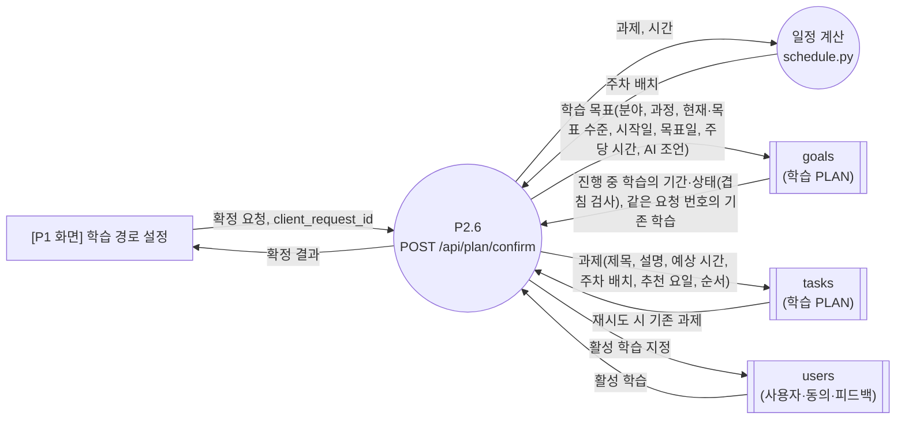

#### 4-2-3. 목표·과제 조회와 과제 상태 (P2.7~P2.11)
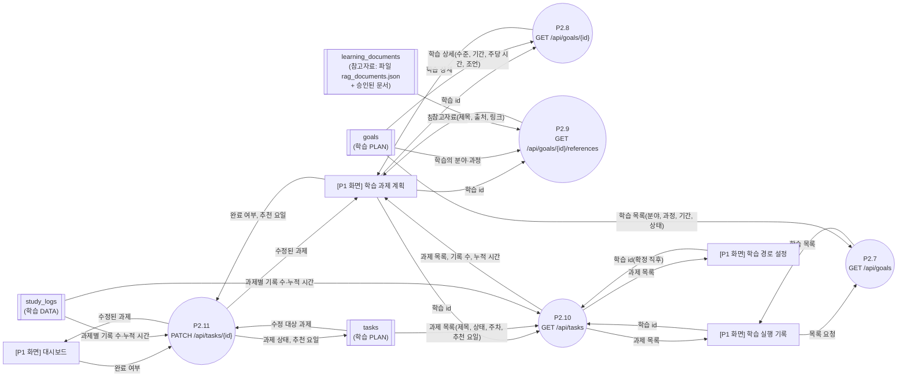

#### 4-2-4. 학습 실행 기록·타이머 (P2.12~P2.19)
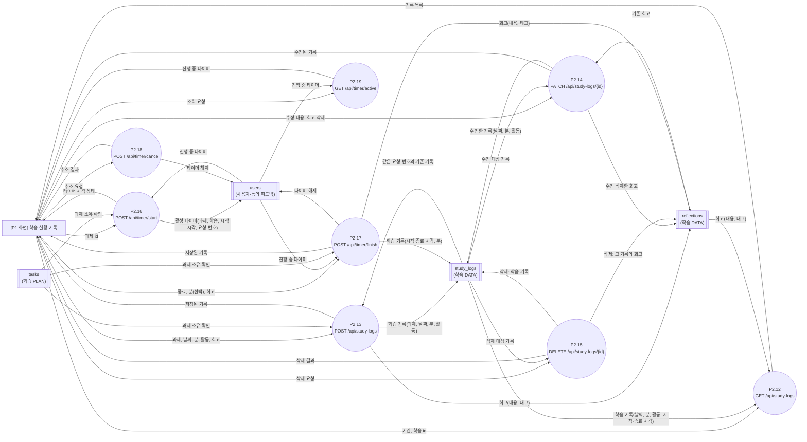

#### 4-2-5. 대시보드·분석·저장된 인사이트 조회 (P2.20~P2.22)
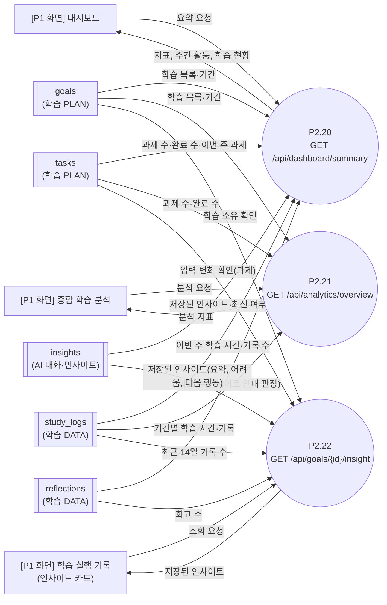

#### 4-2-6. 대화 목록·생성·조회, 학습 요약 (P2.23~P2.26)
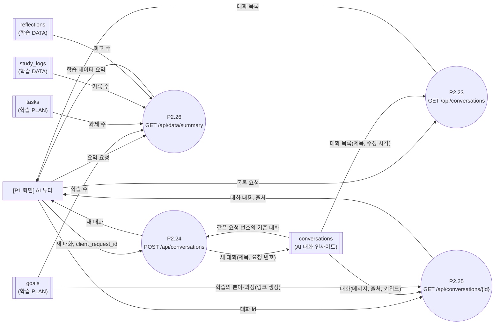

#### 4-2-7. 피드백 접수 (P2.27)
`feedback` 은 user_id 를 저장하지 않는다(삭제 요청 P2.4 로 지워지지 않음).
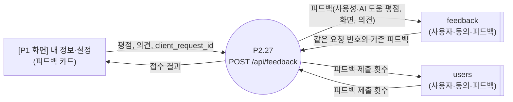

화면이 호출하지 않는 API 5개(P2.28~P2.32: `POST·PATCH·DELETE /api/goals`, `POST·DELETE /api/tasks`)는 서버에만 있고 그림에서 제외했다(표 4-6). 화면에서 목표·과제를 만드는 것은 P2.6 이 맡는다.

### 4-3. P3 백엔드(AI 인터페이스): API 단위
P3 는 필요한 학습 데이터를 저장소에서 **직접 읽고**, 결과(대화·인사이트)를 직접 쓴다. `AI 호출`은 내부 처리이고 OpenAI 키는 서버에만 있다.

#### 4-3-1. 직무·과정·계획 생성 (P3.1~P3.3)
초안은 저장하지 않는다. `schedule.py`(일정 계산)는 P2.6(확정)과 함께 쓰는 공통 계산이다.
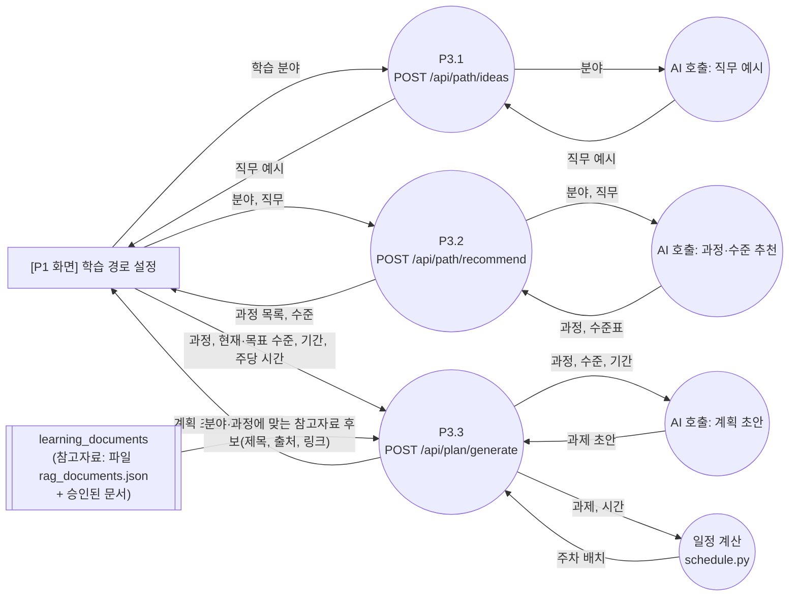

#### 4-3-2. 인사이트 생성 (P3.4)
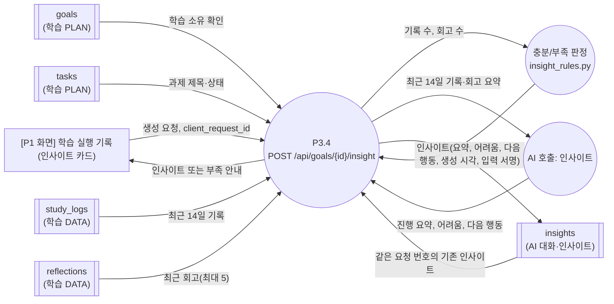

#### 4-3-3. 튜터 답변 (P3.5)
튜터는 검토된 자료만 근거로 쓰고, 출처가 없으면 근거가 있는 것처럼 표시하지 않는다.
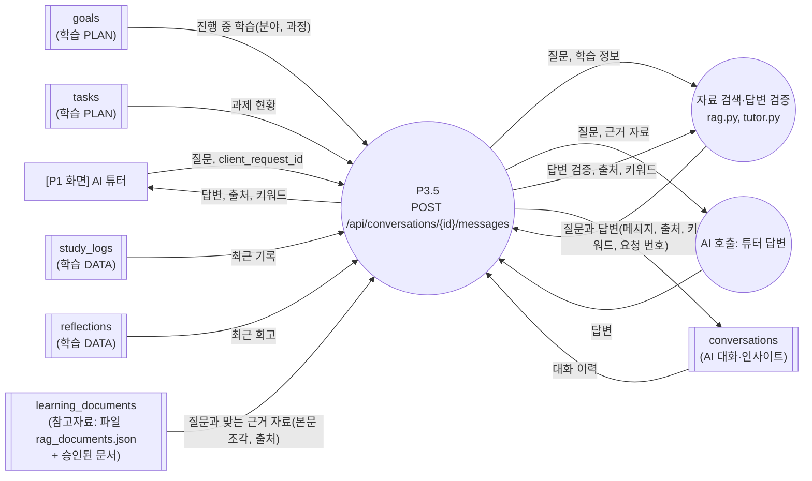

### 4-4. P4 관리자 모듈(프론트+백엔드+수집용 AI)
관리자 API 는 모두 `ADMIN_UIDS` 확인을 먼저 한다(허용 목록 밖은 403).

#### 4-4-1. 참고자료 수집·승인 (P4.1, P4.4~P4.10, P4.15~P4.17)
수집기는 후보 링크만 만들고, 링크 검사·메타데이터 읽기·분류 제안·후보 저장은 모든 수집기가 같은 절차를 지난다. 승인한 자료만 `learning_documents` 에 들어가고, 사용자 화면에 보이는 것은 읽기 스위치(`RESOURCE_READ_SOURCE`, 기본 `file`)에 달려 있다.
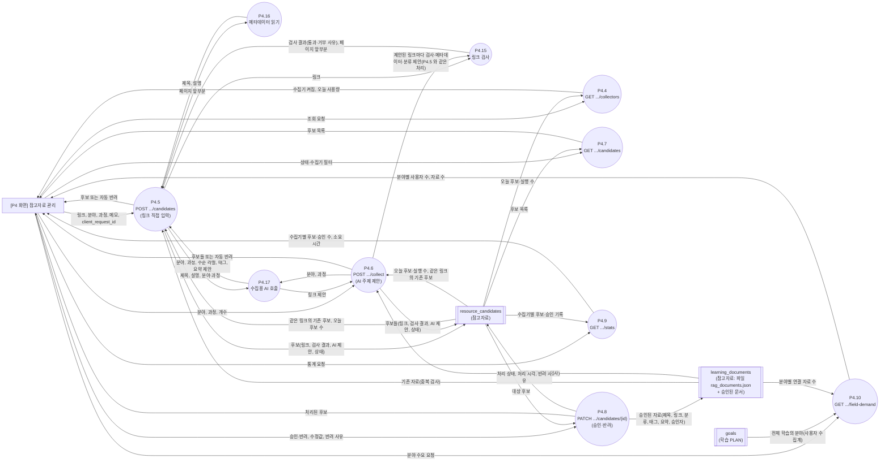

#### 4-4-2. 사용자 관리·사용자 피드백 (P4.2, P4.3, P4.11~P4.14)
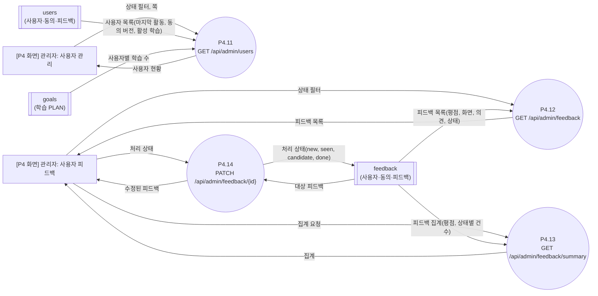

### 4-5. 읽는 법
- **모든 프로세스(P2~P4)는 먼저 토큰 검증을 통과**한다. 개인 데이터 API 는 동의한 UID 만 쓴다(그림 생략).
- 화면 하나가 여러 API 를 부른다. 예: 학습 실행 기록 화면(P1.6)은 학습 전환, 과제 조회, 기록·타이머, 인사이트 조회·생성을 모두 부른다(4-1 표).
- P3.3 의 초안은 저장하지 않고, 확정(P2.6)에서 저장한다.

### 4-6. 전체 프로세스 목록
#### P2·P3 (API)
| 번호 | 영역 | API | 호출하는 화면 | AI 호출 | 읽고 쓰는 저장소(물리) |
|---|---|---|---|---|---|
| P2.1 | P2 DB | POST /api/consent | 동의 창 | - | users, consent_records (쓰기) |
| P2.2 | P2 DB | GET /api/user/profile | 내 정보·설정, 앱 공통(관리자 메뉴 표시), 학습 실행 기록(학습 전환) | - | users (읽기) |
| P2.3 | P2 DB | PATCH /api/user/profile | 학습 실행 기록(학습 전환) | - | users (쓰기) |
| P2.4 | P2 DB | POST /api/user/delete-data | 내 정보·설정 | - | users, consent_records, goals, tasks, study_logs, reflections, conversations, insights (삭제) |
| P2.5 | P2 DB | GET /health | 서버 깨우기 화면 | - | 없음 |
| P2.6 | P2 DB | POST /api/plan/confirm | 학습 경로 설정 | - | goals(겹침 검사 읽기, 쓰기), tasks(쓰기), users(활성 학습) |
| P2.7 | P2 DB | GET /api/goals | 학습 실행 기록(학습 전환) | - | goals |
| P2.8 | P2 DB | GET /api/goals/{id} | 학습 과제 계획 | - | goals |
| P2.9 | P2 DB | GET /api/goals/{id}/references | 학습 과제 계획 | - | goals, 학습 자료(읽기) |
| P2.10 | P2 DB | GET /api/tasks | 학습 과제 계획, 학습 실행 기록, 학습 경로 설정 | - | tasks, study_logs(누적) |
| P2.11 | P2 DB | PATCH /api/tasks/{id} | 대시보드, 학습 과제 계획 | - | tasks (쓰기) |
| P2.12 | P2 DB | GET /api/study-logs | 학습 실행 기록 | - | study_logs, reflections |
| P2.13 | P2 DB | POST /api/study-logs | 학습 실행 기록 | - | study_logs, reflections |
| P2.14 | P2 DB | PATCH /api/study-logs/{id} | 학습 실행 기록 | - | study_logs, reflections |
| P2.15 | P2 DB | DELETE /api/study-logs/{id} | 학습 실행 기록 | - | study_logs, reflections |
| P2.16 | P2 DB | POST /api/timer/start | 학습 실행 기록 | - | users (active_timer) |
| P2.17 | P2 DB | POST /api/timer/finish | 학습 실행 기록 | - | users, study_logs |
| P2.18 | P2 DB | POST /api/timer/cancel | 학습 실행 기록 | - | users |
| P2.19 | P2 DB | GET /api/timer/active | 학습 실행 기록 | - | users |
| P2.20 | P2 DB | GET /api/dashboard/summary | 대시보드 | - | goals, tasks, study_logs, insights |
| P2.21 | P2 DB | GET /api/analytics/overview | 종합 학습 분석 | - | goals, tasks, study_logs |
| P2.22 | P2 DB | GET /api/goals/{id}/insight | 학습 실행 기록(인사이트 카드) | - | insights |
| P2.23 | P2 DB | GET /api/conversations | AI 튜터 | - | conversations |
| P2.24 | P2 DB | POST /api/conversations | AI 튜터 | - | conversations |
| P2.25 | P2 DB | GET /api/conversations/{id} | AI 튜터 | - | conversations |
| P2.26 | P2 DB | GET /api/data/summary | AI 튜터 | - | goals, tasks, study_logs |
| P2.27 | P2 DB | POST /api/feedback | 내 정보·설정 | - | feedback, users(횟수) |
| P3.1 | P3 AI | POST /api/path/ideas | 학습 경로 설정 | 직무 예시 | 없음(저장 안 함) |
| P3.2 | P3 AI | POST /api/path/recommend | 학습 경로 설정 | 과정·수준 추천 | 없음 |
| P3.3 | P3 AI | POST /api/plan/generate | 학습 경로 설정 | 계획 초안 | learning_documents (참고자료 후보 읽기) |
| P3.4 | P3 AI | POST /api/goals/{id}/insight | 학습 실행 기록(인사이트 카드) | 인사이트 | tasks, study_logs, reflections (읽기), insights (쓰기) |
| P3.5 | P3 AI | POST /api/conversations/{id}/messages | AI 튜터 | 튜터 답변 | conversations, goals, 학습 자료(읽기) |
| P2.28 | P2 DB | POST /api/goals | (화면 없음, 서버에만 있음) | - | goals, tasks |
| P2.29 | P2 DB | PATCH /api/goals/{id} | (화면 없음, 서버에만 있음) | - | goals, tasks |
| P2.30 | P2 DB | DELETE /api/goals/{id} | (화면 없음, 서버에만 있음) | - | goals, tasks |
| P2.31 | P2 DB | POST /api/tasks | (화면 없음, 서버에만 있음) | - | goals, tasks |
| P2.32 | P2 DB | DELETE /api/tasks/{id} | (화면 없음, 서버에만 있음) | - | goals, tasks |

#### P4 관리자 모듈
| 번호 | 종류 | API | 화면 | AI 호출 | 읽고 쓰는 저장소(물리) |
|---|---|---|---|---|---|
| P4.1 | 프론트 화면 | (화면) | 참고자료 관리 | - | - |
| P4.2 | 프론트 화면 | (화면) | 관리자: 사용자 관리 | - | - |
| P4.3 | 프론트 화면 | (화면) | 관리자: 사용자 피드백 | - | - |
| P4.4 | 백엔드 API | GET /api/admin/resources/collectors | 참고자료 관리 | - | resource_candidates(오늘 후보·실행 수 읽기) |
| P4.5 | 백엔드 API | POST /api/admin/resources/candidates | 참고자료 관리 | 수집용 AI(분류·요약 제안) | resource_candidates(읽기·쓰기), learning_documents(중복 검사 읽기) |
| P4.6 | 백엔드 API | POST /api/admin/resources/collect | 참고자료 관리 | 수집용 AI(링크 제안, 분류·요약 제안) | resource_candidates(읽기·쓰기), learning_documents(중복 검사 읽기) |
| P4.7 | 백엔드 API | GET /api/admin/resources/candidates | 참고자료 관리 | - | resource_candidates(읽기) |
| P4.8 | 백엔드 API | PATCH /api/admin/resources/candidates/{id} | 참고자료 관리 | - | resource_candidates(읽기·쓰기), learning_documents(승인 시 쓰기) |
| P4.9 | 백엔드 API | GET /api/admin/resources/stats | 참고자료 관리 | - | resource_candidates(읽기) |
| P4.10 | 백엔드 API | GET /api/admin/resources/field-demand | 참고자료 관리 | - | goals(읽기), learning_documents(읽기), 기본 꺼짐 |
| P4.11 | 백엔드 API | GET /api/admin/users | 관리자: 사용자 관리 | - | users |
| P4.12 | 백엔드 API | GET /api/admin/feedback | 관리자: 사용자 피드백 | - | feedback |
| P4.13 | 백엔드 API | GET /api/admin/feedback/summary | 관리자: 사용자 피드백 | - | feedback |
| P4.14 | 백엔드 API | PATCH /api/admin/feedback/{id} | 관리자: 사용자 피드백 | - | feedback (쓰기) |
| P4.15 | 내부 처리 | 링크 검사(https, 허용 도메인, 사설 주소 차단, 시간·크기 제한, 리다이렉트 재검사, 중복) | - | - | 외부 공개 페이지(허용 도메인만) 읽기, learning_documents·resource_candidates(중복 검사) |
| P4.16 | 내부 처리 | 메타데이터 읽기(제목·설명만) | - | - | - |
| P4.17 | 내부 처리 | 수집용 AI 호출(링크 제안, 분류·요약 제안) | - | 수집용 AI | - |

## 5. 확인 수준 (사용자 검증 전)
| 구분 | 내용 |
|---|---|
| 코드로 확인함 | API 47개(+`/health`)와 영역 배정(각 API 는 정확히 한 영역), AI API 5개가 쓰는 컬렉션은 `conversations`, `insights` 뿐, 저장소 읽기·쓰기(옛 레벨 2 의 AST 분석, 2026-10-25 기준) |
| 사람이 정리함 | 화살표의 정보 이름(ERD 필드와 요청·응답 DTO 이름), 논리 저장소 묶음, P4 참고자료 수집 그림(`resource_*.py` 등을 읽고 정리) |
| **미확인** | 옛 레벨 2 이후(2026-10-25 이후) 코드 변경이 저장소 읽기·쓰기를 바꾸었는지의 전수 재확인, P4 참고자료 API 별 컬렉션 읽기·쓰기의 정적 분석 확인, `learning_documents` 읽기가 읽기 스위치에 따라 승인 문서를 합치는 점의 모든 API 반영 |

## 6. 구판과의 관계
- `docs/architecture_dfd.md` 의 §3(옛 DFD: 화면 터미널 + API 그룹 7개)은 **구판**이다. 구성도(§1), 백엔드 모듈 구조(§2), 인증 흐름(§4), 계획 생성 흐름(§5), 저장소 정리(§6), 보안 경계(§7)는 그대로 유효하다.
- 옛 번호와의 대응: 옛 P1.1~1.5 → P2.1~2.5, 옛 P2.1~2.3 → P3.1~3.3, 옛 P2.4 → P2.6, 옛 P3.* → P2.7~2.11, 옛 P4.* → P2.12~2.19, 옛 P5.1~5.3 → P2.20~2.22, 옛 P5.4 → P3.4, 옛 P6.1~6.3 → P2.23~2.25, 옛 P6.4 → P3.5, 옛 P6.5 → P2.26, 옛 P7.1 → P2.27, 옛 P7.2~7.5 → P4.11~4.14.
- 도면 변경 이력은 `docs/change_management.md` CR-010.
