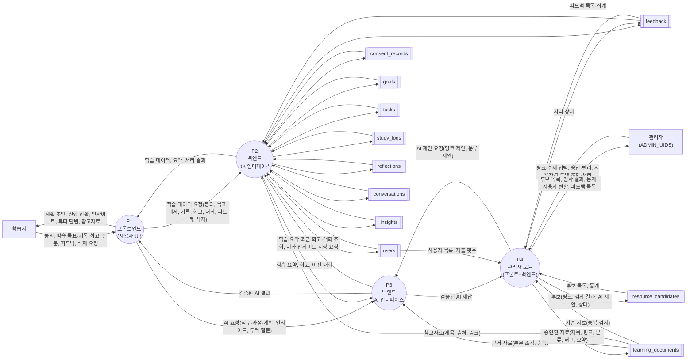

# DFD 레벨 1 초안: 모듈 4개 구분 (CR-010, 사용자 제안 2026-10-27)

작성: 검증/PM, 2026-10-27. 상태: **초안(사용자 확인 대기). `docs/architecture_dfd.md` 는 아직 고치지 않았다.** 확인되면 그 문서의 3-2 이하를 이 구조로 다시 쓴다.

## 1. 제안과 이유 (사용자)
- 레벨 1 프로세스를 **① 프론트엔드(사용자 UI) ② 백엔드(DB 인터페이스) ③ 백엔드(AI 인터페이스) ④ 관리자(참고자료 수집·관리, 프론트+백엔드)** 로 둔다.
- 이유: 메뉴 기능 그룹으로 프로세스를 만들면 각 그룹 안에 프론트와 백엔드가 함께 들어가 **데이터 흐름이 겹친다**. 프론트와 백엔드를 상위 레벨에서 나누면 모듈이 단순해진다. 관리자와 AI 는 독립성이 높아 별도 프로세스가 자연스럽고, 기술 역할 구분(팀 영역, 서비스기획서 9.1)과도 일치한다.

PM 의견: 동의한다. 이전에 반대한 이유는 우리 DFD 범례(10-25)가 "화면 = 터미널"이라 프론트를 프로세스로 둘 수 없었기 때문이다. 범례를 아래 2 와 같이 바꾸면 모순이 없다. 겹침은 실제로 줄어든다(현재 레벨 1 은 화면 10개 × 그룹 7개의 흐름이 얽히지만, 새 구조는 프론트↔DB, 프론트↔AI, 관리자↔AI 가 흐름 이름 한 줄씩이다).

## 2. 범례 변경 (사용자 승인 필요)
| 항목 | 지금(10-25) | 제안 |
|---|---|---|
| 레벨 1 터미널 | 입출력 **화면**(사각형) | **학습자, 관리자**(레벨 0 과 같음) |
| 화면 | 터미널 | **프론트 프로세스(P1)의 내부**. 레벨 2 에서 P1 을 화면 단위로 푼다 |
| 프로세스(원) | API 그룹 7개 → API 함수 | **모듈 4개** → 레벨 2 는 모듈 안의 기능(API 함수·화면) |
| 저장소(띠) | 프로세스와만 연결 | 같음 |
| OpenAI, Firebase | 내부 호출 | 같음(AI 호출은 P3 안의 내부 처리, Firebase 토큰 검증은 모든 프로세스 앞에서 생략) |
| 외부 웹 페이지(링크 검사) | (없음) | P4 안의 내부 처리로 본다(터미널로 그리지 않음) |

## 3. 레벨 1 초안

저장소 화살표의 정보 이름(편집·참조 항목)은 레벨 2 에서 쓴다(지금 문서의 3-3 방식). 이 초안에서는 저장소 흐름의 **방향**만 보인다.

읽는 법
- **P1 은 저장소와 직접 만나지 않는다.** 모든 데이터는 P2(DB) 또는 P3(AI)를 거친다(코드에서도 브라우저는 DB·AI 에 직접 가지 않는다).
- **P3(AI)는 대화·인사이트 저장과 학습 요약 조회를 P2 에 맡긴다**(담당 구분 기준의 논리 구조). 실제 코드는 AI API 함수가 같은 `main.py` 안에서 저장소를 직접 부르므로 **코드 구조와 약간 다르다.** 도면은 담당 영역 기준으로 그리고 이 차이를 3-3 에 주석으로 남긴다.
- **P4(관리자)는 AI 를 P3 를 통해** 쓴다(AI 호출은 한 곳 `ai_client`).
- 기존 도면에는 **`resource_candidates` 저장소와 참고자료 관리 API 7개가 없다**(Phase 8B 이전 기준). 이 초안에서 처음 넣었다.

## 4. API 배정표 (코드 `backend/main.py` 의 라우트 47개를 추출해 영역 배정, `GET /health` 는 별도)
각 API 는 정확히 한 영역에 속한다(중복 없음).

| 새 번호(안) | 영역 | API |
|---|---|---|
| P2 | DB 인터페이스 (31개 + health) | `POST /api/consent`, `GET·PATCH /api/user/profile`, `POST /api/user/delete-data`, `GET /health`, `POST /api/plan/confirm`, `GET·POST /api/goals`, `GET·PATCH·DELETE /api/goals/{id}`, `GET /api/goals/{id}/references`, `GET·POST /api/tasks`, `PATCH·DELETE /api/tasks/{id}`, `GET·POST /api/study-logs`, `PATCH·DELETE /api/study-logs/{id}`, `POST /api/timer/start·finish·cancel`, `GET /api/timer/active`, `GET /api/data/summary`, `GET /api/dashboard/summary`, `GET /api/analytics/overview`, `GET·POST /api/conversations`, `GET /api/conversations/{id}`, `GET /api/goals/{id}/insight`, `POST /api/feedback` |
| P3 | AI 인터페이스 (5개) | `POST /api/path/ideas`, `POST /api/path/recommend`, `POST /api/plan/generate`, `POST /api/goals/{id}/insight`, `POST /api/conversations/{id}/messages` |
| P4 | 관리자 (11개) | 참고자료: `GET /api/admin/resources/collectors`, `POST·GET /api/admin/resources/candidates`, `PATCH /api/admin/resources/candidates/{id}`, `POST /api/admin/resources/collect`, `GET /api/admin/resources/stats`, `GET /api/admin/resources/field-demand` / 사용자·피드백: `GET /api/admin/users`, `GET /api/admin/feedback`, `GET /api/admin/feedback/summary`, `PATCH /api/admin/feedback/{id}` |
| P1 | 프론트엔드 | API 없음. 사용자 화면(동의 창, 내 정보·설정, 대시보드, 학습 경로 설정, 학습 과제 계획, 학습 실행 기록, 종합 학습 분석, AI 튜터, 서버 깨우기 화면)과 `lib/api.ts`(요청 재시도), 익명 로그인(Firebase 토큰) |

경계에서 정해야 할 것(서비스기획서 9.2 와 같음): 튜터·인사이트처럼 AI 와 데이터에 걸치는 API 는 **AI 영역이 소유**하고 DB 영역이 제공하는 조회 함수를 쓴다.

## 5. 레벨 2 계획 (승인 후)
- P1 = 화면 9개를 프로세스로(`P1.1` 동의 창 … `P1.9` 서버 깨우기 화면). 화면마다 어느 API(P2·P3)를 부르는지가 흐름이 된다(지금 3-3 표의 "호출하는 화면" 열을 뒤집은 것).
- P2 = 위 31개 API 를 기능 묶음(계정·동의, 목표·과제, 기록·타이머, 요약·분석, 대화·피드백)별 그림으로. **기존 3-3-2~3-3-8 의 API 단위 그림과 저장소 정보 이름을 재사용**한다(번호만 바꿈).
- P3 = 5개 API + 내부 처리 `AI 호출(용도별)`, `출력 검증`, `자료 검색(RAG)`, `주차 배치`.
- P4 = 11개 API + 내부 처리 `링크 검사`, `메타데이터 읽기`, `AI 제안 요청`, 후보 상태 관리. 신규(8B) 저장소 `resource_candidates` 포함.

## 6. 사용자 확인 필요
1. 범례 변경(2)에 동의하는지(레벨 1 터미널은 학습자·관리자, 화면은 P1 내부).
2. P3 가 대화·인사이트 저장을 **P2 에 위임하는 논리 구조**로 그리는 것(코드와 약간 다름, 주석으로 명시).
3. 관리자 영역 P4 에 사용자 관리·피드백 화면을 포함(서비스기획서 9.1 과 같은 가정).
4. 번호: P1 프론트, P2 DB, P3 AI, P4 관리자로 한다(영역 번호와 같음).
