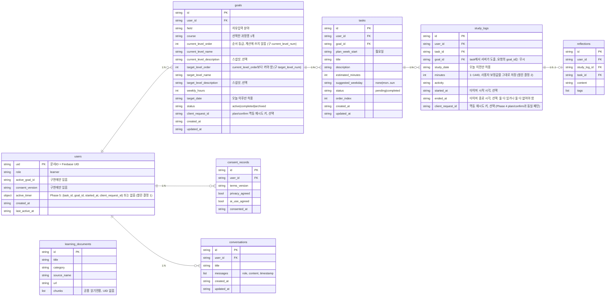

# PaceMate 현재 데이터 설계 ERD (검증팀 정리본)

**기준:** `backend/store.py`, `backend/schemas.py`, `docs/phase1_design.md`, `PRD.md` §6
**목적:** Phase 3 시점 구현과 설계의 데이터 구조를 한 장으로 맞춰 공통 기준으로 삼는다.
**주의:** 기존 설계 문서는 수정하지 않았다. 이 문서는 검증용 참고본이며, 아래 "합의 필요 사항"이 확정되면 설계 문서에 반영한다.

## 1. ERD

`learning_documents`는 공용 읽기 전용이며 다른 엔티티와 관계선이 없다. (설계 ERD의 `learning_documents → tasks` 관계는 구현에 없다.)

## 2. 공통 규칙

- 사용자 소유 문서는 모두 `user_id`를 가지며, 값은 토큰에서 검증된 UID만 사용한다.
- 삭제 전파: 목표 삭제 → 과제·기록·회고 삭제, 과제 삭제 → 기록·회고 삭제, 기록 삭제는 과제에 전파하지 않는다.
- 사용자 데이터 삭제 요청 시 `goals`, `tasks`, `study_logs`, `reflections`, `conversations`, `consent_records`, `users/{uid}`를 삭제한다.
- 과정 목록과 과정별 수준표(AI 제안)는 저장하지 않는 임시 데이터이며, 사용자가 확정한 결과만 `goals`에 저장된다.

## 3. 합의 사항 (Phase 3 검증 결과 반영, docs/phase3_review_instructions.md)

| # | 항목 | 이전 상태 | 결정 및 반영 |
|---|---|---|---|
| 1 | 과정·수준표 저장 | `goals`에 선택한 과정명·수준 번호/이름만 저장, 응답은 평면 `levels[]` | **결정:** 수준표는 여전히 임시 데이터로 유지(별도 테이블 저장 안 함). `PathRecommendationResponse.courses[].levels[]`로 과정별 수준 체계를 갖도록 스키마 변경 완료 (`backend/schemas.py`) |
| 2 | 타이머 시각 | `study_logs`에 `study_date`, `minutes`만 있음 | **결정:** `started_at`, `ended_at`을 선택 필드로 스키마에 추가 완료. 실제 타이머 상태 머신·검증 로직은 Phase 5에서 구현 (`studied_at`은 `study_date`와 중복이라 추가하지 않음) |
| 3 | 목표당 과정 수 | `goals.course`는 단일 문자열, 플랜 요청 `selected_courses`는 목록 | **결정:** 1목표 1과정으로 통일. `PlanGenerateRequest.selected_courses`(목록) → `course`(단일 문자열)로 변경, `goal_id`를 추가해 사전 생성된 목표에 연결 |
| 4 | 필드명 기준 | PRD §6은 `domain`, `due_date`, `selected_process`, `text` | **결정:** 구현 이름(`field`, `target_date`, `course`, `content`)을 기준으로 유지한다. Phase 1에서 이미 합의·테스트된 DTO를 바꾸는 비용이 더 크다고 판단. PRD §6 쪽을 구현 이름에 맞춰 갱신 필요(문서 작업, 코드 변경 아님) |
| 5 | `users` 필드 | 구현에 `active_goal_id`, `consent_version` 존재, 설계 ERD에는 없음 | **반영 완료(Phase 4 착수 전 정리):** `docs/phase1_design.md` 설계 ERD의 `users`에 두 필드 추가. `goals`/`study_logs` 블록도 `*_level_order`, 수준 설명 스냅샷, `started_at`/`ended_at`으로 함께 갱신 |
| 6 | 수준 범위 | `level`은 1~5 고정, 목표는 현재와 같은 수준도 허용 | **결정:** 단계 수 고정(5단계) 폐지, `ge=1, le=20`의 안전 상한만 유지(분야마다 단계 수가 다를 수 있음). 목표 수준은 현재 수준보다 **높아야만** 허용(동일 수준도 거부)하도록 변경. `LevelItem.level` → `order`, `*_num` → `*_order`로 이름도 변경(점수처럼 읽히는 문제 해결) |

**검증:** `backend/tests` 53건 통과(Phase 3 리뷰 반영분 19건 신규), 프론트 `npm run typecheck` / `npm run build` 통과.

## 4. Phase 5 결정 사항 (docs/phase5_dev_prompt.md 열린 결정 1~7)

상세 근거는 `docs/phase5_report.md` §5 참고. 요약:

| # | 항목 | 결정 |
|---|---|---|
| 1 | 활성 타이머 저장 위치 | `users.active_timer` 필드(별도 컬렉션 아님). 일시정지(paused)는 구현하지 않음 — 시작/종료/취소만 |
| 2 | minutes vs started_at/ended_at | `minutes`는 사용자 입력을 그대로 저장(자동 계산으로 덮어쓰지 않음). 타이머 종료(`/api/timer/finish`)는 사용자가 분을 직접 넘기지 않으면 서버가 경과 시간으로 자동 계산 |
| 3 | 기록 저장이 과제 자동 완료시키는지 | 아니오 — `status`는 `PATCH /api/tasks/{id}`로 사용자가 직접 토글 |
| 4 | 회고 단독 삭제 | `StudyLogUpdateRequest.delete_reflection: bool` 전용 플래그 (reflection=null은 `_changes()`의 exclude_none 때문에 구분 불가) |
| 5 | 과제별 누적 시간 제공 위치 | `GET /api/tasks` 응답에 `record_count`/`total_minutes` 추가(요청마다 계산, 별도 저장 안 함). 별도 집계 엔드포인트는 만들지 않음 |
| 6 | 인사이트 충분/부족 기준 | 기록 3건 이상 **그리고** 회고 1건 이상이면 "충분"(Phase 6 안내), 아니면 "부족" 안내 |
| 7 | 동일 과제·같은 날 기록 중복 | 허용(제한 없음) — 하루를 여러 세션으로 나눠 기록하는 사용을 막지 않기 위함 |
