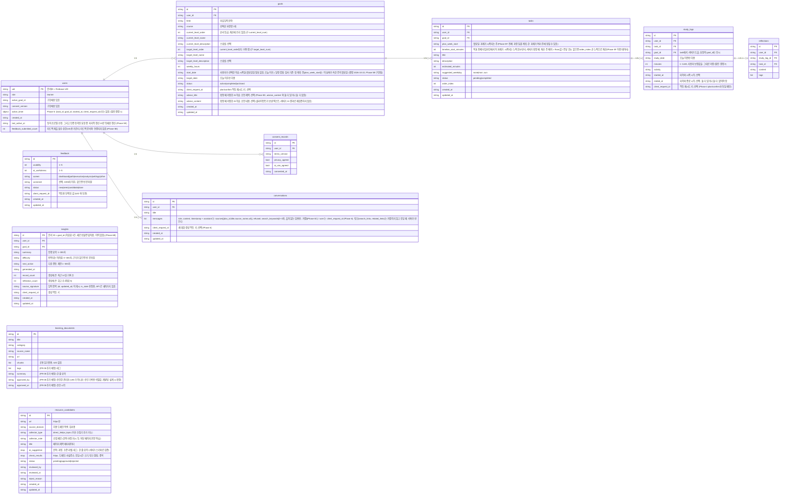

# PaceMate 현재 데이터 설계 ERD (검증팀 정리본)

**기준:** `backend/store.py`, `backend/schemas.py`, `docs/phase1_design.md`, `PRD.md` §6
**목적:** Phase 3 시점 구현과 설계의 데이터 구조를 한 장으로 맞춰 공통 기준으로 삼는다.
**관련:** 시스템 구성도, 모듈 구조, DFD, 인증·계획 흐름은 docs/architecture_dfd.md
**주의:** 기존 설계 문서는 수정하지 않았다. 이 문서는 검증용 참고본이며, 아래 "합의 필요 사항"이 확정되면 설계 문서에 반영한다.

## 1. ERD

`learning_documents`는 공용 읽기 전용이며 다른 엔티티와 관계선이 없다. (설계 ERD의 `learning_documents → tasks` 관계는 구현에 없다.)
`resource_candidates`(FR-08)도 UID 를 갖지 않고 다른 엔티티와 관계선이 없다. 승인되면 내용이 `learning_documents` 의 한 건으로 반영되고, 후보 문서에는 상태와 처리 기록이 남는다.

## 2. 공통 규칙

- 사용자 소유 문서는 모두 `user_id`를 가지며, 값은 토큰에서 검증된 UID만 사용한다.
- 삭제 전파: 목표 삭제 → 과제·기록·회고 삭제, 과제 삭제 → 기록·회고 삭제, 기록 삭제는 과제에 전파하지 않는다.
- 사용자 데이터 삭제 요청 시 `goals`, `tasks`, `study_logs`, `reflections`, `conversations`, `consent_records`, `users/{uid}`를 삭제한다.
- 과정 목록과 과정별 수준표(AI 제안)는 저장하지 않는 임시 데이터이며, 사용자가 확정한 결과만 `goals`에 저장된다.

## 3. 합의 사항 (Phase 3 검증 결과 반영, docs/phase3_review_instructions.md)

| # | 항목 | 이전 상태 | 결정 및 반영 |
|---|---|---|---|
| 1 | 과정·수준표 저장 | `goals`에 선택한 과정명·수준 번호/이름만 저장, 응답은 평면 `levels[]` | **결정:** 수준표는 여전히 임시 데이터로 유지(별도 테이블 저장 안 함). `PathRecommendationResponse.courses[].levels[]`로 과정별 수준 체계를 갖도록 스키마 변경 완료 (`backend/schemas.py`) |
| 2 | 타이머 시각 | `study_logs`에 `study_date`, `minutes`만 있음 | **결정:** `started_at`, `ended_at`을 선택 필드로 스키마에 추가 완료. 실제 타이머 상태 머신·검증 로직은 Phase 5에서 구현 (`studied_at`은 `study_date`와 중복이라 추가하지 않음) |
| 3 | 목표당 과정 수 | `goals.course`는 단일 문자열, 플랜 요청 `selected_courses`는 목록 | **결정:** 1목표 1과정으로 통일. `PlanGenerateRequest.selected_courses`(목록) → `course`(단일 문자열)로 변경, `goal_id`를 추가해 사전 생성된 목표에 연결 |
| 4 | 필드명 기준 | PRD §6은 `domain`, `due_date`, `selected_process`, `text` | **결정:** 구현 이름(`field`, `target_date`, `course`, `content`)을 기준으로 유지한다. Phase 1에서 이미 합의·테스트된 DTO를 바꾸는 비용이 더 크다고 판단. PRD §6 쪽을 구현 이름에 맞춰 갱신 필요(문서 작업, 코드 변경 아님) |
| 5 | `users` 필드 | 구현에 `active_goal_id`, `consent_version` 존재, 설계 ERD에는 없음 | **반영 완료(Phase 4 착수 전 정리):** `docs/phase1_design.md` 설계 ERD의 `users`에 두 필드 추가. `goals`/`study_logs` 블록도 `*_level_order`, 수준 설명 스냅샷, `started_at`/`ended_at`으로 함께 갱신 |
| 6 | 수준 범위 | `level`은 1~5 고정, 목표는 현재와 같은 수준도 허용 | **결정:** 단계 수 고정(5단계) 폐지, `ge=1, le=20`의 안전 상한만 유지(분야마다 단계 수가 다를 수 있음). 목표 수준은 현재 수준보다 **높아야만** 허용(동일 수준도 거부)하도록 변경. `LevelItem.level` → `order`, `*_num` → `*_order`로 이름도 변경(점수처럼 읽히는 문제 해결) |

**검증:** `backend/tests` 53건 통과(Phase 3 리뷰 반영분 19건 신규), 프론트 `npm run typecheck` / `npm run build` 통과.

## 4. Phase 5 결정 사항 (docs/phase5_dev_prompt.md 열린 결정 1~7)

상세 근거는 `docs/phase5_report.md` §5 참고. 요약:

| # | 항목 | 결정 |
|---|---|---|
| 1 | 활성 타이머 저장 위치 | `users.active_timer` 필드(별도 컬렉션 아님). 일시정지(paused)는 구현하지 않음 — 시작/종료/취소만 |
| 2 | minutes vs started_at/ended_at | `minutes`는 사용자 입력을 그대로 저장(자동 계산으로 덮어쓰지 않음). 타이머 종료(`/api/timer/finish`)는 사용자가 분을 직접 넘기지 않으면 서버가 경과 시간으로 자동 계산 |
| 3 | 기록 저장이 과제 자동 완료시키는지 | 아니오 — `status`는 `PATCH /api/tasks/{id}`로 사용자가 직접 토글 |
| 4 | 회고 단독 삭제 | `StudyLogUpdateRequest.delete_reflection: bool` 전용 플래그 (reflection=null은 `_changes()`의 exclude_none 때문에 구분 불가) |
| 5 | 과제별 누적 시간 제공 위치 | `GET /api/tasks` 응답에 `record_count`/`total_minutes` 추가(요청마다 계산, 별도 저장 안 함). 별도 집계 엔드포인트는 만들지 않음 |
| 6 | 인사이트 충분/부족 기준 | 그 학습의 **최근 14일 기록 3건 이상 그리고 회고 1건 이상**이면 "충분", 아니면 "부족" 안내. Phase 6B 에서 실행 화면의 생성 규칙과 대시보드 안내가 같은 기준을 쓰도록 통일(기록 수는 전체 기간이 아니라 인사이트가 읽는 14일 창 기준). 부족하면 AI 를 호출하지 않고 저장하지 않는다 |
| 7 | 동일 과제·같은 날 기록 중복 | 허용(제한 없음) — 하루를 여러 세션으로 나눠 기록하는 사용을 막지 않기 위함 |

## 복수 학습 규칙 (결정 2026-10-22, docs/multi_goal_design.md)
- 사용자는 목표(goals)를 여러 개 가질 수 있다. 새 목표를 확정할 때 [start_date, target_date] 안의 어느 하루라도 status=active 인 기존 목표가 이미 2개 진행 중이면(즉 동시 학습이 2개를 초과하게 되면) 거부한다(409 GOAL_PERIOD_OVERLAP, details 에 max_concurrent=2, overlaps, conflict_from, conflict_to). 같은 날 동시에 2개까지는 허용한다(결정 2026-10-22 개정, docs/multi_goal_design.md §7). completed·archived 는 비교하지 않는다.
- 기존 학습의 일정 변경으로 생기는 겹침은 검사하지 않는다.
- `users.active_goal_id` 는 계획·실행 화면에서 보는 학습이며 학습 전환 드롭다운으로 바꾼다. 대시보드, 튜터, 자료함은 모든 active 목표를 대상으로 한다.

## 피드백·관리자 규칙 (결정 2026-10-22, docs/phase5e_design.md, Phase 5E 구현 예정)
- 신설 컬렉션 `feedback`: id, usability(1~5), ai_usefulness(1~5), screen(enum), comment(선택, 1000자 이하), status(new/seen/candidate/done), client_request_id(제출 멱등용 무작위 값), created_at, updated_at. **user_id 를 두지 않는다.** 따라서 USER_OWNED_COLLECTIONS 에 넣지 않으며 delete-data 로 지워지지 않는다.
- `users` 에 `feedback_submitted_count`(제출 횟수 상한용, 내용과 연결 없음)를 추가할 수 있다.
- 관리자: `users.role` 은 "learner" 그대로 두고, 관리자 판별은 환경변수 `ADMIN_UIDS`(쉼표 구분 UID 목록)로만 한다. `GET /api/user/profile` 응답에 `is_admin`(읽기 전용)을 추가한다.
- 약관 버전: `CURRENT_TERMS_VERSION` 을 `v1.1` 로 올렸다(동의 모달에 피드백 저장 안내 한 줄 추가). v1.0 으로 동의한 기존 사용자는 개인 데이터 API 에서 CONSENT_REQUIRED 를 받고 재동의하면 `users.consent_version` 이 v1.1 로 갱신되며 기존 데이터는 그대로 보인다(구현 확인: Phase 5E).
- 관리자 API 는 `/api/admin/*` 이며 허용 목록 밖은 403 ErrorResponse 다.

## 참고자료 수집·승인 규칙 (결정 2026-10-25, PRD FR-08, Phase 8B 구현 예정, docs/phase8b_design.md)
- **현재 구현 상태(검증된 사실):** 참고자료는 파일 `backend/data/rag_documents.json` 에서만 읽는다. `resource_candidates` 와 Firestore 의 `learning_documents` 는 아직 없다. 위 ERD 의 해당 필드는 **설계(추가 예정)** 이며 구현·검증 전이다.
- `resource_candidates`: 검토 대기·승인·반려 후보. **서비스 화면과 AI 답변에 노출하지 않는다.** UID 없음. `USER_OWNED_COLLECTIONS` 에 넣지 않으며 `delete-data` 로 지워지지 않는다.
- `learning_documents`(Firestore): 승인된 자료만 넣는다. **후보를 이 컬렉션에 넣지 않는다.** Firestore 보안 규칙이 이 컬렉션을 누구나 읽게 두기 때문이다(`firebase/firestore.rules`). `resource_candidates` 는 규칙의 "그 밖의 컬렉션"에 해당해 클라이언트 읽기도 막힌다.
- 읽기 경로는 환경변수 스위치로 정하며 **기본값은 파일**이다. 스위치를 바꾸기 전에는 사용자에게 보이는 자료가 달라지지 않는다.
- 분야별 집계(관리자 화면)는 저장하지 않고 요청마다 계산하는 읽기 전용 값이다(UID, 입력 원문 없음, 최소 사용자 수 미만 분야 숨김). 별도 컬렉션을 만들지 않는다.
- 후보에는 ERD 도형에 없는 보조 필드가 있다(설계 docs/phase8b_design.md §3-5, 구현 검증 docs/phase8b_verification.md): `description`(메타데이터 설명, 잘린 값), `approved_document_id`, `client_request_id`, `collector_run_id`(한 번의 수집 실행 묶음), `ai_status`(ok|failed|skipped|none), `admin_field`·`admin_course`(관리자가 준 분야·과정 힌트). 처리자(`reviewed_by`)와 승인자(`approved_by`)는 관리자 UID 가 아니라 문자열 `"admin"`/`"system"` 이다.
- 수집기는 후보 링크만 만들고 후보에 `collector_type` 을 기록한다. 새 수집기를 추가해도 컬렉션 구조는 바꾸지 않는다.
