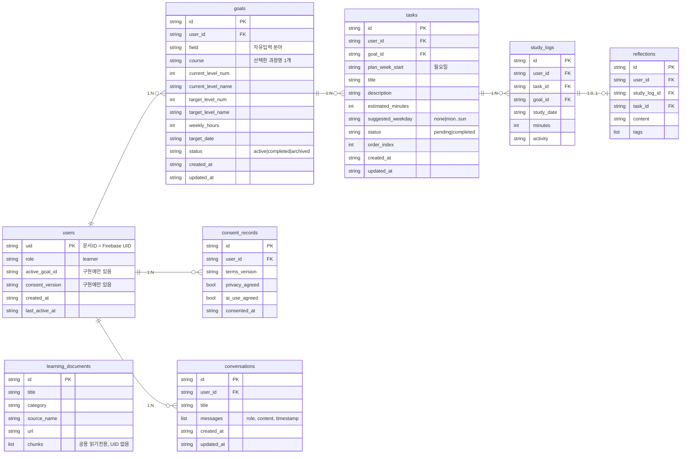

# PaceMate 현재 데이터 설계 ERD (검증팀 정리본)

**기준:** `backend/store.py`, `backend/schemas.py`, `docs/phase1_design.md`, `PRD.md` §6
**목적:** Phase 3 시점 구현과 설계의 데이터 구조를 한 장으로 맞춰 공통 기준으로 삼는다.
**주의:** 기존 설계 문서는 수정하지 않았다. 이 문서는 검증용 참고본이며, 아래 "합의 필요 사항"이 확정되면 설계 문서에 반영한다.

## 1. ERD

`learning_documents`는 공용 읽기 전용이며 다른 엔티티와 관계선이 없다. (설계 ERD의 `learning_documents → tasks` 관계는 구현에 없다.)

## 2. 공통 규칙

- 사용자 소유 문서는 모두 `user_id`를 가지며, 값은 토큰에서 검증된 UID만 사용한다.
- 삭제 전파: 목표 삭제 → 과제·기록·회고 삭제, 과제 삭제 → 기록·회고 삭제, 기록 삭제는 과제에 전파하지 않는다.
- 사용자 데이터 삭제 요청 시 `goals`, `tasks`, `study_logs`, `reflections`, `conversations`, `consent_records`, `users/{uid}`를 삭제한다.
- 과정 목록과 과정별 수준표(AI 제안)는 저장하지 않는 임시 데이터이며, 사용자가 확정한 결과만 `goals`에 저장된다.

## 3. 합의 필요 사항 (확정 전 공통 구현 금지)

| # | 항목 | 현재 상태 | 결정할 내용 |
|---|---|---|---|
| 1 | 과정·수준표 저장 | `goals`에 선택한 과정명·수준 번호/이름만 저장 | 임시 데이터로 유지할지, 확정 수준표를 `goals`에 보존할지. 응답 DTO는 `courses[].levels[]`(과정별)로 수정 필요 (검증 A-1) |
| 2 | 타이머 시각 | `study_logs`에 `study_date`, `minutes`만 있음 | PRD FR-03·§6은 `started_at`, `ended_at` 요구. 필드 추가 여부 (Phase 5 전 확정) |
| 3 | 목표당 과정 수 | `goals.course`는 단일 문자열, 플랜 요청 `selected_courses`는 목록 | 1목표 1과정으로 통일할지, 다중 과정으로 확장할지 |
| 4 | 필드명 기준 | PRD §6은 `domain`, `due_date`, `selected_process`, `text` | 구현 이름(`field`, `target_date`, `course`, `content`)을 기준으로 PRD를 맞출지 |
| 5 | `users` 필드 | 구현에 `active_goal_id`, `consent_version` 존재, 설계 ERD에는 없음 | 설계 ERD에 반영 |
| 6 | 수준 범위 | `level`은 1~5 고정, 목표는 현재와 같은 수준도 허용 | 5단계 고정 여부, 목표는 현재보다 뒤 수준만 허용 (PRD FR-02, 검증 A-2) |
