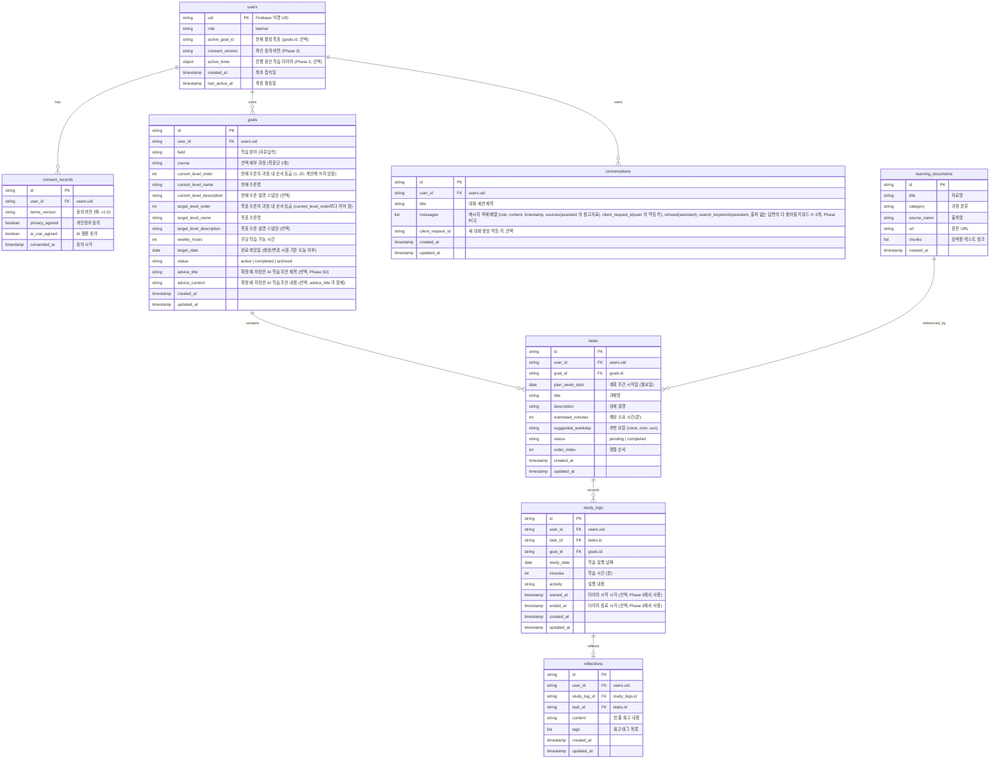

# PaceMate Phase 1 설계 명세서 (DES)

- **작성일:** 2026-10-19
- **기준 문서:** `PRD.md`, `서비스기획서.md`, `TASK.md`, `mockup/index.html`
- **상태:** Phase 1 완료 기준안

---

## 1. 용어 및 MVP 범위 대조·확정 (Task 1.1)

### 1.1 용어 정의

| 용어 | 정의 | 비고 |
|---|---|---|
| **학습 분야 (field)** | 사용자가 자유 입력하는 대주제 (예: "Python 개발", "UX 디자인") | 고정 카탈로그 없음, AI 자유 제안 |
| **세부 과정 (course)** | AI가 제안한 분야 내 하위 학습 코스 (예: "기본문법", "자료구조") | 사용자가 칩 형태로 선택 |
| **수준 체계 (level system)** | AI가 분야/과정에 맞춰 제안한 1~5단계 수준명 및 설명 | 화면에서는 콤보박스로 선택 |
| **현재/목표 수준 (current / target level)** | 학습자의 시작 지점과 도달 희망 수준 | 수준 순서 역전 검증 필요 |
| **학습 목표 (goal)** | 분야, 과정, 현재/목표 수준, 주간 가능 시간, 완료일을 포함한 학습 단위 | `goals` 컬렉션 |
| **학습 과제 (task)** | 주간 계획 내의 개별 학습 과업 | `tasks` 컬렉션, 예상 분, 추천 요일 포함 |
| **선택적 추천 요일 (suggested_weekday)** | 월~일 또는 "none". 권장 학습 요일 | **마감일 아님, 미학습 시에도 자동 실패/이월 없음** |
| **학습 실행 기록 (study_log)** | 과제에 종속(1:N)된 실제 공부 시간과 활동 내용 | 단순 타이머 또는 수동 입력 |
| **학습 회고 (reflection)** | 실행 기록에 1:0..1로 연결되는 한 줄 회고와 태그 | AI 튜터 Long-term Memory에 활용 |
| **AI 튜터 (AI tutor)** | RAG(사전 검토 자료)와 Memory(사용자 회고)를 결합한 질의응답 | 단일화된 세션/메시지 API 사용 |
| **참고자료 (learning_documents / resources)** | 팀이 사전 검토·선정한 읽기 전용 학습 지식 문서 | 사용자 추가/업로드 불가 |

### 1.2 MVP 범위 및 제외 사항

- **MVP 포함:**
  - 첫 방문 동의 모달 및 Firebase Anonymous Authentication (익명 UID 발급)
  - 자유 입력 분야 기반 AI 세부 과정/수준 제안 및 주간 계획 생성·편집·저장
  - 과제별 다건 실행 기록 등록·수정·삭제, 단순 시작/종료 타이머
  - 한 줄 회고 및 태그 저장
  - 사전 검토 자료 기반 RAG + 최근 회고 기반 Long-term Memory AI 튜터
  - 튜터 대화 세션 자동 저장 및 이력 불러오기
  - 대시보드 4대 지표, 오늘 추천 과제 체크리스트, 주간 활동, 실행 인사이트
  - 읽기 전용 참고자료 보관함
  - 내 정보 확인 및 데이터 삭제 요청
- **MVP 제외 (PRD/기획서/목업 일치):**
  - 관리자 콘솔 (`admin-page`): `mockup/index.html`에 포함된 관리자 미리보기는 검토용 목업이며 실제 백엔드/DB/권한 구현에서 완전히 제외.
  - AI Agent Function Calling (튜터의 자율 도구 선택 흐름은 MVP 안정화 후 Phase 11 후속 과제로 진행).
  - Make 자동화 리마인더, 외부 실시간 웹 검색, 퀴즈/오답노트, 뽀모도로 타이머, 소셜/이메일 로그인, 멀티모달 입력.

---

## 2. 사용자 여정과 7개 화면 확정 (Task 1.2)

### 2.1 사용자 여정 (End-to-End User Flow)
1. **[온보딩]** 첫 접속 ➡️ 개인정보·AI 이용 동의 모달 ➡️ 필수 동의 ➡️ Firebase 익명 UID 생성.
2. **[경로 설정]** 분야 자유 입력 ➡️ (선택) `POST /api/path/ideas` 로 대표 직무·목표 예시(참고용 Chip)를 보고 누르면 학습 목표 입력칸에 채움 ➡️ 학습 목표 입력(선택) ➡️ `POST /api/path/recommend` ➡️ AI 제안 세부 과정(Chip) 및 현재/목표 수준(Select), 주간 가능 시간, 학습 시작일(아무 요일, 오늘 이후)과 완료일 설정 ➡️ `POST /api/plan/generate` 호출.
3. **[계획 확정]** 주간 과업/조언/참고자료 탭 확인 ➡️ 과업별 예상 시간 및 추천 요일 편집 ➡️ 계획 및 과제 저장.
4. **[대시보드]** 전체 진행률, 이번 주 학습 시간, 오늘의 추천 과제 확인 및 완료 토글, AI 인사이트 확인.
5. **[실행 기록]** 과제 선택 ➡️ 타이머 시작/종료 또는 수동 입력 ➡️ 실행 내용 및 회고/태그 작성 ➡️ 저장. 기록 수정/삭제 시 집계 즉시 반영.
6. **[AI 튜터]** 새 대화 생성 또는 기존 대화 선택 ➡️ 질문 전송 ➡️ 본인 학습 요약 + 최근 회고 + RAG 자료가 반영된 답변 수신 ➡️ 세션 자동 저장.
7. **[보관함/설정]** 사전 검토 자료 조회, 내 정보 확인, 필요 시 데이터 삭제 요청.

### 2.2 사용자용 7개 화면 정의

| 화면 ID (DOM) | 화면명 | 주요 기능 및 역할 |
|---|---|---|
| `page-dashboard` | **대시보드** | 상단 4대 지표 카드, 진행률 바, 오늘의 추천 과제 체크리스트, 주간 요일별 활동 점(hit), AI 학습 인사이트 요약 |
| `page-path` | **학습 경로 설정** | 학습 분야 입력, AI 세부 과정 칩 선택, 현재/목표 수준 콤보박스, 가용 시간/목표일 입력, 계획 초안 3개 탭 미리보기 |
| `page-wbs` | **학습 과제 계획** | 주간 목표 현황, 주간 과제 목록, 추천 요일(월~일/none) 선택, 과업 편집 및 확정 상태 관리 |
| `page-execution` | **학습 실행 기록** | 4대 실행 지표, AI 실행 인사이트 및 갱신, 과제별 다건 기록 리스트, 단순 타이머 패널, 실행 내용/회고 입력 폼, 수정/삭제 |
| `page-tutor` | **AI 튜터** | 좌측 최근 대화 목록 및 새 대화 버튼, 중앙 대화 메시지 영역 및 질문 입력창, 우측 답변 참고 컨텍스트(학습 요약/회고/자료) |
| `page-resources` | **참고자료 보관함** | 사전 검토된 읽기 전용 학습 자료 검색, 과정별 필터링, 원문 URL 외부 링크 제공 |
| `page-settings` | **내 정보·설정** | 익명 계정 프로필 확인, 현재 목표 수정, 개인정보/AI 안내, 피드백 안내 링크, 학습 데이터 전체 삭제 요청 모달 |

---

## 3. 논리 ERD 및 엔티티 관계 (Task 1.3, 1.4, 1.4a)

### 3.1 논리 ERD (Mermaid)



### 3.2 관계 규칙 (Cardinality & Constraints)
1. `users (1) : (N) goals`: 사용자는 여러 학습 목표를 가질 수 있으나, 활성(`active`) 목표는 기본 1개로 운영.
2. `goals (1) : (N) tasks`: 한 목표는 주차별 여러 학습 과제를 포함함.
3. `tasks (1) : (N) study_logs`: **한 과제에 대해 여러 번 학습 기록을 등록할 수 있음** (1:N 다건 기록 지원).
4. `study_logs (1) : (0..1) reflections`: 각 학습 기록은 최대 하나의 회고를 연결함.
5. `users (1) : (N) conversations`: 사용자는 여러 튜터 대화 세션을 생성하고 이력을 보존함.
6. `learning_documents`: 공용 읽기 전용(Public Read-only) 지식 저장소로 사용자 UID 격리 대상이 아님.

### 3.3 [BE] Conversations 문서 계약 상세 (Task 1.4a)
- **컬렉션 경로:** `/conversations/{conversation_id}`
- **문서 필드 계약:**
  ```json
  {
    "id": "conv_abc123",
    "user_id": "firebase_anonymous_uid_xyz",
    "title": "Python 자료형 변환 질문",
    "messages": [
      {
        "role": "user",
        "content": "자료형 변환할 때 왜 int('10.5')는 에러가 나나요?",
        "timestamp": "2026-10-19T09:00:00Z"
      },
      {
        "role": "assistant",
        "content": "int()는 정수 형태 문자열만 바로 변환할 수 있습니다...",
        "timestamp": "2026-10-19T09:00:03Z"
      }
    ],
    "created_at": "2026-10-19T09:00:00Z",
    "updated_at": "2026-10-19T09:00:03Z"
  }
  ```
- **제약:**
  - `role`은 `"user"` 또는 `"assistant"`로만 엄격히 제한.
  - `user_id`는 토큰에서 검증된 UID와 반드시 일치해야 함.
  - 목록 조회(`GET /api/conversations`) 시에는 페이로드 절감을 위해 `messages` 배열을 제외하고 `id`, `title`, `created_at`, `updated_at`만 반환.

---

## 4. UID 권한 경계 및 동의·삭제 규칙 (Task 1.5, 1.6, 1.7, 1.8)

### 4.1 UID 보안 원칙
- **클라이언트 전송 UID 불신뢰:** 클라이언트가 요청 Body나 Query로 `user_id`를 보내더라도 백엔드는 이를 권한 판정의 근거로 일절 사용하지 않음.
- **FastAPI 토큰 검증:** 모든 보호된 엔드포인트는 `Authorization: Bearer <Firebase_ID_Token>`을 의존성(`get_current_user_uid`)으로 검증하여 `uid`를 추출하고, 해당 `uid`를 데이터 생성·조회·수정·삭제의 유일한 키로 사용.

### 4.2 동의 규칙 (`consent_records`)
- 필수 동의 항목: 개인정보 이용 안내, 익명 UID 발급, AI 생성 결과 활용 및 기록 이용.
- 동의 전에는 UID 발급 및 어떠한 학습 데이터도 DB에 저장하지 않음.
- 동의 시 최소 정보(`user_id`, `terms_version`, `consented_at`, `privacy_agreed`, `ai_use_agreed`)만 기록.

### 4.3 사용자 데이터 삭제 요청 절차
1. 사용자가 `page-settings`에서 "내 학습 데이터 삭제 요청" 클릭 및 확인 모달 승인.
2. `POST /api/user/delete-data` 호출.
3. 백엔드는 토큰 검증 `uid`에 속한 모든 하위 문서를 일괄 삭제(Batch Delete):
   - `goals` (해당 UID)
   - `tasks` (해당 UID)
   - `study_logs` (해당 UID)
   - `reflections` (해당 UID)
   - `conversations` (해당 UID)
   - `consent_records` (해당 UID)
4. Firebase Authentication에서 해당 익명 계정 삭제 또는 비활성화.
5. 삭제 완료 후 클라이언트 로컬 상태 초기화 및 첫 온보딩 화면으로 리다이렉트.

### 4.4 Firestore 컬렉션, 인덱스 및 보안 규칙 (Task 1.7)
- **복합 인덱스 필요 항목:**
  - `tasks`: `user_id` (ASC) + `plan_week_start` (ASC) + `order_index` (ASC)
  - `study_logs`: `user_id` (ASC) + `study_date` (DESC)
  - `reflections`: `user_id` (ASC) + `created_at` (DESC)
  - `conversations`: `user_id` (ASC) + `updated_at` (DESC)
- **Firestore Security Rules 원칙:**
  ```javascript
  rules_version = '2';
  service cloud.firestore {
    match /databases/{database}/documents {
      // 사용자 소유 문서 규칙 (goals, tasks, study_logs, reflections, conversations)
      match /{collectionName}/{docId} {
        allow read, write: if request.auth != null && resource.data.user_id == request.auth.uid;
        allow create: if request.auth != null && request.resource.data.user_id == request.auth.uid;
      }
      // 공용 참고자료 (읽기 전용)
      match /learning_documents/{docId} {
        allow read: if true;
        allow write: if false;
      }
    }
  }
  ```

### 4.5 설문 데이터 격리 (Task 1.8)
- 실사용자 UAT 설문(만족도, AI 유용성 등)은 Google Forms/Tally 등 외부 익명 설문 도구를 활용.
- 제품 Firestore에는 설문 응답 테이블/컬렉션을 일체 두지 않음.

---

## 5. REST API 명세 및 DTO 계약 (Task 1.9, 1.10, 1.11, 1.12)

### 5.1 공통 사양

- **기본 URL:** 로컬 `http://localhost:8001`, 배포 Render URL
- **인증 헤더:** `Authorization: Bearer <Firebase_ID_Token>`
- **공통 표준 에러 응답 (`ErrorResponse`):**
  ```json
  {
    "detail": {
      "code": "BAD_REQUEST | UNAUTHORIZED | FORBIDDEN | NOT_FOUND | VALIDATION_ERROR | INTERNAL_ERROR",
      "message": "사용자에게 전달할 안내 메시지",
      "details": null
    }
  }
  ```

### 5.2 전체 엔드포인트 요약 테이블

| 메서드 | 경로 | 역할 및 설명 | 태그 |
|---|---|---|---|
| `POST` | `/api/path/ideas` | 1단계 보조: 분야 입력 기반 대표 직무·목표 예시 3~5개(`suggested_roles`, 참고용). 버튼을 눌렀을 때만 호출 | `path` |
| `POST` | `/api/path/recommend` | 1단계: 분야 입력 기반 세부 과정 및 수준 제안 (`suggested_roles` 는 호환용 선택 필드, 화면은 `/api/path/ideas` 를 쓴다) | `path` |
| `POST` | `/api/plan/generate` | 2단계(Phase 5F): 과정·수준·시간 선택 기반 **전체 학습 과정** 과업·조언·자료 생성(초안, 미저장). `start_date`(필수, 오늘 이후 아무 요일)가 속한 주의 월요일이 첫 주, 목표일이 속한 주까지 `week_count` 주(주차 배치·주 이동용 달력 주 수). **가용 분 = floor(주당 분 × 시작일~목표일 일수(양 끝 포함) / 7)** 이며 주당 분 × `week_count` 를 넘지 않는다(시작일이 주 중간이면 첫 주를 통째로 세지 않는다. 월~일 한 주는 주당 분 그대로). `plan_week_start` 는 선택이며 주어지면 첫 주 월요일과 같아야 한다. AI 는 과제 3~60개(제목·설명·예상 10~6000분)와 조언만 정하고, 주차 배치·추천 요일 기본값·합계 검증은 서버가 한다(제목 중복 금지, 총합 ≤ 가용 분). AI 입력에는 `period_days`, `week_count`(일수 기준 주 수, 소수점 한 자리), `max_total_minutes`(=가용 분)와 권고용 `suggested_task_count_range`(기간 주 수 × 1~2개, 3~60 안), `suggested_total_range_minutes`(가용의 50~100%)가 들어가며 이 범위는 서버가 거부 사유로 쓰지 않는다. 응답 `{plan_week_start, plan_week_end(마지막 주 일요일), week_count, available_minutes, coverage_percent(총합/가용 정수 %, 안내용), total_estimated_minutes, tasks[{title, description, estimated_minutes, plan_week_start, timeline_start_minutes, suggested_weekday}], advice, references, references_notice}` | `plan` |
| `GET` | `/api/goals` | 사용자의 목표 목록 조회 | `goals` |
| `POST` | `/api/plan/confirm` | 편집한 계획을 목표와 과제로 함께 저장. Phase 5F: `tasks` 는 순서가 있는 과제 목록(3~60개, 아니면 400), 제목 중복 400, 총합 > 가용 분이면 400(메시지에 총합과 가용 시간). 클라이언트의 주차·타임라인 값은 받지 않고 서버가 다시 계산해 과제마다 `plan_week_start`(시작 주), `timeline_start_minutes`, `order_index`, `suggested_weekday` 를 저장한다. 사용자가 고른 요일은 유지하고 none/생략이면 서버 기본값. `client_request_id` 멱등 | `goals`, `tasks` |
| `POST` | `/api/goals` | 학습 목표 생성 및 확정 (start_date=이번 주 월요일, 같은 날 진행 중인 활성 학습이 이미 2개면(동시 최대 2개 초과) 409 `GOAL_PERIOD_OVERLAP`, `details.overlaps` 에 해당 날에 걸린 학습 전부. `/api/plan/confirm` 은 사용자가 고른 `start_date` 로 동일 검사) | `goals` |
| `GET` | `/api/goals/{goal_id}` | 목표 상세 조회 (확정 때 저장한 `advice_title`, `advice_content` 포함, 없는 기존 목표는 null) | `goals` |
| `GET` | `/api/goals/{goal_id}/insight` | 저장된 마지막 AI 학습 인사이트 `{insight: {summary, difficulty, next_action, generated_at, record_count, reflection_count, is_stale} \| null}`. **AI 를 호출하지 않는다.** 타 UID 403, 없는 id 404 | `insights` |
| `POST` | `/api/goals/{goal_id}/insight` | AI 학습 인사이트 만들기 `{client_request_id}`. 기록 부족이면 AI 미호출·미저장 200 `{insight: null, is_insufficient: true, message, record_count, reflection_count}`. 충분하면 AI 1회 호출·검증·저장 후 201, 같은 `client_request_id` 재요청은 200(AI 재호출 없음). 같은 학습의 마지막 생성 후 60초 이내 새 요청은 429 `INSIGHT_COOLDOWN`(`details.retry_after_seconds`). 검증 실패·AI 오류는 502/503/504 이며 기존 인사이트 유지 | `insights` |
| `GET` | `/api/goals/{goal_id}/references` | 학습에 연결된 검토 참고자료(읽기 전용). 응답 `{references[{title, category, source_name, url, is_verified}], references_notice, search_links[{label, url}]}`. 매칭은 plan/generate 와 같은 규칙(Phase 6C: 분야 토큰이 자료 tags·category 에 하나 이상 일치해야 후보, 점수 = tags 일치 + category 일치, 일반어 제외, 최대 5건; 분야가 하나도 안 맞으면 과정 토큰만으로 다시 점수를 내되 tags 의 도메인 단어가 정확히 일치해야 함). `search_links` 는 서버가 고정 템플릿(구글·공식 문서·유튜브 검색, 퍼센트 인코딩, 최대 3개)으로 만든 검토 전 외부 링크이며 항상 존재(`source_name` 은 `ResourceReferenceItem` 의 선택 필드). 타 UID 403, 없는 id 404 | `goals` |
| `PATCH` | `/api/goals/{goal_id}` | 목표 수정 | `goals` |
| `DELETE` | `/api/goals/{goal_id}` | 목표 삭제 | `goals` |
| `GET` | `/api/tasks` | 과제 목록 조회 (`goal_id`, `plan_week_start`(과제가 시작하는 주) 필터). 응답에 `timeline_start_minutes`(Phase 5F, 저장값이 없는 기존 과제는 같은 목표의 과제를 order_index 순으로 누적해 계산) | `tasks` |
| `POST` | `/api/tasks` | 과제 생성 (단건 또는 다건). Phase 5F: 그 목표의 전체 과제 합계 ≤ 가용 분을 검증하고 타임라인 끝(또는 지정 주의 시작 중 늦은 쪽)에 둔다. `PATCH` 로 분을 바꿔도 다른 과제를 다시 배치하지 않는다(일정 고정) | `tasks` |
| `PATCH` | `/api/tasks/{task_id}` | 과제 상태(완료 토글) 또는 추천 요일 수정 | `tasks` |
| `DELETE` | `/api/tasks/{task_id}` | 과제 삭제 | `tasks` |
| `GET` | `/api/study-logs` | 과제별/목표별(`goal_id`)/기간별 학습 실행 기록 조회 | `study-logs` |
| `POST` | `/api/study-logs` | 학습 기록 등록 (단순 타이머 결과 또는 수동 입력) 및 회고 저장 | `study-logs` |
| `PATCH` | `/api/study-logs/{log_id}` | 학습 기록 및 회고 내용 수정 | `study-logs` |
| `DELETE` | `/api/study-logs/{log_id}` | 학습 기록 삭제 (회고 동반 삭제, 과제는 유지) | `study-logs` |
| `POST` | `/api/timer/start` | 학습 타이머 시작 (사용자당 하나, 이미 있으면 409) | `users.active_timer` |
| `GET` | `/api/timer/active` | 활성 타이머 조회 (새로고침 복원용) | `users.active_timer` |
| `POST` | `/api/timer/finish` | 타이머 종료, 학습 기록으로 저장 | `study-logs` |
| `POST` | `/api/timer/cancel` | 활성 타이머 취소 (기록 생성 없음) | `users.active_timer` |
| `GET` | `/api/data/summary` | **AI 튜터 컨텍스트용** 진행 중인 모든 학습의 요약(`learning_summary`, 줄바꿈으로 학습 구분) 및 최근 회고(최대 5건, `keywords` 일치 우선 후 최신순, 진행 중 학습의 과제 회고만) | `summary` |
| `GET` | `/api/dashboard/summary` | **대시보드 화면용** 4대 지표, 오늘 추천 과제, 주간 활동, 인사이트(최근 학습=active_goal_id 기준: 저장된 인사이트 요약, 없으면 안내 문구. **AI 를 호출하지 않는다**) + `goals_overview`(진행 중인 모든 학습의 일정·진행률). Phase 5F: 이번 주 과제 = 이번 주에 예정 분이 있는 과제(그 주에 시작 + 앞 주에서 이어지는 과제), `today_tasks[].week_minutes/continued`, `week_scheduled_minutes`, `today_scheduled_minutes`, `plan_total_minutes`, `plan_available_minutes` 추가 | `summary` |
| `GET` | `/api/analytics/overview` | **종합 학습 분석 화면용** 진행 중 학습별 일정·진행률·이번 주 요일별 학습 분(읽기 전용, AI 호출 없음) | `summary` |
| `POST` | `/api/conversations` | 새 튜터 대화 세션 생성(제목 "새 대화", `client_request_id` 로 멱등: 재요청 200) | `conversations` |
| `GET` | `/api/conversations` | 최근 갱신순 튜터 대화 목록 조회 (최대 50건, 메시지 제외) | `conversations` |
| `GET` | `/api/conversations/{conversation_id}` | 특정 대화 세션 전체 메시지 이력 조회 (assistant 메시지의 `sources`: doc_id, title, source_name, url; `search_keywords`(저장), `search_links[{label,url}]`·`related_links[{title,source_name,url}]`(저장하지 않고 응답 때 서버가 생성, Phase 6C)) | `conversations` |
| `POST` | `/api/conversations/{conversation_id}/messages` | **튜터 질의 전송 및 응답 수신 (튜터 호출 엔드포인트 단일화).** 요청 `{content(1~1000자), client_request_id}`, 응답 `{user_message, assistant_message, conversation_title, refused}`. 같은 `client_request_id` 재요청은 중복 저장 없이 200. AI 1회 호출(학습 관련 판정 + 답변 + 사용 자료 + 출처 없을 때 `search_keywords` 0~3개(URL 금지, 서버 검증)), 응답 assistant_message 에 `search_keywords`, `search_links`, `related_links`(출처 있을 때 현재 학습과 매칭되는 링크 자료 최대 2건) 포함, 실패 시 저장 없음(502/503/504), 대화 200메시지 초과 409 `CONVERSATION_FULL` | `conversations` |
| `GET` | `/api/resources` | 사전 검토된 읽기 전용 참고자료 목록 검색·조회 | `resources` |
| `GET` | `/api/user/profile` | 익명 사용자 프로필 조회. `is_admin`(ADMIN_UIDS 에 포함되면 true, 읽기 전용) 포함 | `user` |
| `PATCH` | `/api/user/profile` | 사용자 프로필 수정. `active_goal_id` 변경(학습 전환)은 본인 소유이고 status=active 인 목표만 허용 | `user` |
| `POST` | `/api/user/delete-data` | 내 학습 데이터 전체 삭제 요청 (익명 피드백 `feedback` 은 UID 와 연결이 없어 남는다) | `user` |
| `POST` | `/api/feedback` | 테스트 피드백 제출 `{usability, ai_usefulness, screen, comment?, client_request_id}`. 사용자 정보 없이 저장, 같은 `client_request_id` 재요청은 200, 사용자당 10건 초과 429 `FEEDBACK_LIMIT_REACHED` | `feedback` |
| `GET` | `/api/admin/users` | **[관리자]** 사용자 목록 `?status=all\|active\|dormant&page=`(50건, 최근 활동순). 마스킹된 ID, 유형, 동의, 진행 중 학습 수, 최근 활동, 상태. 비관리자 403 | `admin` |
| `GET` | `/api/admin/feedback` | **[관리자]** 피드백 목록 `?status=all\|new\|seen\|candidate\|done&limit=`(최신순, 최대 200) | `admin` |
| `GET` | `/api/admin/feedback/summary` | **[관리자]** 미확인 건수, 사용성·AI 유용성 평균과 응답 수, 개선 후보 수, 최근 30일 반영 완료 수 | `admin` |
| `PATCH` | `/api/admin/feedback/{id}` | **[관리자]** 상태만 변경 `{status: seen\|candidate\|done}` (의견 수정·삭제 없음) | `admin` |

---

## 6. 미결정 사항 및 고려 사항 (Open Decisions)

1. **RAG 인덱싱 방식:** MVP 14일 일정 상 가벼운 인메모리 TF-IDF/코사인 유사도 또는 소규모 임베딩 메모리 인덱스 중 어떤 것을 기본 채택할지 (Phase 6 착수 전 결정 필요).
2. **복수 활성 목표 허용 여부:** 현재 UI는 단일 목표 흐름을 전제로 하나, DB 모델은 1:N 구조로 유연하게 설계함. MVP에서는 `status="active"` 목표를 1개로 제한할지 여부.
   **결정 2026-10-22(사용자):** 복수 활성 목표를 허용하되 같은 날 진행되는 학습은 최대 2개이며 2개를 초과하는 계획은 만들 수 없다(2026-10-22 개정). 상세는 docs/multi_goal_design.md, docs/erd_current.md.
3. **토큰 만료 시의 클라이언트 UX:** Firebase Anonymous Auth 세션 갱신 실패 시 오프라인/재인증 모달 처리 세부 시나리오.
