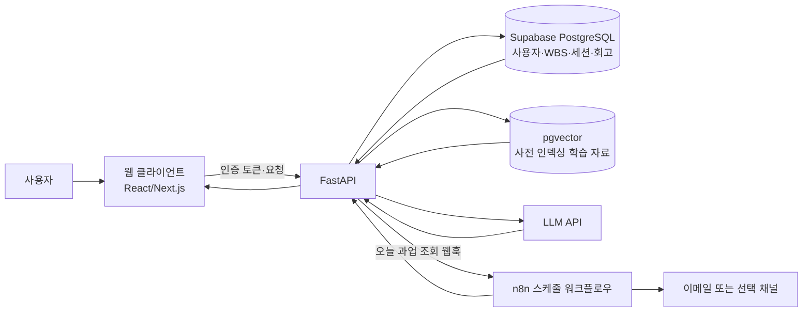

# PaceMate 서비스 기획서 (보완)

**문서 상태:** MVP 기획안  
**작성일:** 2026-10-16  
**프로젝트명:** PaceMate (페이스메이트)  
**기준 문서:** mission.md, 서비스기획서.md

---

## 1. 서비스 개요

### 1.1 서비스 정의
PaceMate는 부트캠프 수강생과 IT 취업 준비생이 학습 목표를 현실적인 주간·일간 계획으로 나누고, 계획이 밀려도 다시 페이스를 찾도록 돕는 AI 학습 코치 웹 서비스다. 사용자의 목표와 가용 시간으로 WBS를 만들고, 학습 타이머·회고·진도 기록을 바탕으로 다음 행동을 제안한다.

- **메인 카피:** 지치지 않는 독학의 비밀, PaceMate
- **핵심 가치:** 계획 수립부터 실행, 회고, 재조정까지 이어지는 완주 지원
- **MVP 성공 기준:** 외부 배포된 서비스에서 테스터 5명 이상이 핵심 여정을 완료하고, 피드백을 수집해 최소 1회 개선한다.

### 1.2 문제와 해결 방식
독학 학습자는 목표를 작은 과업으로 나누기 어렵고, 실제 가용 시간보다 계획을 크게 잡는 경우가 많다. 일정이 밀렸을 때 무엇을 포기하거나 옮길지 결정하지 못해 학습을 중단하기도 한다.

PaceMate는 AI가 목표를 WBS로 분해하고, 사용자의 진행 상태와 회고를 참고해 학습 질문에 답하거나 남은 일정을 재조정함으로써 다음에 할 일을 명확히 한다. 계획은 제안으로 제공하며, 사용자가 확인한 뒤 적용한다.

### 1.3 타겟 사용자
- **주요 타겟:** 부트캠프 수강생, IT 직군 취업 준비생
- **확장 타겟:** 자격증·어학 시험 등 장기 목표를 가진 독학 학습자
- **초기 테스터 모집군:** 부트캠프 동료, IT 취준생 커뮤니티 및 지인 학습자

---

## 2. MVP 범위와 사용자 여정

### Step 1. 목표 설정 및 WBS 생성
사용자는 학습 목표, 완료 희망일, 주당 가용 시간, 현재 수준을 입력한다. AI는 이를 일일 과업으로 나눈 WBS를 생성하고 사용자가 편집·확정한다. 외부 웹을 무제한 실시간 검색하지 않으며, 사전 등록한 대표 학습 자료를 우선 검색하고 부족한 경우 검색 키워드만 제안한다.

**완료 조건:** 입력값 저장, WBS 생성·수정·확정, 과업별 상태(대기/진행/완료) 변경.

### Step 2. 학습 실행
확정된 오늘의 과업을 선택해 뽀모도로 타이머를 시작하고 세션 시간을 기록한다. 탭 또는 페이지 이탈이 감지되면 타이머를 일시정지하거나 안내 모달을 보여준다. 이 기능은 브라우저에서 가능한 알림 수준이며 다른 탭·앱이나 네트워크 접속을 차단하지 않는다.

**완료 조건:** 타이머 시작·일시정지·완료, 세션 및 학습 시간 기록, 이탈 안내.

### Step 3. 진도 및 회고 확인
대시보드는 전체 WBS 진행률 프로그레스 바와 날짜별 학습 스트릭 히트맵을 보여준다. 세션 종료 후 사용자는 한 줄 회고와 선택 태그(예: 헷갈림, 복습 필요)를 남긴다. 초기 사용자가 적으므로 다른 사용자와의 비교 통계는 제공하지 않는다.

**완료 조건:** 일별 학습 기록, 진행률, 스트릭, 회고의 저장 및 조회.

### Step 4. AI 튜터와 팝퀴즈
AI 튜터는 사용자의 질문에 답할 때 현재 WBS, 사전 인덱싱한 학습 자료, 관련 회고를 참고한다. 학습 세션 종료 후 선택적으로 객관식 3문항 팝퀴즈를 생성하고, 답 선택 즉시 정답·해설을 제공한다. AI가 만든 설명과 문제에는 AI 생성 안내를 표시한다.

**완료 조건:** 근거 자료를 바탕으로 한 질의응답, 문항 생성·채점·해설, 회고 맥락 활용.

### Step 5. 일정 재조정 및 리마인더
사용자가 “계획이 밀렸어요”를 선택하면 재조정 Agent가 미완료 과업과 남은 날짜·가용 시간을 확인해 새 일정 초안을 제시한다. 사용자가 검토하고 적용해야 WBS가 변경된다. n8n 스케줄 워크플로우는 사용자가 동의한 알림 채널로 오늘의 과업을 발송한다.

**완료 조건:** 재조정안 미리보기·승인·적용, 리마인더 발송 또는 발송 실패 기록.

---

## 3. 기능 요구 명세

| ID | 기능 | 요구사항 | 우선순위 |
|---|---|---|---|
| F-01 | 로그인 및 사용자 데이터 격리 | 이메일 기반 간편 로그인 또는 게스트 데모를 제공한다. 모든 학습 데이터는 사용자 ID로 분리한다. | P0 |
| F-02 | 목표·WBS | 목표와 시간 제약을 받아 WBS를 생성하고 수정·확정·완료 처리한다. | P0 |
| F-03 | 집중 타이머 | 세션을 기록하고 페이지 이탈 시 안내 또는 일시정지한다. | P0 |
| F-04 | 대시보드 | 진행률, 학습 스트릭, 최근 학습 시간을 표시한다. | P0 |
| F-05 | 회고 메모리 | 회고·태그를 저장하고 관련 AI 응답에 사용자 맥락으로 활용한다. | P0 |
| F-06 | AI 튜터·퀴즈 | 인덱싱 자료와 사용자 맥락을 참고해 답변·객관식 퀴즈를 제공한다. | P0 |
| F-07 | 일정 재조정 | 미완료 과업 기준으로 새 일정을 제안하고 사용자 승인 후 반영한다. | P1 |
| F-08 | 일일 리마인더 | 동의한 사용자에게 당일 과업을 자동 발송한다. | P1 |
| F-09 | 마이크로 러닝 추천 | 연관 키워드 또는 등록 자료를 추천한다. 외부 실시간 큐레이션은 하지 않는다. | P2 |

### MVP 제외 범위
- 브라우저 밖 사이트·앱 차단 및 네트워크 우회 차단
- Canvas/SVG 기반 RPG 스킬트리와 사용자 간 비교 분석
- 검증되지 않은 외부 링크를 실시간으로 무제한 수집하는 큐레이션
- Google·GitHub 등 복수 소셜 로그인
- 스터디 커뮤니티, 구독 결제, 기관용 LMS/B2B 대시보드
- 이미지·음성 입력 멀티모달 기능(일정 여유 시 후속 검토)

---

## 4. AI 기술 요소 및 적용 방식

미션의 필수 기술 5개 중 **AI Agent, RAG, Long-term Memory, 자동화 워크플로우**를 적용한다. MVP의 핵심 검증은 Agent·RAG·Memory를 중심으로 하고, 자동화 리마인더를 보조 기능으로 제공한다. 멀티모달 AI는 이번 MVP의 필수 범위에서 제외한다.

| 미션 기술 요소 | PaceMate 적용 | 입력·처리·출력 및 통제 |
|---|---|---|
| **AI Agent** | 일정 재조정 Agent | 미완료 과업·마감일·가용 시간 조회 → 재배치 도구 실행 → 변경 초안 제시. 사용자 승인 전 DB 일정을 변경하지 않는다. |
| **RAG** | AI 튜터의 학습 자료 검색 | 사전 등록한 IT 학습 자료를 청크·임베딩해 저장하고 질문과 관련된 상위 자료를 검색해 답변 문맥에 제공한다. MVP에는 제한된 커리큘럼 자료를 사용한다. |
| **Long-term Memory** | 학습 회고 및 취약점 기억 | 세션 회고와 태그를 사용자별로 저장한다. 질문과 관련된 최근 회고를 조회해 프롬프트에 주입하며 사용자는 회고 기록을 확인·삭제할 수 있다. |
| **자동화 워크플로우** | n8n 일일 리마인더 | 매일 지정 시각에 동의한 사용자의 당일 과업을 API로 조회해 이메일 또는 팀이 선택한 채널로 발송한다. 중복 발송 방지와 실패 로그를 둔다. |
| 멀티모달 AI | MVP 제외 | 사진·음성 입력은 핵심 여정 및 배포를 안정화한 후 별도 범위로 평가한다. |

### 기술 스택 제안 및 선정 근거
실제 팀 환경에 따라 최종 확정하며, 아래는 기능 범위에 맞춘 기준안이다.

| 영역 | 기준안 | 선정 근거 |
|---|---|---|
| Frontend | React 또는 Next.js, TypeScript | 대시보드·타이머 UI를 빠르게 구성하고 배포하기 적합 |
| Backend API | Python FastAPI | AI·RAG 라이브러리와 연동이 쉽고 명시적인 API 구성 가능 |
| AI | OpenAI API 또는 팀이 사용 가능한 LLM API | WBS·튜터·퀴즈·재조정 생성에 공통 사용, JSON 출력으로 검증 |
| 데이터베이스 | Supabase PostgreSQL 및 pgvector | 사용자·학습 기록 관계형 저장과 벡터 검색을 한곳에서 구성 가능 |
| 인증 | Supabase Auth 이메일 로그인(또는 게스트 데모) | 소셜 로그인 다중 연동을 줄여 구현·테스트 시간을 확보 |
| 자동화 | n8n + 웹훅 | 일정 실행, 채널 발송, 실패 재시도 흐름을 시각적으로 관리 |
| 배포·협업 | Vercel(Frontend), Render 또는 동급(FastAPI), GitHub | 외부 접근 가능한 MVP 배포와 변경 이력 관리 |

**선정 원칙:** 유료 요금·키 발급 여부와 팀 계정 접근성을 1주차에 확인하고, 팀이 이미 보유한 배포 환경이 있으면 해당 환경을 우선한다. 비밀키는 서버 환경 변수에만 저장한다.

---

## 5. 시스템 아키텍처 및 데이터 흐름

1. 사용자가 웹 클라이언트에서 로그인하고 목표·질문·회고를 제출한다.
2. FastAPI가 인증 토큰을 확인하고 사용자 ID 범위 안에서 데이터를 조회·저장한다.
3. 튜터 요청은 pgvector에서 관련 자료를 검색하고, 관련 회고를 함께 구성해 LLM에 전달한다.
4. 재조정 요청은 Agent가 미완료 과업을 읽고 새 일정 초안을 반환한다. 사용자가 승인한 뒤 API가 변경을 저장한다.
5. n8n은 정해진 시각에 웹훅/API를 호출해 발송 대상과 과업을 확인한 후 리마인더를 전송한다.

### 주요 데이터
- `users`: 인증 주체 및 설정, 알림 동의 상태
- `goals`: 사용자 목표, 기간, 주간 가용 시간
- `tasks`: WBS 과업, 예정일, 상태, 정렬 순서
- `study_sessions`: 시작·종료 시각, 학습 시간, 연결 과업
- `reflections`: 한 줄 회고, 태그, 생성 시각
- `learning_documents`: 사전 등록 자료의 메타데이터·청크·임베딩
- `feedback`: 테스트 응답, 평점, 자유 의견(동의 및 익명 처리 기준 적용)

---

## 6. 비기능 요구사항

| 구분 | 요구사항 및 MVP 목표 |
|---|---|
| 성능 | 일반 API 응답은 95백분위 기준 2초 이내를 목표로 한다. AI 생성은 스트리밍이 가능하면 토큰 스트리밍을 제공하고, 불가하면 진행 상태와 재시도 안내를 표시한다. |
| 안정성 | AI 호출 실패·시간 초과 시 오류 안내와 재시도 경로를 제공한다. 타이머 기록은 화면 갱신·네트워크 재연결 후에도 복구 가능한 구조로 저장한다. |
| 보안 | HTTPS 배포, 서버 측 API 키 관리, 인증된 사용자별 데이터 접근 제어(RLS 또는 API 권한 검사)를 적용한다. 로그에 비밀키나 불필요한 개인정보를 기록하지 않는다. |
| 개인정보 | 수집 항목·이용 목적·보유 기간을 고지하고 동의를 받는다. 학습 기록과 회고 삭제 요청 경로를 제공하며, 테스트용 개인정보는 최소 수집한다. |
| 사용성 | 모바일 폭에서도 목표 입력, 타이머, 오늘의 과업 확인이 가능하도록 반응형 화면을 제공한다. AI 결과는 확정 전 편집할 수 있다. |
| AI 품질·안전 | 구조화 출력은 서버에서 스키마 검증한다. 근거 자료가 없으면 불확실성을 알리고, 학습·일정 제안임을 명확히 한다. AI 생성 콘텐츠 안내 문구를 표시한다. |
| 관측성 | 주요 오류, AI 지연·실패, 리마인더 발송 결과를 개인정보를 최소화해 기록한다. 사용 로그는 테스트 개선에 필요한 이벤트만 수집한다. |

### AI 윤리 및 개인정보 안내
- AI 응답·퀴즈·일정 제안에 **“AI가 생성한 내용이며 정확성을 확인해 주세요”**를 표시한다.
- 이메일, 목표, 학습 세션, 회고 등 수집 항목과 사용 목적을 가입·첫 사용 시 알리고 동의를 받는다.
- 알림은 별도 선택 동의 후 발송하고, 설정에서 해제할 수 있게 한다.
- 초기 테스터 설문은 가급적 익명으로 수집하고, 연락처가 필요한 경우 설문 응답과 분리 보관한다.
- 사용자가 요청하면 학습 기록과 회고를 삭제할 수 있도록 MVP에서 삭제 경로를 제공하거나 테스트 종료 시 삭제 절차를 안내한다.

---

## 7. 실사용자 테스트 및 피드백 계획

### 7.1 모집 및 일정
최소 **5명**을 모집한다. 부트캠프 동료와 IT 취업 준비생을 우선 대상으로 하며, 3주차 초기 배포 시 사용자를 모집하고 4주차에 테스트를 진행한다. 모집 시 서비스의 베타 성격, 수집 데이터, 테스트 소요 시간 및 피드백 이용 목적을 안내하고 동의를 받는다.

### 7.2 테스트 시나리오
1. 학습 목표와 가용 시간을 입력하고 WBS를 생성·수정한다.
2. 오늘의 과업을 골라 타이머를 완료하고 한 줄 회고를 남긴다.
3. 회고 또는 등록 학습 자료와 연관된 질문을 AI 튜터에게 한다.
4. 팝퀴즈를 풀고 진행률·스트릭을 확인한다.
5. 일정이 밀린 상황을 가정해 재조정안을 검토하고 승인 여부를 선택한다.

### 7.3 수집 방법 및 지표
- Google Forms 또는 동등한 설문으로 과업 완료 여부, 사용 편의성(1~5), AI 답변 유용성(1~5), 계속 사용할 의향(1~5), 불편 사항을 수집한다.
- 인앱 이벤트는 목표 생성, WBS 확정, 타이머 완료, 회고 작성, 튜터 질의, 재조정 승인·거절 등 최소 이벤트만 기록한다.
- 테스트 후 짧은 인터뷰 또는 자유 서술 응답으로 개선 이유를 확인한다.
- **초기 성공 지표:** 테스터 5명 이상, 5명 중 4명 이상이 목표 생성부터 첫 학습 기록까지 완료, 유용성 중앙값 4/5 이상을 목표로 한다. 수치는 평가 기준이지 보장된 결과가 아니며 테스트 결과와 함께 보고한다.

### 7.4 피드백 반영 절차
응답을 빈도와 사용자 영향으로 분류해 개선 후보를 정하고, 개발 가능한 범위에서 상위 문제를 수정한다. 변경 전후 화면 또는 사용 로그와 반영 항목을 README·발표 자료에 기록한다. 실제 피드백이 목표에 미치지 못하면 결과를 그대로 공개하고 원인을 정리한다.

---

## 8. 5주 실행 일정 및 산출물

| 주차 | 핵심 목표 | 주요 작업 | 산출물·검증점 |
|---|---|---|---|
| 1주차 | 기획·설계 확정 | 사용자 문제·MVP 확정, 역할 분담, 데이터 모델·화면 흐름·AI 프롬프트 설계, 기술 계정 및 배포 방식 확인 | 보완 기획서, 기능 명세, 아키텍처, 이슈 보드 |
| 2주차 | 핵심 흐름 개발 | 인증·목표·WBS API 및 화면, DB 사용자 격리, 타이머·학습 기록 개발, AI WBS 연결 | 내부 테스트 가능한 수직 기능 흐름 |
| 3주차 | AI 기능·조기 배포 | RAG 자료 인덱싱, 회고 저장·맥락 주입, 튜터·퀴즈, 재조정 초안, 초기 n8n 연결, 외부 배포 및 테스터 모집 | 공개 MVP URL, 테스트 안내·설문, 기본 로그 |
| 4주차 | 사용자 테스트·개선 | 최소 5명 테스트, 설문·사용 로그 분석, 우선순위 높은 오류·UX 수정, 배포 업데이트 | 피드백 요약, 개선 기록, 개선 배포 |
| 5주차 | 마무리·발표 | 주요 흐름 안정화, README·역할·기술 선정 근거 정리, 시연 시나리오 및 발표 자료 작성·리허설 | GitHub 저장소, 서비스 URL, 발표 자료, 회고 |

**일정 원칙:** 2~3주차에 핵심 여정을 조기 배포한다. P0 기능과 사용자 테스트를 먼저 완료하고, P1/P2 기능은 일정에 여유가 있을 때만 구현한다.

---

## 9. 팀 역할 및 협업

팀 구성과 이름은 착수 시 확정한다. 3~5인 팀을 기준으로 역할을 나누며, 인원이 적으면 역할을 겸한다.

| 역할 | 주요 책임 |
|---|---|
| PM·기획 | 범위·일정·이슈 관리, 사용자 모집·테스트 진행, 발표 구성 |
| Frontend | 목표 설정, 대시보드, 타이머, 튜터 화면 및 API 연동 |
| Backend | FastAPI, 인증·권한, DB 스키마, 배포·로그 |
| AI·Data | 프롬프트·JSON 검증, RAG 인덱스, 메모리 조회, Agent 도구 |
| Automation·QA | n8n 웹훅·리마인더, 시나리오 점검, 피드백 정리 |

GitHub 이슈와 PR로 작업·결정을 기록하고, README에 프로젝트 개요, 팀원 역할, 기술 스택 및 선정 근거, 실행 방법, 배포 URL, 사용자 피드백과 개선 결과를 정리한다.

---

## 10. 출시 후 확장 로드맵

- **MVP:** 목표·WBS, 타이머, 진행률·스트릭, 회고 메모리, RAG 튜터·퀴즈, 일정 재조정, 동의 기반 리마인더
- **후속 v1:** 자료 업로드 및 관리 개선, 개인별 학습 패턴 인사이트, 알림 설정 고도화
- **후속 v2:** 스터디 그룹과 협업 기능, 유료 모델 검토
- **후속 v3:** 교육 기관용 관리 화면 및 LMS 연동 검토

후속 기능은 MVP 테스트 결과와 실제 사용 수요를 확인한 뒤 우선순위를 정한다.

---

## 11. 배포 및 제출 산출물 체크리스트

- [ ] 외부에서 접근 가능한 서비스 URL
- [ ] GitHub 저장소와 버전 관리 기록
- [ ] README: 개요, 역할, 기술 스택·선정 이유, 실행 방법, 결과
- [ ] 기능·비기능 명세와 아키텍처 문서
- [ ] AI 적용 방식 및 필수 기술 요소 구현 설명
- [ ] 최소 5명 실사용자 테스트와 피드백 요약
- [ ] 피드백 기반 개선 내역
- [ ] 발표 자료: 문제, 기술 선택 근거, 구현, 피드백, 개선 과정

---

## 부록 A. MVP 핵심 시연 흐름

로그인/게스트 진입 → 목표·가용 시간 입력 → AI WBS 생성 및 확정 → 오늘 과업 타이머 실행 → 학습 회고 작성 → RAG·회고 기반 튜터 질문 → 일정 지연 재조정안 승인 → 대시보드와 리마인더 확인.
