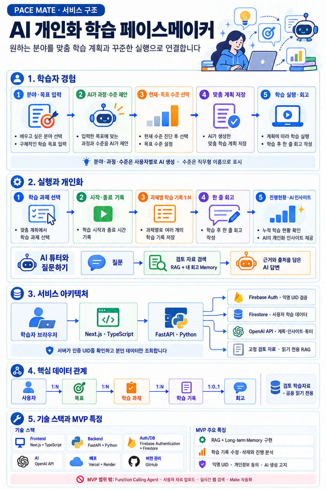

# PaceMate 서비스 기획서 (2주 MVP)

**문서 상태:** 개발 기준안  
**작성일:** 2026-10-16  
**프로젝트명:** PaceMate (페이스메이트)  
**기준:** mission.md  
**개발 기간:** 총 14일

---

## 1. 서비스 개요

### 1.1 서비스 정의
PaceMate는 사용자가 배우고 싶은 분야와 목표를 자유롭게 입력하면 AI가 분야별 세부 과정과 수준 체계를 제안하고, 선택한 현재 수준과 목표 수준에 맞는 계획을 제공하는 AI 학습 코치 웹 서비스다. 초기 핵심 이용자는 부트캠프 수강생과 IT 취업 준비생이며, 다양한 독학 분야로 확장할 수 있도록 분야 목록을 고정하지 않는다.

- **핵심 가치:** 큰 목표를 실행 가능한 주간 과업으로 나누고, 오늘 시작하기 좋은 과제와 내 학습 기록을 고려한 도움을 제공한다.
- **주요 대상:** 부트캠프 수강생과 IT 직군 취업 준비생
- **확장 대상:** 자격증·어학 시험 등 장기 학습 목표를 가진 독학 학습자
- **문제:** 목표를 작은 과업으로 나누기 어렵고, 자신의 기록과 약점을 반영한 학습 도움을 받기 어렵다.
- **해결:** AI가 현재 수준에서 목표 수준까지의 전체 학습 계획을 만들어 주차별로 배치하고, 이번 주 계획에서 오늘의 추천 과제를 보여준다. 튜터는 검토된 자료와 사용자 학습 요약·저장된 회고를 참고해 답하며 대화 이력을 저장한다.

*그림. 서비스 한눈에 보기 (학습자 경험 → 실행·개인화 → 아키텍처 → 데이터 관계 → 기술 스택)*

### 1.2 MVP 성공 기준
- 외부에서 접속 가능한 웹 서비스 배포
- 테스터 5명 이상에게 사용 기회를 제공하고 피드백 수집
- 목표 생성부터 첫 학습 기록까지 핵심 여정이 동작
- RAG와 사용자별 학습 회고 메모리가 실제 AI 답변에 사용됨
- 튜터 대화 세션을 저장하고 과거 대화를 다시 불러올 수 있음
- 피드백을 바탕으로 최소 1건 개선하고 결과를 기록

---

## 2. MVP 범위

### 2.1 포함 기능
- **목업 기준:** mockup/index.html을 단일 표준으로 사용한다. 학습자 7개 화면과 관리자 미리보기 메뉴를 함께 보여주며, 관리자 화면 중 **사용자 관리·사용자 피드백(테스트 운영용)과 참고자료 관리 최소판(5.4)만 구현**하고, 운영 현황·AI 생성 이력·서비스 설정은 "준비 중" 표시만 둔다(PRD 3, FR-07, FR-08). 구버전 PaceMate_Mockup.html은 아카이브한다.
1. **첫 방문 동의·익명 로그인:** 동의 후 Firebase 익명 인증으로 진입하고 사용자 데이터를 UID 로 분리한다. 동의 전에는 개인 데이터를 저장하지 않는다(FR-01).
2. **분야별 과정·수준 제안과 AI 학습 계획:** 자유 입력한 분야·목표에 맞는 과정과 수준을 AI 가 제안하고, 사용자가 현재·목표 수준을 고르면 AI 가 전체 학습 계획 초안을 만든다. 사용자는 확인·편집·확정한다. 추천 요일은 마감일이 아니며 놓쳐도 실패·이월 처리하지 않는다(FR-02).
3. **학습 실행 기록:** 한 학습 과제에 여러 기록을 남기고(시작·종료 타이머 또는 직접 입력), 수정·삭제와 과제별·주간 집계를 지원한다(FR-03).
4. **학습 회고:** 학습 후 한 줄 회고와 선택 태그를 저장한다(FR-03, FR-05).
5. **AI 학습 튜터:** 팀이 검토·등록한 소규모 자료(RAG)와 본인의 최근 회고(Long-term Memory)로 답하고, 대화 세션을 저장·불러온다. 사용자 자료 업로드는 포함하지 않으며, 자료가 없는 분야는 근거가 없음을 알린다(FR-04, FR-05).
6. **진행현황·AI 인사이트:** 계획 대비 실제 학습 시간과 과제 완료 현황, 오늘 시작하기 좋은 추천 과제를 보여주고, 기록·회고를 바탕으로 학습 요약과 다음 행동을 짧게 제안한다. 기록이 부족하면 분석 대신 안내한다(FR-06).
7. **AI·개인정보 안내:** AI 생성 안내, 수집 항목·사용 목적 고지, 테스트 데이터 삭제 방법을 제공한다(FR-01, PRD 6).

기능별 상세 동작과 수용 기준은 PRD 4(FR-01~08)에 있다.

### 2.2 제외 기능 및 향후 계획
다음 기능은 2주 MVP 범위에서 제외하며, 사용자 피드백과 개발 여건에 따라 후속 검토한다.

- 일정 재조정 AI Agent
- Make 일일 리마인더와 외부 채널 알림
- 객관식 팝퀴즈와 오답노트
- 뽀모도로 타이머, 탭 이탈 감지·집중 알림 (단순 학습 시작·종료 타이머는 실행 기록에 포함)
- 학습 스트릭 히트맵, RPG 스킬트리, 사용자 간 비교
- 외부 웹 실시간 검색 및 링크 자동 큐레이션
- 이메일·소셜 로그인, 계정 연동, 커뮤니티·결제·기관 기능
- 이미지·음성 입력 등 멀티모달 기능

---

## 3. 핵심 사용자 흐름

익명 진입(동의) → 분야·목표 입력 → AI 과정·수준 제안과 선택 → 학습 계획 확정 → 학습 기록·회고 → 인사이트·튜터 질문 → 테스트 후 설문. 단계별 상세 흐름은 PRD 2.

**핵심 완료 조건:** 로그인 → 자유 분야·목표 입력 → AI 과정·수준 제안 및 현재·목표 선택 → 학습 계획 확정 → 오늘의 추천 과제 확인 → 학습 기록 → 회고 저장 → 자료·요약·회고 기반 튜터 질문 → 대화 저장 및 재불러오기.

---

## 4. 미션 필수 기술 매핑

MVP에서는 필수 기술 중 두 가지를 실제 사용자 흐름에 구현한다. 생성형 AI 계획 생성은 서비스 핵심 기능으로 사용한다.

| 미션 요소 | MVP 구현 | 검증 근거 |
|---|---|---|
| **RAG** | 제한된 IT 학습 자료를 사전 인덱싱하고 질문과 관련된 자료를 검색해 튜터 프롬프트에 전달 | 자료 출처와 검색 결과를 포함한 테스트 질의 확인 |
| **Long-term Memory 및 대화 이력** | 인증 UID의 최근 회고를 학습 요약 API로 조회해 프롬프트에 넣고, 대화 세션·메시지를 자동 저장·불러오기 | 본인 회고 반영, 세션 목록·이력 재조회, UID 격리 확인 |
| **Long-term Memory** | 사용자별 회고와 태그를 Firestore에 저장하고, 관련 질문에 최근 회고를 검색해 참고 | 사용자별 회고가 답변 맥락에 주입되는 테스트 사례 |
| 생성형 AI | 자유 입력 분야에 맞는 과정·수준 목록, 전체 학습 계획, 실행 기록 기반 AI 인사이트, 요약·회고·RAG 컨텍스트 튜터 답변 | 계획 설정, 실행 인사이트, 질문응답 시연 |
| AI Agent | MVP 제외, 안정화 후 튜터 Function Calling 도구 선택 흐름으로 학습·확장 | AI의 회고/자료 도구 선택, 서버 실행, 결과 반영 답변 시연 |
| 자동화 워크플로우 | MVP 제외, 향후 계획 | Make 리마인더로 확장 검토 |
| 멀티모달 AI | MVP 제외 | 후속 검토 |

### AI 응답 원칙
- AI 는 초안을 제안하고 사용자가 확인·수정해 확정한다(과정·수준·계획은 확정한 뒤에만 저장).
- 사용자별 회고·대화·기록은 인증된 본인 것만 사용한다.
- 등록 자료에 근거가 없으면 근거가 있는 것처럼 답하지 않고 일반 답변과 구분해 표시한다. 모든 AI 결과에 "AI가 생성한 내용이며 정확성을 확인해 주세요" 안내를 표시한다.
- 분야·과정·수준은 고정 목록에 가두지 않고 AI 가 사용자 입력에 맞게 생성하며, 서버가 형식과 규칙을 검증한다.

상세는 PRD 5, FR-02·04·06.

---

## 5. 기술 구성 및 아키텍처

### 5.1 확정 기준 스택
Frontend Next.js·TypeScript(Vercel), Backend Python FastAPI(Render), AI OpenAI API, 인증·DB Firebase 익명 인증·Firestore, RAG 고정 자료 묶음과 메모리 내 검색, 버전 관리 GitHub. 구성별 사용 목적과 선택 근거는 PRD 10. 작은 사전 등록 자료로 시작하며 영구 벡터 DB, 사용자 자료 업로드, 자동·대량 수집은 만들지 않는다(관리자 수집·승인 절차는 5.4).

### 5.2 데이터 흐름
요청은 프론트 → (인증 토큰) → FastAPI → AI·Firestore 순으로 흐른다. 프론트는 DB 와 AI 를 직접 부르지 않는다. 튜터 요청의 상세 흐름은 PRD 5.

### 5.3 주요 데이터
사용자별 데이터(users, consent_records, goals, tasks, study_logs, reflections, conversations)와 공용 읽기 전용 자료(learning_documents)로 나뉜다. 모든 사용자 데이터는 서버가 인증 토큰에서 정한 UID 기준으로만 조회·변경한다. 컬렉션과 필드는 PRD 6, 확정 구조는 docs/erd_current.md.

### 5.4 참고자료 수집·승인 (목적과 범위)
**목적:** 튜터와 계획 화면의 참고자료를 팀이 직접 파일로 고치지 않고, 관리자가 후보를 모으고 승인해 등록하는 **절차를 구축**한다(수집 가능성 확보). 이번 MVP에서는 절차가 동작함을 보이는 **시험 규모의 수집만** 실행하고 대량 수집은 하지 않는다.

**방향**
- AI 는 제안하고 사람이 승인한다(자동 승인 없음). 승인 전 자료는 사용자에게 보이지 않는다.
- 출처는 허용 도메인으로 제한하고, 링크만 제공하며 외부 페이지 본문은 복제하지도 AI 에 넣지도 않는다.
- 수집 방식은 한 가지로 고정하지 않는다. 수집기는 후보 링크만 만들고, 검사·승인·반영은 모든 수집기가 같은 절차를 지난다. 이번에는 링크 직접 입력과 AI 주제 제안 두 가지만 구현한다.
- 수집할 분야는 처음에는 관리자가 고르고, 이후에는 사용자 통계(개인 식별 없이 집계)를 보고 관리자가 모아서 정한다.

**성공 기준(요약):** 링크 입력부터 승인, 사용자 화면 노출까지 한 번에 동작하고, 승인 전에는 노출되지 않으며, 허용되지 않은 주소는 거부되고, 새 수집기를 추가해도 검사·승인 절차를 바꾸지 않아도 된다.

**상세(처리 절차, 수집기 목록, 보안, 수용 기준)는 PRD FR-08**, 구현 설계는 `docs/phase8b_design.md`, 단계별 확대는 `docs/resource_curation_roadmap.md`.

---

## 6. 비기능·개인정보 요구사항

- **성능·신뢰성:** 일반 API 는 95백분위 2초 이내를 목표로 한다. AI 요청에는 진행·실패·재시도 안내를 제공하고, 유휴 후 재기동으로 첫 응답이 늦을 수 있음을 안내한다.
- **보안·개인정보:** HTTPS 배포, 이메일을 수집하지 않는 익명 인증, 사용자별 권한 검사(본인 데이터만), 비밀키의 서버 환경변수 관리. AI 가 쓰는 기록·회고·대화는 안내하고 동의를 받으며, 삭제 요청 범위에 대화 이력을 포함한다. 로그에 회고·대화 원문과 비밀정보를 남기지 않는다.
- **AI 고지:** AI 생성 계획과 답변에 생성형 AI 사용 안내를 표시한다.
- **모바일·문서화:** 핵심 흐름이 모바일 브라우저에서 가능해야 하고, API 문서(OpenAPI)를 개발·검수에서 확인한다.

상세 요구사항은 PRD 6~7.

---

## 7. 실사용자 테스트 및 개선

### 모집·동의
- 초기 타겟과 가까운 부트캠프 수강생·IT 취업 준비생 최소 5명을 테스트 시작 전 모집한다.
- 테스트 목적, 베타 상태, 수집 항목, AI에 전달되는 학습 기록, 삭제 방법을 알리고 동의를 받는다.
- 로그인 이메일은 수집하지 않는다. Google Forms 등 외부 설문으로 응답을 익명 수집하고 연락처가 필요하면 응답과 분리한다. 외부 설문과 별개로 앱 안에서도 사용성·AI 답변 유용성 피드백을 받는다(식별 정보 저장 안 함, PRD FR-07). 사용 편의성·AI 답변 유용성(각 1~5점), 핵심 여정 완료 여부, 불편 사항과 자유 의견을 받는다.

### 테스트 시나리오
핵심 여정 전체(분야 입력·계획 확정, 기록·수정, 인사이트, 회고, 자료·회고 기반 튜터, 대화 복원, 설문)를 확인한다. 단계별 시나리오 10건은 PRD 8.

### 지표 및 개선
- 참여 테스터: 5명 이상
- 기본 여정 완료: 5명 중 4명 이상을 목표
- 사용 편의성·AI 답변 유용성: 각각 1~5점 설문, 중앙값을 기록
- 피드백 빈도와 영향도를 기준으로 최소 1건 수정하고 변경 내용을 기록
- 목표 미달 시 결과를 숨기지 않고 원인과 후속 계획을 문서화

---

## 8. 일정 및 산출물

| 기간 | 작업 | 산출물 및 종료 조건 |
|---|---|---|
| 1~2일차 | 환경·계정 점검, 요구사항·ERD 설계, 동의·설문 준비, 테스터 사전 모집 | 실행 가능한 개발 환경, ERD·권한 초안, 동의·설문, 저장소·배포 골격 |
| 3~5일차 | 인증·분야 입력·AI 과정·수준 제안·학습 계획 생성·수정·저장 | 로그인부터 학습 계획 확정까지 배포 가능한 흐름 |
| 6~8일차 | 학습 기록·회고·인사이트, 자료 검색·튜터, 대화 저장·조회 | 기록 관리·진행현황·인사이트와 개인화 튜터·대화 복원 시연 가능 |
| 9~10일차 | 진행 화면, 오류·고지, 콜드스타트 안내, 접근 점검, 외부 배포 | 테스터가 사용할 공개 URL과 API 문서 확인 |
| 11~12일차 | 사전 모집자 5명 이상 사용 테스트, 설문 수집 | 테스트 결과 및 우선 개선점 |
| 13일차 | 영향이 큰 피드백 1건 이상 반영, 재배포 | 개선 전후 기록 및 업데이트된 서비스 |
| 14일차 | README, 기술 선택 근거, 역할·기여, 결과·한계, 발표 리허설 | GitHub 저장소, 배포 URL, 발표 자료 |

작업 단위의 상세 일정은 PRD 9 와 TASK.md.

**일정 관리 원칙:** 테스터 모집은 개발 완료 후 시작하지 않고 1~2일차에 병행한다. 8일차까지 AI 핵심 흐름이 불안정하면 시각화·부가 화면을 줄이고, 배포와 사용자 테스트 시간을 확보한다.

---

## 9. 팀 역할 및 제출물

### 9.1 영역별 역할과 담당 (2026-10-27, 팀원 4명)
영역은 모듈 경계(REST API 계약, DB 처리, AI 처리, 관리자 수집 모듈)에 맞춰 나누고, **구현 담당과 검증 담당을 서로 다른 팀원**으로 교차 배정한다.

| 영역 | 범위 | 구현 | 검증 |
|---|---|---|---|
| ① 프론트엔드(사용자 UI) | 사용자 화면, 상태 관리, API 연결, 로딩·오류·콜드스타트 안내 | member1 | member2 |
| ② 백엔드(DB 인터페이스) | 인증·권한(UID), Firestore, 학습 데이터 API(동의·목표·과제·기록·회고·대화 저장), 배포(Render·Vercel), API/DTO 계약 관리(공통) | member2 | member1 |
| ③ 백엔드(AI 인터페이스) | AI 호출·프롬프트·출력 검증, RAG 검색, 계획·튜터·인사이트 API | member3 | member4 |
| ④ 관리자(AI 학습참고자료 수집·관리, 프론트+백엔드) | 후보 수집·링크 검사·AI 제안·승인 절차, 관리자 화면(참고자료 관리, 사용자 관리, 사용자 피드백) | member4 | member3 |

### 9.2 운영 원칙
- 영역 사이는 REST API/DTO 계약(PRD 5, docs/erd_current.md)으로만 연결하고, 계약 변경은 양쪽 담당과 검증 담당이 함께 검토한다.
- 검증 담당은 담당 영역의 코드와 테스트를 직접 실행·확인하고 결과를 기록한다. 확인하지 못한 것은 "미검증"으로 표시하며, 구현자의 보고만으로 완료 처리하지 않는다.
- 튜터처럼 영역에 걸치는 API는 AI 영역(③)이 소유하고, DB 영역(②)이 제공하는 조회 함수를 쓴다.
- 업무량 차이는 검증 배정으로 조정한다(영역별 코드량과 추정 노력은 docs/change_management.md CR-010).
- 공통 업무(범위·우선순위 결정, 테스터 모집·동의·익명 설문, 피드백 반영, README·발표 정리)는 팀 전체가 나누어 맡고 담당은 정해지는 대로 기록한다(미정).
- 구현에는 AI 코딩 도구를 사용하며 담당 팀원이 결과에 책임진다. 배포 계정과 비밀키 입력, 최종 승인은 사람이 한다.

### 미션 제출 체크리스트
- [ ] 외부에서 접근 가능한 서비스 URL
- [ ] GitHub 저장소와 변경 이력
- [ ] README: 개요, 역할, 기술 스택·선정 근거, 실행 방법, 결과
- [ ] 기능·비기능 요구사항 및 아키텍처
- [ ] RAG·Long-term Memory 구현과 검증 사례
- [ ] 최소 5명 사용자 테스트와 피드백 요약
- [ ] 피드백 반영 내역
- [ ] 발표 자료와 프로젝트 회고

---

## 10. 향후 계획

### MVP 안정화 후 학습 과제
- Function Calling 기반 튜터: AI가 회고 조회 또는 학습자료 검색 도구를 선택하고, 백엔드가 인증 UID로 읽기 전용 실행한 결과를 모델에 반환한다. 이 단계에서 Agent·Function Calling·RAG 개념을 학습하고 도구 선택 사례를 검증한다.

### 후속 후보
- 일정 재조정 AI Agent
- Make 일일 학습 리마인더
- 퀴즈와 오답 기록

### 추가 검토 후보
- 뽀모도로 타이머 및 탭 복귀 알림
- 스트릭 히트맵과 상세 학습 통계
- 검증된 학습 자료 확대 및 사용자 자료 업로드(관리자 수집·승인 절차는 5.4, 단계별 확대는 docs/resource_curation_roadmap.md)
- 이메일 로그인·게스트 계정 연동(docs/auth_upgrade_design.md)
- 멀티모달 노트 질문, 스터디 그룹, 유료 모델, 기관용 기능

AI가 분야·과정·수준을 사용자별로 생성하므로 MVP에는 공용 분야·과정 카탈로그 및 수준체계 관리 메뉴를 두지 않는다. 심사 시에는 이를 동적 개인화 설계로 설명하고, AI 생성 결과의 관리자 검수·공용 표준화는 필요성이 확인될 때 후속 기능으로 검토한다.

후속 우선순위는 2주 MVP 테스트 결과와 실제 사용자 수요를 근거로 결정한다. 2026-10-26 이후 추가·변경 이력은 docs/change_management.md.
